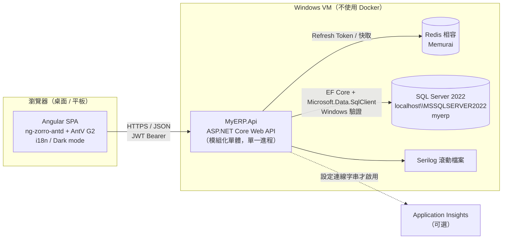
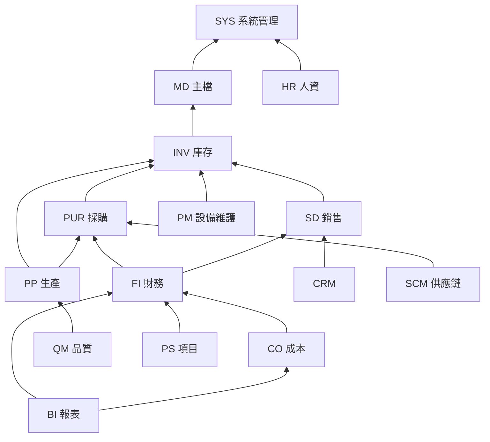
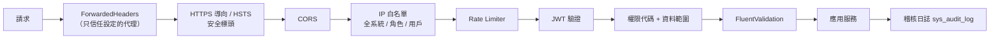

# MyERP 整體架構

> 來源：MASTER_PROMPT 第 4、5、7、8 節；版本一律見 [ADR-001](adr/ADR-001-技術版本固定.md)，專案結構與資料存取見 [ADR-003](adr/ADR-003-模組專案結構與資料存取.md)。
> 本檔是 SDS 第 3 章（System Architecture、Security Architecture、Software Architecture）與 SRS 4.2（NFR）的來源之一。
> 相關規範：[api-conventions.md](api-conventions.md)、[db-conventions.md](db-conventions.md)、[ui-conventions.md](ui-conventions.md)。

## 1. 系統全景



- 前後端分離：SPA 只透過 `/api/v1/...` 存取後端；後端是**單一部署單位**（模組化單體），所有模組在同一進程、同一資料庫。
- 狀態：API 本身無狀態（JWT），Refresh Token 與共用快取存於 Redis，可水平擴充為多個執行個體。
- 背景工作（排程報表、月結批次）於同一 Api 進程以 `BackgroundService` 執行（BI 階段再評估是否獨立 Worker，屆時寫 ADR）。

## 2. 模組化單體與分層

### 2.1 解決方案結構（WU-P0-006 建立）

```
src/backend/
├─ MyERP.sln
├─ Directory.Build.props / Directory.Packages.props   # 共同設定、集中版本（ADR-001）
├─ MyERP.Api/                       # 組合根：Program.cs、中介層、模組註冊、Swagger
├─ MyERP.Shared/                    # 共用核心（無 EF 相依）：IClock、Money、ICurrentUser、ICurrentCompany、
│                                   #   分頁、Result/錯誤、領域事件介面、權限代碼型別
├─ MyERP.Shared.Infrastructure/     # MyErpDbContext、審計 / 版本 interceptor、Global Query Filter、
│                                   #   事件分派、SP 呼叫輔助
├─ MyERP.Migrations/                # 唯一的 migration 組件（含 database/procedures 部署）
└─ Modules/
   ├─ MyERP.Modules.Sales.Contracts/   # 對外公開：Application 介面、整合事件、跨模組 DTO
   └─ MyERP.Modules.Sales/             # 內部：Api / Application / Domain / Infrastructure 四個資料夾
tests/
├─ backend.unit/MyERP.<模組>.Tests/、MyERP.Shared.Tests/、MyERP.ArchitectureTests/
└─ backend.integration/MyERP.IntegrationTests/
```

### 2.2 模組內分層（MASTER_PROMPT 第 5 節）

| 層（資料夾） | 內容 | 可依賴 |
|---|---|---|
| `Api` | Controller、Request / Response DTO、Swagger 註解 | Application |
| `Application` | 應用服務（用例）、FluentValidation 驗證、權限檢查、交易邊界、領域事件處理 | Domain、本模組 Contracts、**其他模組 Contracts** |
| `Domain` | 實體、值物件、列舉、業務規則、領域事件 | 只依賴 `MyERP.Shared` |
| `Infrastructure` | EF Core 實體設定（`IEntityTypeConfiguration`）、Repository、SP 呼叫、Contracts 介面實作 | Domain、Application、`MyERP.Shared.Infrastructure` |

- 依賴方向單向：Api → Application → Domain；Infrastructure 實作 Application 定義的介面。
- `Domain` 不得引用 EF Core、ASP.NET Core 或其他模組。
- 分層與模組邊界由 `MyERP.ArchitectureTests`（xUnit + 反射檢查組件引用與命名空間，不另引入套件）自動檢查，違反即測試失敗。

### 2.3 模組清單與代碼

| 代碼 | 專案 | SRS 模組編號 | 資料表 / 路由 / 權限前綴 | Phase |
|---|---|---|---|---|
| SYS | MyERP.Modules.System | 1、8（部分） | `sys` | P0 |
| MD | MyERP.Modules.MasterData | 8（部分） | `md` | P1 |
| INV | MyERP.Modules.Inventory | 5 | `inv` | P1 |
| PUR | MyERP.Modules.Purchasing | 4 | `pur` | P1 |
| SD | MyERP.Modules.Sales | 2 | `sal` | P1 |
| FI | MyERP.Modules.Finance | 6 | `gl`、`ar`、`ap`、`fa`、`cm`、`tax` | P2 |
| CO | MyERP.Modules.Controlling | 10 | `co` | P2 |
| BI | MyERP.Modules.Reporting | 7 | `bi` | P2 |
| PP | MyERP.Modules.Production | 3 | `pp` | P3 |
| QM | MyERP.Modules.Quality | 11 | `qm` | P3 |
| PM | MyERP.Modules.Maintenance | 12 | `pm` | P3 |
| CRM | MyERP.Modules.Crm | 13 | `crm` | P4 |
| HR | MyERP.Modules.HumanResources | 14 | `hr` | P4 |
| PS | MyERP.Modules.Projects | 15 | `ps` | P4 |
| SCM | MyERP.Modules.SupplyChain | 16 | `scm` | P4 |

> 前綴同時用於資料表（`sal_order`）、API 路由（`/api/v1/sal/orders`）與權限代碼（`SAL.ORDER.APPROVE`），三者一致，詳見各 conventions。

## 3. 模組依賴圖

箭頭 `A --> B` 表示「A 依賴 B」（A 呼叫 B 的 Contracts 或訂閱 B 的事件）。依賴必須是**有向無環**；出現反向需求時改用領域事件（由被依賴方發佈、依賴方訂閱）。



說明：

- 上圖只畫直接依賴（與 backlog「依賴」欄一致）；傳遞依賴（例如 SD → MD → SYS）不重畫。所有模組都可使用 SYS 的共用服務（單號、審批、稽核、通知、權限）與 MD 的主檔查詢，圖中省略。
- **過帳**：SD、PUR、INV、PP、FI 子帳等產生的會計分錄一律呼叫 FI Contracts 的 `IGlPostingService`；但 FI 在 SD / PUR **之後**開發，因此 SD / PUR 開發時先在單據上記錄「待過帳」狀態並發佈領域事件（例如 `SalesInvoiceIssued`），FI 階段由 FI 訂閱事件產生傳票。這樣 SD / PUR 不需反向依賴 FI，依賴圖保持無環。
- **BI** 只讀：透過各模組 Contracts 的查詢介面或 BI 專用 SP（`usp_bi_*`，SP 內讀取多模組資料表屬「報表讀取」例外，見 db-conventions 第 7 節），不寫入其他模組資料。

## 4. 跨模組溝通規則

1. 只可經由對方的 **Contracts 專案**：Application 介面（同步查詢 / 命令）或**整合事件**（進程內發佈 / 訂閱）。
2. **不得**引用其他模組的實作專案、不得 `Set<OtherModuleEntity>()`、不得在 SQL / LINQ 中 JOIN 其他模組資料表（BI 報表 SP 例外）。
3. 跨模組只存 Id（`customer_id`、`item_id`），不建 navigation、不建 FK；顯示名稱時由 Application 層呼叫對方查詢介面批次取得（禁止逐行查詢造成 N+1）。
4. 交易：同一 HTTP 請求內所有模組共用同一個 scoped `MyErpDbContext`（ADR-003），因此同步呼叫與「交易內事件處理器」在同一資料庫交易中，一起提交或一起回滾。
5. 事件分兩類：
   - **交易內（pre-commit）**：必須與原單據一致的副作用，例如出貨 → 扣庫存（`inv_stock_move`）、單據過帳 → 傳票；在 `SaveChanges` 前分派，失敗則整個交易回滾。
   - **交易後（post-commit）**：通知、快取失效、寄信等；提交成功後分派，失敗只寫 Warning 日誌，不影響單據。
6. 共用服務（SYS）：單號產生 `IDocumentNumberService`、審批 `IApprovalWorkflowService`、通知 `INotificationService`；過帳（FI）：`IGlPostingService`。

## 5. 橫切關注點

| 關注點 | 做法 | 工作單元 |
|---|---|---|
| 時間 | 只用 `IClock.Now`（UTC+8，`App:TimeZoneOffset`）與 `IClock.Today`（DateOnly）；禁止 `DateTime.Now/UtcNow` | P0-007 |
| 金額 | `decimal` + `Money.Round(value, currency)` 於明細行取整；表頭 = 明細加總 | P0-007 |
| 多公司 | `ICurrentCompany` + EF Global Query Filter（`company_id`）；寫入時 interceptor 自動填入 | P0-007 |
| 審計 / 樂觀鎖 | SaveChanges interceptor 填 `created_*`、`updated_*`，遞增 `version`；寫 `sys_audit_log` 欄位級差異 | P0-007、SYS-007 |
| 錯誤 | 全域例外處理 → ProblemDetails（api-conventions 第 4 節） | P0-007 |
| 驗證 | FluentValidation 於 Application 層明確呼叫 | 各模組 |
| 權限 | `[RequirePermission("SAL.ORDER.APPROVE")]` + 資料範圍過濾；後端為準 | SYS-004 |
| 日誌 | Serilog 結構化，enricher：TraceId、UserId、CompanyId、Module；API > 1 秒寫 Warning | P0-009 |
| 安全 | HTTPS/HSTS、CORS 白名單、Rate limiting、安全標頭、IP 白名單、Captcha、帳號鎖定（第 6 節） | SYS-003～006 |
| 快取 | `IDistributedCache`（Redis）；主檔下拉選單等讀多寫少資料，以事件失效 | 各模組 |

## 6. 安全架構（SDS 3.2 來源）



- JWT：Access 15 分鐘；Refresh 7 天、每次使用輪替、存 Redis、登出即失效。
- 密碼：ASP.NET Core Identity `PasswordHasher`；連續失敗 5 次鎖定 15 分鐘；政策可在系統參數調整。
- Captcha：登入、註冊、忘記密碼；Development 萬用碼只在 Development 生效，其他環境偵測到設定即拒絕啟動。
- 機密：user-secrets / 環境變數，不入 Git。
- 漏洞與修補：每完成 3 個模組依 `dependency-log.md` 檢查套件更新與已知漏洞（`dotnet list package --vulnerable`、`npm audit`）。

## 7. 部署視圖

| 項目 | 說明 |
|---|---|
| 主機 | Windows VM；開發時 Kestrel，正式可用 IIS（ASP.NET Core Module）或 Windows Service |
| 資料庫 | SQL Server 2022 Windows 驗證；服務帳號（例如 IIS AppPool 身分）須建立登入並授權（部署文件記錄） |
| 前端 | `ng build` 產出靜態檔，由 IIS 或 Api 的靜態檔中介層提供 |
| 環境 | `Development` / `Staging` / `Production`；種子資料與萬用碼只在 Development |
| CI | GitHub Actions `windows-latest`：後端建置 + 單元測試、前端建置 + 測試；整合測試 / E2E 在 VM 本機 |

## 8. 非功能需求指標（SRS 4.2 來源）

ID 規則 `REQ_NF42{小節}.{序號}`（MASTER_PROMPT 15.2）。此表為 SRS 4.2 的量化指標來源；`05-doc-sources/srs/ch4-2-*.md` 撰寫敘述時引用這些 ID。量測方法欄說明驗證方式，測試結果記錄於對應模組 `test-plan.md` 或 `06-quality/`。

### 8.1 Performance（4.2.1）

| ID | 指標 | 量測方法 |
|---|---|---|
| REQ_NF421.1 | 列表 API 在單表 10 萬筆資料下，分頁查詢 P95 回應 < 500 ms | 整合測試灌入資料後以計時測試量測 |
| REQ_NF421.2 | 單筆讀取 / 儲存 API（不含 SP 批次）P95 < 300 ms | 同上 |
| REQ_NF421.3 | 任一 API 超過 1 秒寫 Warning 日誌，正常負載下 Warning 比例 < 1% | Serilog 慢 API 日誌、log-analysis.md |
| REQ_NF421.4 | 儀表板首屏（彙總 SP）< 2 秒；12 個月交易量報表 < 5 秒 | 種子資料下 Playwright 計時 |
| REQ_NF421.5 | 前端首次載入（初始 bundle，gzip）< 500 KB；模組 lazy-load，路由切換 < 1 秒 | `ng build` 預算設定（budgets）、Playwright |
| REQ_NF421.6 | 支援 200 個同時在線用戶，一般 API 錯誤率 < 0.1% | 本機負載測試（BI 階段前執行一次） |
| REQ_NF421.7 | 列表查詢不得有 N+1：單次列表請求 SQL 指令數 ≤ 5 | 整合測試以 EF 指令攔截計數 |

### 8.2 Security（4.2.2）

| ID | 指標 | 量測方法 |
|---|---|---|
| REQ_NF422.1 | 全部 API 只經 HTTPS；HTTP 一律導向，HSTS max-age ≥ 365 天（非 Development） | 整合測試檢查標頭 |
| REQ_NF422.2 | Access Token 有效 15 分鐘；Refresh Token 7 天、使用後即輪替，登出後立即失效 | SYS 整合測試 |
| REQ_NF422.3 | 連續 5 次登入失敗鎖定 15 分鐘 | SYS 單元 / 整合測試 |
| REQ_NF422.4 | Rate limit：登入 / 註冊 / 忘記密碼每 IP 每分鐘 5 次；一般 API 每用戶每分鐘 300 次；匯出每用戶每分鐘 10 次；超出回 429 | 整合測試 |
| REQ_NF422.5 | 100% 業務 API 有權限代碼檢查；無權限回 403 | ArchitectureTests 反射檢查 Controller 標註 |
| REQ_NF422.6 | 100% 資料異動（新增 / 修改 / 刪除 / 作廢 / 審批 / 過帳）寫入 `sys_audit_log` | 整合測試 |
| REQ_NF422.7 | 回應必含 CSP、X-Content-Type-Options、X-Frame-Options、Referrer-Policy | 整合測試 |
| REQ_NF422.8 | 日誌與 API 回應不得含密碼、Token、完整身分證號、銀行帳號 | 單元測試（遮罩）、log-analysis 抽查 |
| REQ_NF422.9 | 已知高 / 嚴重漏洞套件數 = 0（每 3 個模組檢查） | `dotnet list package --vulnerable`、`npm audit` |

### 8.3 Quality（4.2.3）

| ID | 指標 | 量測方法 |
|---|---|---|
| REQ_NF423.1 | Domain 與 Application 層單元測試行覆蓋率 ≥ 80% | coverlet 報告 |
| REQ_NF423.2 | 合併到 `main` 前全部測試通過率 100% | CI + 本機整合 / E2E |
| REQ_NF423.3 | 所有介面文字有 zh-Hant / zh-Hans / en 三語，缺漏 key = 0 | 前端單元測試比對三份語言檔 key |
| REQ_NF423.4 | 所有頁面支援亮 / 暗 / 跟隨系統；一般文字對比 ≥ 4.5:1（WCAG 2.1 AA） | Playwright 截圖 + 對比檢查 |
| REQ_NF423.5 | 金額計算誤差 = 0：明細行 `Money.Round` 後表頭 = 明細加總；傳票借貸相等 | 單元測試 |
| REQ_NF423.6 | 建置零警告（後端 `TreatWarningsAsErrors`，前端 strict 模式） | 建置 |

### 8.4 Availability（4.2.4）

| ID | 指標 | 量測方法 |
|---|---|---|
| REQ_NF424.1 | 服務時間可用率 ≥ 99.5%（每月） | 正式部署後監控（Application Insights 可用性） |
| REQ_NF424.2 | 提供 `/health/live` 與 `/health/ready`（檢查 SQL Server、Redis），回應 < 1 秒 | 整合測試 |
| REQ_NF424.3 | 資料庫備份 RPO ≤ 24 小時（完整）/ ≤ 15 分鐘（交易記錄）；RTO ≤ 4 小時 | 部署文件、還原演練 |
| REQ_NF424.4 | Redis 不可用時，已登入用戶的 Access Token 仍可使用至到期；系統寫 Error 日誌而不中止 | 整合測試（模擬 Redis 失敗） |
| REQ_NF424.5 | 單一模組例外不影響其他模組 API（全域例外處理回 ProblemDetails 500，進程不中止） | 整合測試 |

### 8.5 Testability（4.2.5）

| ID | 指標 | 量測方法 |
|---|---|---|
| REQ_NF425.1 | 每個 REQ_F 至少對應 1 個自動化測試案例（追溯矩陣覆蓋 100%） | docgen 一致性檢查 |
| REQ_NF425.2 | 測試資料庫 `myerp_test` 每次整合測試前可自動重建，重建 < 60 秒 | 整合測試 fixture 計時 |
| REQ_NF425.3 | 時間相關邏輯 100% 經 `IClock`，可在測試中固定時間 | ArchitectureTests 掃描禁用 API |
| REQ_NF425.4 | 跨模組端到端流程（銷售、採購、生產三條，MASTER_PROMPT 第 10 節）各有 ≥ 1 個整合測試 | test-plan.md |
| REQ_NF425.5 | 主要單據的建立 / 審批 / 查詢各有 Playwright E2E；全套 E2E < 15 分鐘 | Playwright 報告 |
| REQ_NF425.6 | 每個可測元素有穩定的 `data-testid`（ui-conventions 第 10 節） | 程式碼審查 |
