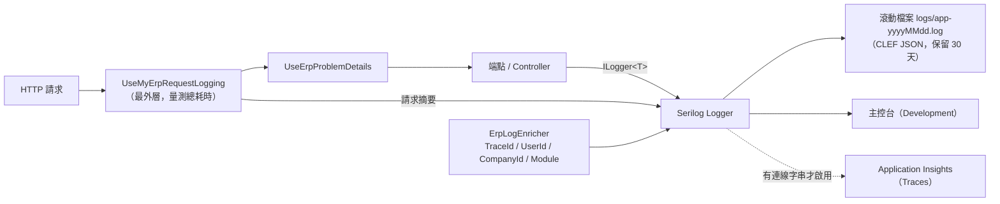

# 應用程式日誌（Serilog）

> 工作單元：WU-P0-009。依據：MASTER_PROMPT 8.1、architecture.md 第 6 節「日誌」、REQ_NF421.3。決策見 [ADR-008](adr/ADR-008-應用程式日誌實作決策.md)。
> 稽核日誌（`sys_audit_log`，MASTER_PROMPT 8.2）不在本文件範圍，於 WU-SYS-007 實作。

## 1. 架構

- 程式位置：`MyERP.Shared.Infrastructure/Logging`（`ErpLoggingOptions`、`ErpLogEnricher`、`ErpLoggingExtensions`）。
- `Program.cs`：`builder.Services.AddMyErpLogging(configuration, environment)`；`app.UseMyErpRequestLogging()` 放在管線第一個，才能記錄 ProblemDetails 之後的最終狀態碼。
- 業務程式碼一律注入 `ILogger<T>`（Microsoft.Extensions.Logging），不直接引用 Serilog；建議用 `[LoggerMessage]` 原始碼產生器（參考 `ErpExceptionHandler`）。

## 2. 每筆日誌的欄位

| 屬性 | 來源 | 沒有時 |
|---|---|---|
| `TraceId` | `Activity.Current.TraceId`（32 碼十六進位），否則 `HttpContext.TraceIdentifier` | 背景作業且無 Activity 時省略 |
| `UserId` | `ICurrentUser.UserId`（JWT `sub`），寫日誌當下讀取 | 未登入時省略 |
| `CompanyId` | `ICurrentCompany.CompanyId`（`X-Company-Id`） | 沒有公司上下文時省略 |
| `Module` | 路由 `/api/v{n}/{前綴}/…` → `ErpModuleCatalog.FindByPrefix`；否則記錄者命名空間 `MyERP.Modules.{專案}` | `/health` 等非模組路由、共用基礎設施省略 |
| `Application` | 主機名稱（`MyERP.Api`） | — |
| `SourceContext` | 記錄者類別全名（Serilog 內建） | — |

- ProblemDetails 回應的 `traceId`（W3C `traceparent`，格式 `00-{TraceId}-{SpanId}-01`）包含日誌的 `TraceId`，用戶回報錯誤時可直接以此搜尋日誌。
- 已有同名屬性時不覆寫（`AddPropertyIfAbsent`），模組可在 `BeginScope` 內自行指定。

## 3. 設定

| 鍵 | 預設 | 說明 |
|---|---|---|
| `Serilog:MinimumLevel:Default` | `Information`（Development：`Debug`） | 最低等級；正式環境不得低於 Information（MASTER_PROMPT 8.1 Debug / Trace 正式關閉） |
| `Serilog:MinimumLevel:Override:{命名空間}` | `Microsoft.AspNetCore`、`Microsoft.EntityFrameworkCore` = `Warning` | 框架雜訊 |
| `App:SlowRequestMilliseconds` | `1000` | 超過（不含等於）即寫 Warning；`0` = 每個請求都寫（只供測試）；負數啟動失敗 |
| `App:Logging:FileEnabled` | `true` | 是否寫檔 |
| `App:Logging:FilePath` | `logs/app-.log` | 相對路徑以內容根目錄為準；Serilog 在副檔名前加日期 |
| `App:Logging:RetainedDays` | `30` | 依檔案時間清除（`retainedFileTimeLimit`），至少 1 |
| `App:Logging:ConsoleEnabled` | 未設定 = 只在 Development | 主控台輸出 |
| `ApplicationInsights:ConnectionString`（或環境變數 `APPLICATIONINSIGHTS_CONNECTION_STRING`） | 空白 = 不啟用 | **不得**寫入版控的 appsettings；用環境變數或 user-secrets |

設定值格式錯誤（非整數、非 true/false、超出範圍）時啟動即拋出 `FormatException`，訊息含設定鍵名。

## 4. 檔案格式與保留

- CLEF（Compact Log Event Format，一行一個 JSON）：`@t` 時間、`@l` 等級（Information 省略）、`@mt` 訊息範本、`@x` 例外，其餘為屬性。可用 `Get-Content logs/app-*.log | ConvertFrom-Json` 或 Seq / `clef-tool` 分析（log-analysis.md）。
- 每天一個檔；單檔超過 100 MB 另開新檔（`_001` 後綴）；超過保留天數的檔案自動刪除。`shared: true` 允許多個程序寫同一檔。

## 5. 請求日誌與慢 API

- 每個請求一筆摘要：`HTTP {RequestMethod} {RequestPath} responded {StatusCode} in {Elapsed} ms`，記錄者 `Serilog.AspNetCore.RequestLoggingMiddleware`。
- 等級：`Elapsed > App:SlowRequestMilliseconds` → **Warning**（REQ_NF421.3），否則 **Debug**（正式環境不輸出）。
- 例外與 5xx 由 `ErpExceptionHandler` 寫 Error（含例外），請求摘要不重複寫 Error。
- `RequestPath` 不含查詢字串，避免把 Token 等參數寫入日誌。

## 6. 敏感資料（MASTER_PROMPT 8.1）

- 不得記錄密碼、Token、完整身分證號、銀行帳號。日誌參數只放 Id、單號、代碼；不得把整個請求 / DTO 物件解構（`{@Dto}`）寫入日誌。
- 框架不記錄請求標頭與本文；`Microsoft.AspNetCore` 預設 Warning。
- 需要記錄的個資以遮罩形式寫入（例如身分證只留後 4 碼），遮罩工具於 WU-SYS-002 建立時一併加入。

## 7. 測試

| 測試 | 驗證 |
|---|---|
| `ErpLogEnricherTests`（單元） | 模組解析（路由 / 命名空間 / 邊界）、TraceId 來源與退回、匿名省略、已釋放範圍、不覆寫既有屬性 |
| `ErpLoggingOptionsTests`（單元） | 預設值、讀取、錯誤設定啟動失敗、慢 API 門檻邊界（等於不警告）、路徑解析、有 / 無 App Insights 連線字串的註冊 |
| `LoggingTests`（整合，WebApplicationFactory） | 慢請求 Warning 帶 UserId / CompanyId / TraceId、快請求 Debug、匿名省略、`Module` 與 ProblemDetails `traceId` 對應、查詢字串不入日誌、檔案輸出 CLEF 欄位 |

整合測試以 DI 註冊的 `ILogEventSink` 收集日誌（`ReadFrom.Services`），以 `IStartupFilter` 模擬登入用戶（正式認證於 WU-SYS-003）。
