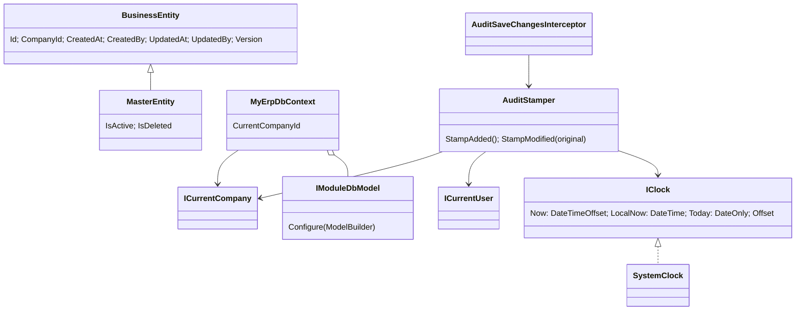

# 共用核心（Shared Kernel / Shared Infrastructure）

> 工作單元：WU-P0-007。決策見 [ADR-005](adr/ADR-005-共用核心實作決策.md)。本檔同時作為需求、設計、測試追溯與優化記錄（共用核心不屬任何業務模組，不另開 `02-modules/` 目錄）。

## 1. 需求與驗收條件

| ID | 需求 | 驗收條件 | 測試 |
|---|---|---|---|
| CORE-01 | 統一時間來源 IClock（UTC+8，可設定） | `Now` 偏移 = `App:TimeZoneOffset`；`Today` 依該時區（UTC 16:30 → 隔日）；設定錯誤啟動失敗；除 SystemClock 外不得讀系統時間 | `SystemClockTests`、`CoreServiceRegistrationTests`、`BannedApiTests` |
| CORE-02 | 金額捨入 `Money.Round(value, currency)` | TWD / JPY 0 位、其他 2 位；AwayFromZero（2.5 → 3）；可覆寫幣別小數位與捨入方式；幣別碼須為三碼字母 | `MoneyTests` |
| CORE-03 | 目前用戶 / 公司 | 用戶 Id 取自已驗證 JWT `sub`；公司取自 `X-Company-Id`；無效值視為無 | `HttpContextAccessorsTests` |
| CORE-04 | 分頁 / 排序 | page ≥ 1、pageSize 1–200，否則 400；sort 欄位白名單（不分大小寫、回傳標準名稱），不在白名單或重複回 400 | `PagingTests` |
| CORE-05 | 錯誤型別與 ProblemDetails | 錯誤代碼格式 `{PREFIX}.{RESOURCE}.{REASON}`；400 / 403 / 404 / 409 / 422 / 500 對應；帶 `errorCode`、`traceId`、`instance`；標題依 Accept-Language 三語；500 不洩漏例外內容；路由不存在亦回 ProblemDetails | `ErpExceptionTests`、`ErpProblemDetailsFactoryTests`、`ErpExceptionHandlerTests`、`ProblemDetailsTests`（整合） |
| CORE-06 | MyErpDbContext 與型別慣例 | snake_case；decimal 預設 (19,4)，模組可覆寫；DateTime → `datetime2(6)`；DateOnly → `date`；enum → `varchar(30)` 字串；version 為 concurrency token | `MyErpDbContextTests` |
| CORE-07 | Global Query Filter | `company_id = 目前公司`；無公司 → `WHERE 0 = 1`；主檔排除 `is_deleted`；可只略過軟刪除；無共用介面的表不套用 | `MyErpDbContextTests` |
| CORE-08 | 審計 / 版本 interceptor | 新增：created_at/by、version = 1、company_id（未指定時取目前公司，皆無則拋出）；修改：updated_at/by、version = 原值 + 1；created_* 與 company_id 不可被修改；無用戶時用系統用戶 0 | `AuditStamperTests`、`AuditSaveChangesInterceptorTests` |

## 2. 設計

| 位置 | 內容 |
|---|---|
| `MyERP.Shared/Time` | `IClock`、`SystemClock`（`ParseOffset`） |
| `MyERP.Shared/Monetary` | `Money`、`CurrencyPrecision` |
| `MyERP.Shared/Security` | `ICurrentUser`、`ICurrentCompany`、`SystemUser` |
| `MyERP.Shared/Paging` | `PagedRequest`、`PagedResult<T>`、`SortSpec` / `SortField` |
| `MyERP.Shared/Errors` | `ErpException`（`BusinessRuleException`、`NotFoundException`、`ConflictException`、`ForbiddenException`、`RequestValidationException`）、`CommonErrorCodes` |
| `MyERP.Shared/Domain` | `IAuditable`、`ICompanyOwned`、`IVersioned`、`ISoftDeletable`、`Entity`、`BusinessEntity`、`MasterEntity` |
| `MyERP.Shared.Infrastructure/Persistence` | `MyErpDbContext`、`IModuleDbModel`、`ErpQueryFilters`、`AuditStamper`、`AuditSaveChangesInterceptor`、`AddMyErpPersistence` / `UseMyErpSqlServer` |
| `MyERP.Shared.Infrastructure/Web` | `HttpCurrentUser`、`HttpCurrentCompany`、`ErpProblemDetailsFactory`、`ErpExceptionHandler`、`AddErpProblemDetails` / `UseErpProblemDetails` |
| `MyERP.Shared.Infrastructure` | `AddMyErpCore`（IClock、current user / company、ProblemDetails） |

### 模組使用方式

1. 實體繼承 `BusinessEntity`（單據）或 `MasterEntity`（主檔），業務程式不設定審計 / 公司 / 版本欄位。
2. 模組提供 `IModuleDbModel`，在 `AddServices` 中 `services.AddSingleton<IModuleDbModel, XxxDbModel>()`；資料表以模組前綴命名（`b.ToTable("sal_order")`），單價 `HasPrecision(19, 6)`、匯率 `HasPrecision(19, 8)`。
3. 修改 / 刪除：把請求的 `version` 設為 `Entry(e).Property(x => x.Version).OriginalValue` 後 SaveChanges。
4. 業務錯誤 `throw new BusinessRuleException("SAL.ORDER.CREDIT_LIMIT_EXCEEDED", "...")`；Controller 不寫 try/catch。
5. 列表：`request.EnsureValid()`、`SortSpec.Parse(request.Sort, 白名單, 預設)`，回傳 `PagedResult.Create(items, request, total)`。

### 已知限制（後續工作單元處理）

- 只改明細行時表頭 version 不會自動遞增；需要「整張單據」樂觀鎖的模組應在 Application 層同時標記表頭為 Modified。
- `custom_fields` 的 ISJSON 檢查約束、`version` 的 DB `DEFAULT 1` 由各模組設定 / WU-P0-008 的 migration 慣例處理。
- ~~對 SQL Server `myerp_test` 的整合測試~~：WU-P0-008 已完成（`PersistenceTests`、`DatabaseApiTests`，見第 5 節）。

## 3. 測試結果

| 日期 | 測試總數 | 通過 | Shared 行覆蓋率 | Shared.Infrastructure 行覆蓋率 |
|---|---|---|---|---|
| 2026-10-10 | 243（Shared.Tests 213、ArchitectureTests 23、IntegrationTests 7） | 243 | 93.5% | 87.0% |

覆蓋率指令：`powershell -NoProfile -ExecutionPolicy Bypass -File tools/scripts/Get-BackendCoverage.ps1`（ADR-005 決定 8）。

## 4. 檢查與優化記錄

| 日期 | 問題 | 原因 | 修改 | 效果 |
|---|---|---|---|---|
| 2026-10-10 | 請求格式錯誤（JSON 無法解析、Body 過大）會回 500 並寫 Error 日誌 | 全域處理器把所有非業務例外視為未預期錯誤 | `BadHttpRequestException` 保留其 4xx 狀態，記 Information 日誌 | 用戶端得到正確 400 / 413；Error 日誌只留真正的系統錯誤 |
| 2026-10-10 | 用戶端中斷連線被記為 500 Error | `OperationCanceledException` 走未預期錯誤分支 | `RequestAborted` 已取消時只記 Debug、不寫回應；非用戶端取消仍回 500 | 避免日誌分析（log-analysis.md）被雜訊淹沒 |
| 2026-10-10 | 無公司上下文時的篩選語意未經驗證 | 原測試只檢查欄位名稱，必定通過 | 測試改為驗證 WHERE 子句為 `WHERE 0 = 1` | 確認封閉失敗行為由測試保護 |
| 2026-10-10 | `PagedResult<T>.Create` 觸發 CA1000（泛型型別的靜態成員） | 分析器規則 | 移到非泛型 `PagedResult.Create<T>` | 呼叫端可推斷型別 |

## 5. 資料庫基線（WU-P0-008）

決策見 [ADR-006](adr/ADR-006-資料庫基線與migration機制.md)。

| ID | 需求 | 驗收條件 | 測試 |
|---|---|---|---|
| CORE-09 | 建庫 migration 與定序 | `Core_Baseline` 套用後無待套用 migration；資料庫定序 `Chinese_Traditional_Stroke_Count_100_CI_AS_SC`（不分大小寫、補充字元長度 1）；預先建立且定序不同的庫由 migration 修正；正式模型與 snapshot 無差異 | `DatabaseBaselineTests` |
| CORE-10 | SP 部署機制 | `database/procedures/{前綴}/usp_*.sql` 嵌入 Migrations 組件；`CreateOrAlterProcedure` / `DropProcedure`（名稱只允許英數底線）；每個嵌入 SP 均已部署且符合命名、`SET NOCOUNT ON`、`@company_id` 慣例 | `ProcedureScriptsTests`、`DatabaseBaselineTests` |
| CORE-11 | `myerp_test` 重建 | 每次測試執行重建一次；資料庫名稱不是 `myerp_test` 時拒絕執行 | `TestDatabase`（assembly fixture） |
| CORE-12 | 共用核心對真實資料庫生效 | 新增蓋章（created_*、company_id、version 1、datetime2 微秒）；修改 version + 1、updated_*；舊 version → `DbUpdateConcurrencyException`、資料不變、API 回 409 `COMMON.CONCURRENCY.CONFLICT`；公司篩選每個 DbContext 實例獨立、無公司不回資料、他公司 API 回 404；軟刪除可單獨略過且仍保公司隔離；NVARCHAR 繁簡及補充字元往返 | `PersistenceTests`、`DatabaseApiTests` |
| CORE-13 | 就緒檢查 | `/health/ready` 資料庫可連線 200 `Healthy`；無法連線或未設定連線字串 503 `Unhealthy`（不含細節）；`/health/live` 不碰資料庫 | `DatabaseApiTests` |
| CORE-14 | 模型快取依模組組合 | 不同模組組合各自建模；相同組合共用；鍵含設計期旗標 | `ModelCacheKeyTests` |

| 日期 | 測試總數 | 通過 | Migrations 行覆蓋率 | Shared.Infrastructure 行覆蓋率（單元 / 整合） |
|---|---|---|---|---|
| 2026-10-10 | 282（Shared.Tests 218、ArchitectureTests 23、IntegrationTests 41） | 282 | 93.9% | 84.9% / 91.5% |

檢查與優化記錄：

| 日期 | 問題 | 原因 | 修改 | 效果 |
|---|---|---|---|---|
| 2026-10-10 | 建庫失敗「定序無效」 | MASTER_PROMPT 指定的 `Chinese_Taiwan_Stroke_100_CI_AS_SC` 不存在 | 改用 100 版正式名稱 `Chinese_Traditional_Stroke_Count_100_CI_AS_SC`，寫 ADR-006、CR-007 | 建庫成功，排序規則維持臺灣筆畫 |
| 2026-10-10 | 未設定連線字串時 `/health/ready` 回 500 | 健康檢查以建構子注入 DbContext，建立失敗的例外在檢查外拋出 | DbContext 改在檢查內解析，失敗回 Unhealthy | 監控得到正確 503，且不洩漏例外 |
| 2026-10-10 | 初始 migration 為空、不會修正既有庫的定序 | EF 只在 `CREATE DATABASE` 帶定序，對既有庫不產生 ALTER | `Core_Baseline` 加入不在交易內的條件式 `ALTER DATABASE ... COLLATE`（手動以 Chinese_PRC_CI_AS 的暫存庫驗證） | 預先建立的資料庫亦得到正確定序 |
