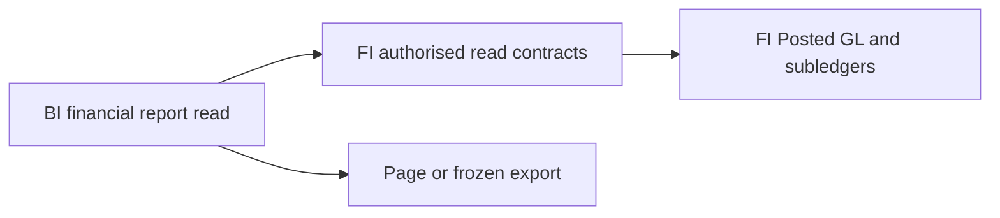

# BI data structure

WU-BI-000d introduces no persistence and allocates no `REQ_DS43` ID. Financial facts remain in FI-owned future tables; BI receives immutable read DTOs through FI Contracts. A saved export job or schedule, if required later, needs a separate BI data requirement and migration.

No BI-to-FI database FK or EF navigation is permitted. The diagram represents contract flow, not a physical ER model; there is no BI table to show in an ER diagram yet.
