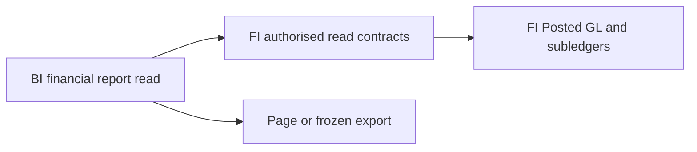
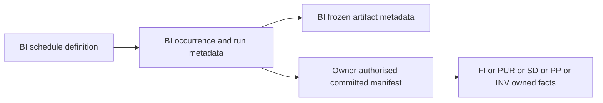

# BI data structure

WU-BI-000d introduces no persistence and allocates no `REQ_DS43` ID. Financial facts remain in FI-owned future tables; BI receives immutable read DTOs through FI Contracts. A saved export job or schedule, if required later, needs a separate BI data requirement and migration.

No BI-to-FI database FK or EF navigation is permitted. The diagram represents contract flow, not a physical ER model; there is no BI table to show in an ER diagram yet.

WU-BI-003d adds no table or `REQ_DS43` ID. Future dashboard cards consume owner read DTOs through Application/Contracts, with FI, SD and INV retaining their own source tables and committed manifests. A BI materialized KPI cache would need a separate design, migration and invalidation proof before use.

WU-BI-002d also allocates no table or `REQ_DS43` ID. PUR/SD/PP/INV retain their source data and expose authorised immutable DTOs. A future durable report manifest may be owner-held or use an owner-provided committed snapshot mechanism; its persistence design and migration belong to the source implementation units, and BI cannot substitute a local copy. The contract flow extends to PUR, SD, PP and INV with no cross-module database FK.

WU-BI-004d also allocates no `REQ_DS43` ID because it delivers design only. Comparison/drill use immutable owner manifest DTOs and do not persist source rows in BI. WU-BI-004c must define BI-owned schedule, occurrence/run and artifact metadata tables with same-company keys, version, unique schedule/resolved-instant occurrence, lease state, status/reason, frozen filter digest, owner cutoff, file digest and retention; the exact schema and reversible migration are deferred to its true-SQL test-first unit. Artifact storage must be bounded and download guarded. No BI-to-owner database FK, EF navigation or copied accounting/stock fact is allowed.

This is a planned ownership flow, not a physical ER diagram; BI tables do not yet exist.
