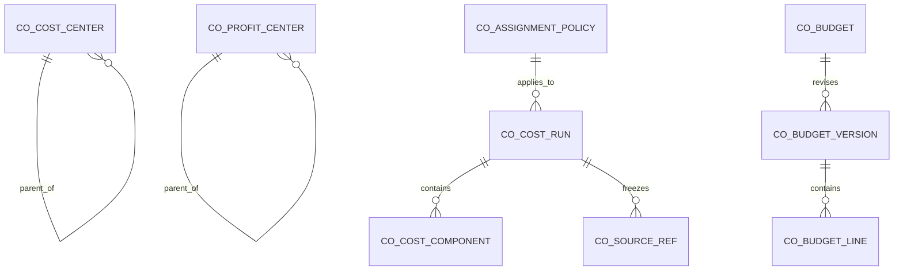

# CO — Planned data structure

WU-CO-000d allocates no `REQ_DS43` ID and adds no migration. Candidate CO-owned aggregates are cost center, profit center, effective assignment policy, cost run with source manifest and components, and budget header/version/line. Exact columns, indexes, unique constraints and delete rules belong to the SQL implementation slices. Every record has company scope, audit and optimistic version. Cross-module owner references remain IDs without SQL foreign keys.

This diagram is conceptual. FI journals, INV movements, PP work orders and MD items/accounts remain in their owner modules.
