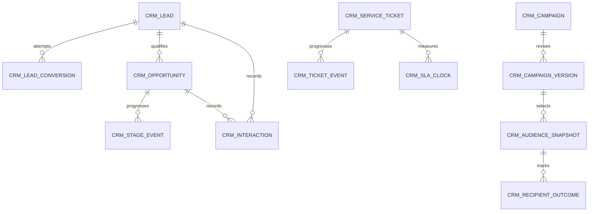

# CRM — Planned data structure

WU-CRM-000d allocates no `REQ_DS43` and makes no migration. Candidate company-scoped aggregates are lead and conversion attempt, opportunity and stage event, interaction, campaign/version/audience snapshot/recipient outcome, and service ticket/event/SLA clock. Implementation units will specify columns, decimal scales, constraints, indexes, audit fields, optimistic versions and reversible migrations. Cross-module IDs are values, without database foreign keys or EF navigation.

MD customer/contact identity and consent source, SD quotation/order, SYS approval and delivery provider records remain owner data. CRM stores confirmed IDs, versions, command keys and source cutoffs only. Lead and customer identities must be explicitly linked, never inferred from matching names or email.
