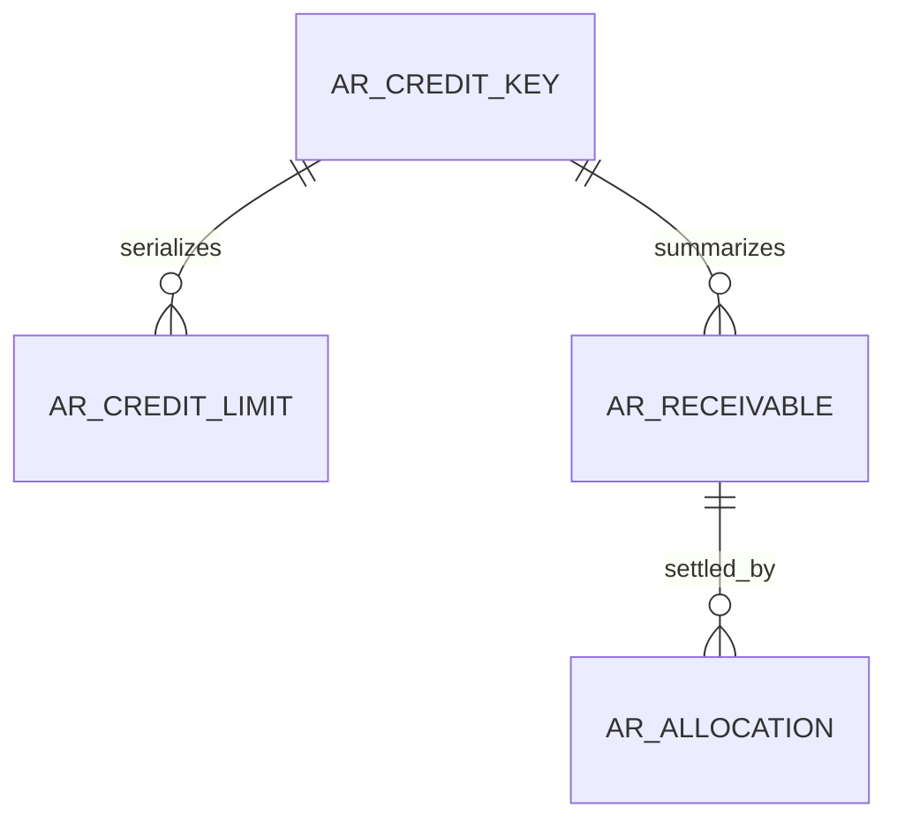

# FI data structure (planned)

WU-FI-000d creates no table and allocates no REQ_DS43 ID. WU-FI-001a will allocate IDs when the migration and real SQL validation exist.

Planned ownership: a permanent company/customer lock key, versioned effective limits, immutable posted receivable sources and settlement allocations. IDs for MD company/customer are scalar cross-module references without database FK or EF navigation. FI-owned foreign keys and indexes are required for limit intervals, source uniqueness, company/customer exposure and allocations. Amounts use `decimal(19,4)`, currency `char(3)`, business dates `date`, timestamps `datetime2(6)` in UTC+8. The exact schema, constraints and reversible migration belong to WU-FI-001a/b; the diagram is conceptual and does not assert deployed tables.
