# FI data structure

## WU-FI-002a1 sales source and credit allocation schema (2026-11-13T23:47:09+08:00)

| Requirement ID | Version | Table Name | Description | Author | Related REQ_F |
|---|---|---|---|---|---|
| REQ_DS43.189 | 1.0 | ar_sales_source | This table stores each posted SD invoice or return source with its version, fingerprint, GL journal and saved original and base net, tax and gross amounts. | Developer | REQ_F4116.8.1, REQ_F4116.8.2, REQ_F4116.8.3 |
| REQ_DS43.190 | 1.0 | ar_credit_allocation | This table stores per-invoice-line credit allocations from a return source to an original posted receivable. | Developer | REQ_F4116.8.2, REQ_F4116.8.3 |

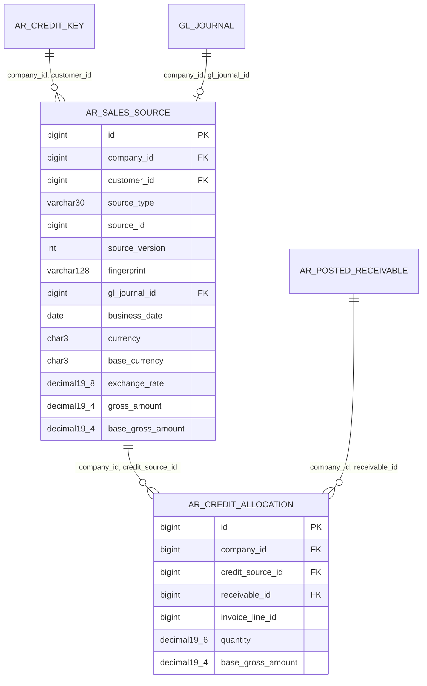

Migration `20261113154511_Finance_SalesSourceFoundation` is reversible. It has been applied to `myerp`, and Down/Up was verified there. Both tables carry the 6.4 audit columns. Neither has a soft-delete column, so the source key is permanent (ADR-106). The net, tax and gross columns are stored for both the original currency and the base currency, each as decimal(19,4). `ar_posted_receivable` gains the alternate key `ak_ar_posted_receivable_company_id_id`, which the allocation's same-company FK needs. SD invoice/return/line IDs and the MD customer ID are scalars without cross-module FKs.

| Table | Constraint / index | Purpose |
|---|---|---|
| ar_sales_source | `ux_ar_sales_source_company_id_source_type_source_id`; `ux_ar_sales_source_gl_journal_id`; `ix_ar_sales_source_company_id_customer_id_business_date` | Permanent source key (BR-FI-008), one source per journal, customer/date reads (REQ_F4116.8.3). |
| ar_sales_source | `fk_ar_sales_source_ar_credit_key_company_id_customer_id`; `fk_ar_sales_source_gl_journal_company_id_gl_journal_id` | The pair must already have a credit key (lock protocol, ADR-073), and the journal must belong to the same company. |
| ar_sales_source | `ck_ar_sales_source_identity`, `ck_ar_sales_source_type` (`Invoice`/`Return`), `ck_ar_sales_source_currency` (binary-collation upper-case codes, rate > 0), `ck_ar_sales_source_amounts` (net/tax ≥ 0, gross > 0, net + tax = gross in both currencies) | BR-FI-009 component reconciliation with no rounding plug. |
| ar_credit_allocation | `ux_ar_credit_allocation_credit_source_id_invoice_line_id`; `ix_ar_credit_allocation_company_id_receivable_id` INCLUDE base gross; `ix_ar_credit_allocation_company_id_invoice_line_id` INCLUDE quantity/net/tax | No duplicate line per credit source (BR-FI-011); covered cumulative lookups for WU-FI-002a3. |
| ar_credit_allocation | `fk_ar_credit_allocation_ar_sales_source_company_id_credit_source_id`; `fk_ar_credit_allocation_ar_posted_receivable_company_id_receivable_id`; checks `ck_ar_credit_allocation_refs`, `_quantity` (> 0), `_amounts` | Same-company source and receivable; positive reconciled components. |
| both | Triggers `tr_ar_sales_source_immutable`, `tr_ar_credit_allocation_immutable` (AFTER UPDATE/DELETE → SQL 51024) | BR-FI-014 immutable financial history. |

WU-FI-002a2/002a3 own the transaction invariants: the cumulative per-line and per-receivable credit limits, and the open-AR reduction. `FinanceSalesSourceSchemaTests` was first observed red on real SQL (13/13 failing on missing tables; the test only accepts constraint errors, so SQL error 208 for a missing table cannot count as a pass). It is now 13/13 green. The lowercase-currency case exposed a defect: `LIKE` is case-insensitive under the default collation. The new checks use a binary collation to fix it.

## WU-FI-004a3b GL journal foundation (2026-11-05T12:17:07+08:00)

| Requirement ID | Version | Table Name | Description | Author | Related REQ_F |
|---|---|---|---|---|---|
| REQ_DS43.180 | 1.0 | gl_source_key | This table stores permanent company/module/type/source identity, source version and fingerprint. | Developer | REQ_F4116.10.3 |
| REQ_DS43.181 | 1.0 | gl_journal | This table stores the Posted header, accounting period, saved business date and balanced base totals. | Developer | REQ_F4116.10.1, REQ_F4116.10.2, REQ_F4116.10.3 |
| REQ_DS43.182 | 1.1 | gl_journal_line | This table stores immutable base debit or credit legs with scalar MD account ID, code, name and version and the FI mapping version used at posting. | Developer | REQ_F4116.10.2, REQ_F4116.10.3 |

WU-FI-004a3 (2026-11-12T17:18:45+08:00): reversible migration `Finance_GlPostedImmutable` adds UPDATE/DELETE triggers to `gl_source_key`, `gl_journal` and `gl_journal_line`. Affected saved rows raise SQL 51023; FK 547 can reject a referenced parent deletion first. No columns, keys or ER relationships change. This enforces the existing REQ_DS43.180–182 immutable descriptions; their versions remain unchanged.

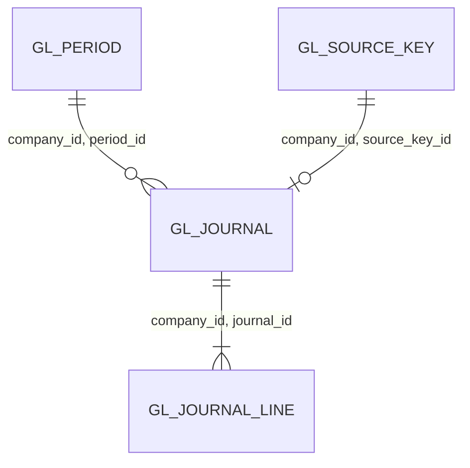

Migration `20261105041413_Finance_GlJournalFoundation` is reversible and applied to `myerp`. All three tables use bigint identity PK, company, audit and version fields. Source uniqueness `(company_id, source_module, source_type, source_id)` is permanent because the key table has no soft-delete field. The journal has one unique source key and indexed `(company_id, period_id, business_date, status)` for Posted-date protection. Composite same-company FKs link journal to source key and period, and lines to journal; line `(journal_id, sequence)` is unique. Checks reject invalid source identity, non-Posted or unbalanced header, and zero/both-sided or invalid-reference lines. MD account ID is scalar only. The schema does not itself prove header totals equal the sum of lines, prevent direct updates, or supply an authorised posting path; WU-FI-004a3 owns those transaction invariants. `FinanceJournalSchemaTests` observed missing-table red, then real SQL green.

WU-FI-004a1/004a2a/004a2b/004a2c/004a2d add only pure period date and write-decision policies. WU-FI-004a2e creates the first physical GL table; WU-FI-004a2 still owns real SQL exclusion and transaction proof.

## WU-FI-004a2e accounting period schema (2026-11-05T11:10:23+08:00)

| Requirement ID | Version | Table Name | Description | Author | Related REQ_F |
|---|---|---|---|---|---|
| REQ_DS43.179 | 1.0 | gl_period | This table stores inclusive company accounting periods and their Open or Closed state. | Developer | REQ_F4116.10.1 |

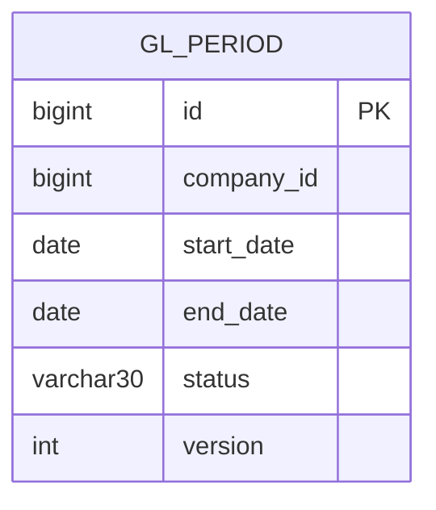

Migration `20261105030714_Finance_GlPeriod` has a reversible Down and was applied to `myerp`. `gl_period` uses `id bigint identity` as clustered PK; `company_id` is a scalar cross-module reference without SYS FK. It carries audit fields `created_at`, `created_by`, `updated_at`, `updated_by` and positive `version`. SQL checks enforce positive company/version, non-reversed inclusive dates and Open/Closed state. Index `ix_gl_period_company_id_start_date_end_date` supports company overlap and business-date reads. The index alone does not exclude overlapping intervals; WU-FI-004a2 must implement the company transaction lock. `FinancePeriodSchemaTests` observed missing-table red and then 5/5 real SQL green, including rejected invalid rows.

## WU-FI-001a credit foundation schema (2026-11-04T09:21:58+08:00)

WU-FI-001d (ADR-077) adds no column, table, index or migration. Customer code/name are queried from MD through `ICustomerLabels` after FI reads its own company-scoped limits. The existing scalar `customer_id` remains the sole cross-module reference; no MD FK or EF navigation is introduced.

Migration `20261104011440_Finance_CreditFoundation` (module project `MyERP.Modules.Finance`) creates the three FI credit tables and has been applied to `myerp`; Down/Up was verified against `myerp`. `FinanceCreditSchemaTests` was observed red (tables missing) before the migration and is now green, together with `CustomerCreditServiceTests` (SQL checks, FK, unique source key, two-connection lock races).

| Requirement ID | Version | Table Name | Description | Author | Related REQ_F |
|---|---|---|---|---|---|
| REQ_DS43.176 | 1.0 | ar_credit_key | This table stores the permanent per-company customer credit lock key. | Developer | REQ_F4116.7.3 |
| REQ_DS43.177 | 1.0 | ar_credit_limit | This table stores dated customer credit limits in the company base currency, including deactivated history. | Developer | REQ_F4116.7.1, REQ_F4116.7.2 |
| REQ_DS43.178 | 1.0 | ar_posted_receivable | This table stores posted receivable sources and their open base-currency balance for credit exposure. | Developer | REQ_F4116.7.2 |

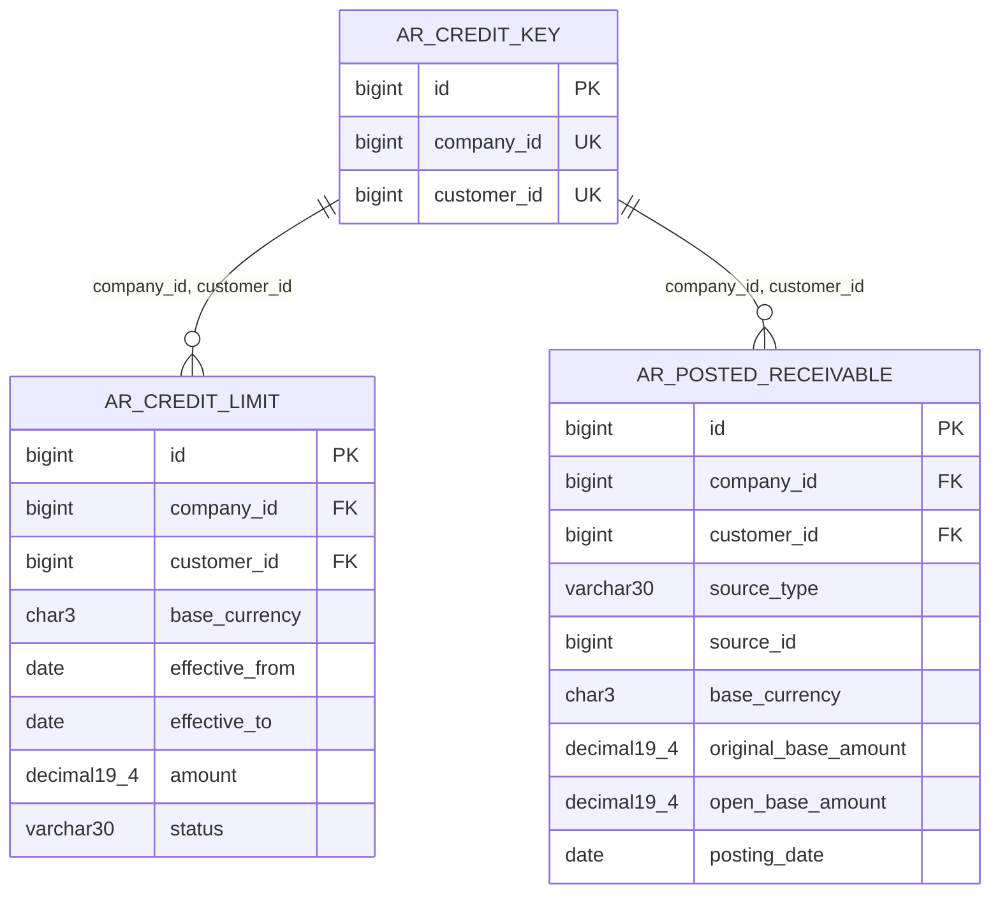

All three tables carry the 6.4 audit columns (`company_id`, `created_at`, `created_by`, `updated_at`, `updated_by`, `version`). `customer_id` is a scalar MD reference without database FK or EF navigation. Key/index design:

| Table | Constraint / index | Purpose |
|---|---|---|
| ar_credit_key | `ux_ar_credit_key_company_id_customer_id` (unique constraint, alternate key); `ck_ar_credit_key_refs` (IDs > 0) | One permanent lock row per pair; principal key for both child FKs. |
| ar_credit_limit | `fk_ar_credit_limit_ar_credit_key_company_id_customer_id` (restrict); `ix_ar_credit_limit_company_id_customer_id_effective_from_effective_to` (also covers the FK); checks `ck_ar_credit_limit_dates` (to ≥ from), `ck_ar_credit_limit_amount` (≥ 0), `ck_ar_credit_limit_status` (`Active`/`Deactivated`), `ck_ar_credit_limit_currency` (three upper-case letters) | Effective-date lookup; zero limit valid; reversed interval and negative amount rejected by SQL. Interval non-overlap is enforced by the write path under the key lock (WU-FI-001b, FI-CREDIT-007). |
| ar_posted_receivable | `ux_ar_posted_receivable_company_id_source_type_source_id`; `ix_ar_posted_receivable_company_id_customer_id` INCLUDE (`base_currency`, `open_base_amount`) (also covers the FK); `fk_ar_posted_receivable_ar_credit_key_company_id_customer_id`; checks `ck_ar_posted_receivable_open_amount` (0 ≤ open ≤ original), `ck_ar_posted_receivable_source`, `ck_ar_posted_receivable_currency` | Replay of one source cannot add exposure twice; exposure sum is a covered index seek. |

Lock protocol as implemented: see ADR-073. The children use the composite alternate key instead of the planned surrogate `credit_key_id`, so SQL guarantees company/customer consistency between a key and its limits/receivables.

## Earlier planning notes

WU-FI-000d created no table. The section below is the original WU-FI-001a acceptance design; the deployed schema above supersedes its column-level details.

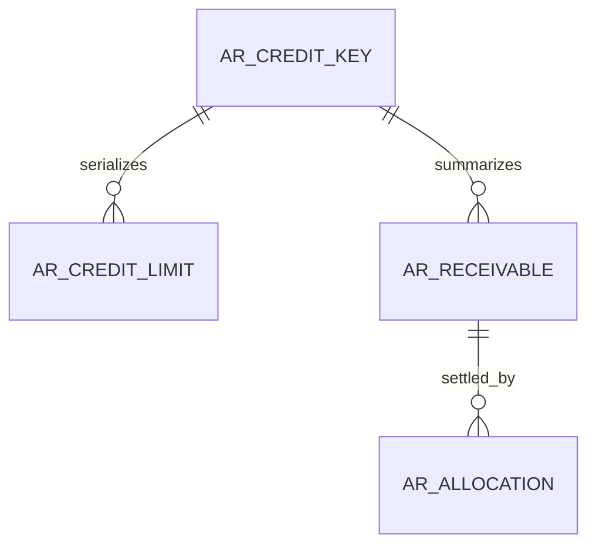

Planned ownership: a permanent company/customer lock key, versioned effective limits, immutable posted receivable sources and settlement allocations. IDs for MD company/customer are scalar cross-module references without database FK or EF navigation. FI-owned foreign keys and indexes are required for limit intervals, source uniqueness, company/customer exposure and allocations. Amounts use `decimal(19,4)`, currency `char(3)`, business dates `date`, timestamps `datetime2(6)` in UTC+8. The exact schema, constraints and reversible migration belong to WU-FI-001a/b; the diagram is conceptual and does not assert deployed tables.

### WU-FI-001a SQL acceptance detail (2026-10-29; pending red test)

| Planned table | Required columns and constraints | Required access path |
|---|---|---|
| `ar_credit_key` | `id bigint identity` PK; `company_id`, `customer_id` positive bigint and immutable. Keep the row permanently after any limit is deactivated so concurrent transactions share one lock target. No MD FK. | Unique `(company_id, customer_id)` over all rows; lock by this key with an update lock held to caller commit/rollback. |
| `ar_credit_limit` | `id bigint identity` PK; FI-owned `credit_key_id` FK; scalar `company_id`, `customer_id`; `base_currency char(3)`; `effective_from date`, `effective_to date` inclusive; `amount decimal(19,4)` nonnegative; `status`, positive `version`, audit identity/time. SQL checks reject reversed dates and negative amount. Historical rows remain after deactivation. | Indexed `(company_id, customer_id, effective_from, effective_to)` and indexed FI FK. The key lock plus overlap query prevents two active approved periods from matching one date, including shared endpoints. |
| `ar_posted_receivable` | `id bigint identity` PK; FI-owned `credit_key_id` FK; scalar `company_id`, `customer_id`; immutable `source_type`, `source_id`; `base_currency char(3)`; `original_base_amount`, `open_base_amount decimal(19,4)`; posted business date and audit time. SQL checks keep `0 <= open_base_amount <= original_base_amount`. This baseline cannot itself claim an SD invoice is posted; WU-FI-002a owns source verification and GL linkage. | Unique `(company_id, source_type, source_id)` including historical rows; indexed `(company_id, customer_id)` and FI FK for exposure sum. |

All FI writes first acquire a transaction-owned SQL application lock for the exact `(company_id, customer_id)` pair, using an unambiguous resource such as `ar_credit:{company_id}:{customer_id}`. A negative `sp_getapplock` return is a named retryable failure. Once held, the caller finds or inserts the permanent key and holds an update/serializable row lock until its existing transaction commits or rolls back; the snapshot then reads approved effective limit and committed open AR. This order also covers first use: a second connection waits before attempting the insert, then sees the first committed row or creates its own if the first transaction rolled back. The unique `(company_id, customer_id)` index remains the final integrity constraint, but a duplicate-key exception is never interpreted as credit approval or blindly retried in a possibly aborted transaction. Every FI/SD credit decision and FI limit/AR write must use this same order. Distinct pairs use distinct application-lock resources; no global lock is permitted. Creation and lock acquisition must join the caller's transaction, so rollback leaves neither key nor exposure. SQL checks protect individual rows; interval exclusion and AR aggregate invariants require transaction-level tests. FI-CREDIT-007/010/018/021 must prove overlap, two-connection serialization, rollback and first-use key creation before this schema is considered delivered. Exact physical columns may be refined by the red/green tests, and REQ_DS43 IDs are allocated only with a verified migration.

## WU-FI-002d sales source model (conceptual)

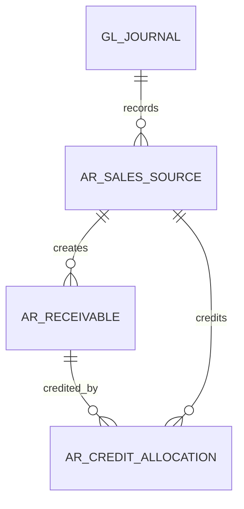

`AR_SALES_SOURCE` retains company, source module/type/ID/version, canonical fingerprint, posting and GL IDs, currency, original/base net/tax/gross, customer and immutable actor/time. Invoice receivables retain original and open balances; credit allocations reference FI-owned receivables and SD invoice-line scalar IDs. The source key is unique across soft deletion; allocation lookup indexes start with company and original receivable ID. FI-owned rows may have FKs to each other; SD and MD IDs are scalars with no cross-module FK/navigation. Money is `decimal(19,4)` and quantity precision is confirmed against saved SD source at migration design. WU-FI-002a will select exact tables, FK/index names and allocate REQ_DS43 IDs only with migration and SQL tests; no table exists from this design unit.

## WU-FI-003d purchase payable source model (conceptual)

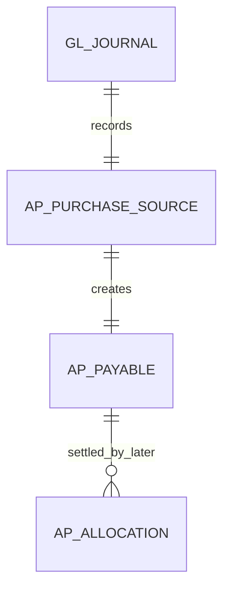

The planned source stores company, PUR invoice scalar ID/version, canonical fingerprint, supplier scalar ID, source currency and saved original/base net/tax/gross, posting time and FI journal/payable IDs. A permanent unique source key covers soft-deleted history. FI-owned payable and later allocation rows may have FI FKs; PUR, MD and SYS IDs have no cross-module FK or navigation. Indexes must support `(company_id, source_type, source_id)` uniqueness and `(company_id, supplier_id, posting_date, id)` payable reads. Amounts use `decimal(19,4)`, currency `char(3)`, business date `date`, and UTC+8 timestamp `datetime2(6)`. WU-FI-003a chooses the exact schema, reversible migration, constraints and REQ_DS43 IDs with real SQL tests; this diagram does not assert deployed tables.

## WU-FI-004d GL foundation (conceptual)

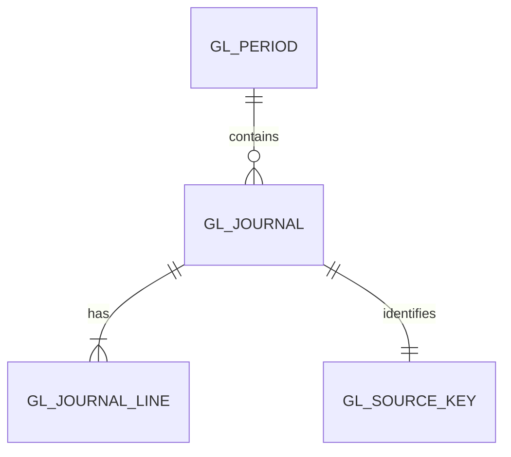

`gl_period`, `gl_source_key`, `gl_journal` and `gl_journal_line` now have the physical foundation described above. The journal ID is resolved by its unique `source_key_id` link; it is not stored redundantly on the key. FI-owned relationships get FKs and indexed FK columns; MD/SYS/SD/PUR IDs have no cross-module FK/navigation. `date`, `decimal(19,4)`, `char(3)` and UTC+8 `datetime2(6)` follow the database convention. The posting service must still establish immutable Posted headers/lines, source verification, line aggregate balance and document-currency snapshots; this schema alone is not a completed GL posting engine.

WU-FI-004a3e (2026-11-05T16:35:48+08:00): pure `GlAccountSnapshot` includes company ID, MD account ID/code/name/version and FI mapping version. The existing `gl_journal_line` stores only account ID/code; the transaction service must add and test any required persisted name/version/mapping fields in a reversible migration before claiming the full BR-FI-027 immutable snapshot. No cross-module FK or navigation is added.

WU-FI-004a3p (2026-11-06T02:53:12+08:00, REQ_DS43.182 v1.0 → v1.1): migration `20261105185102_Finance_GlJournalLineAccountSnapshot` (reversible, applied to `myerp`) adds `account_name nvarchar(200) NOT NULL`, `account_version int NOT NULL` and `mapping_version int NOT NULL` to `gl_journal_line`, with check `ck_gl_journal_line_account_snapshot` (non-blank name, positive versions). Values are copied from the transaction-time MD contract and FI mapping version; no cross-module FK. No backfill: a legacy row would fail the check (ADR-089). Real SQL `FinanceJournalSchemaTests` observed red then green.

WU-FI-004a3g (2026-11-05T16:52:27+08:00): the in-memory draft now rejects conflicting snapshots for a repeated account ID or code. No table changes are made; persisted account name/version/mapping fields and their reversible migration remain WU-FI-004a3.

## WU-FI-005d sales collection and settlement (conceptual)

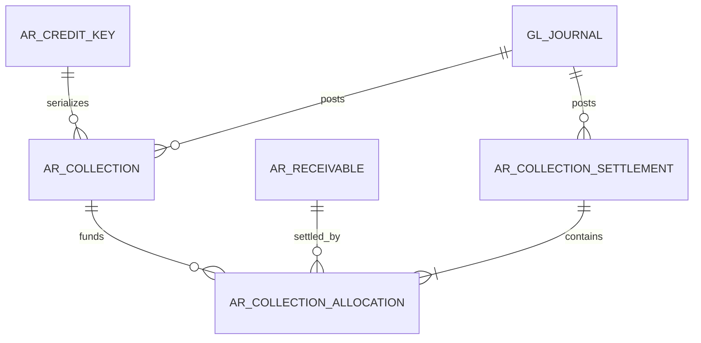

Planned receipt and settlement each retain a permanent company/type/source ID, saved version/fingerprint, customer, base currency, business date, state, journal ID and audit identity. Receipt stores positive posted/base amount and a unique bank reference within company/bank, including soft-deleted Posted history. Allocation stores FI receipt, settlement and receivable IDs, positive base amount and immutable posting reference. FI-owned relationships need FKs and indexed FK columns; MD bank/account and SD invoice IDs remain scalars without cross-module FK/navigation. Unique `(company_id, receipt_id, receivable_id)` is inappropriate because separate valid settlements may apply the same receipt to the same invoice over time; uniqueness is per settlement/receivable row. Indexes must support customer credit totals and ordered receipt/receivable locking. SQL checks enforce positive DECIMAL(19,4) and immutable source keys; transaction locks enforce aggregate balance caps. WU-FI-005a selects exact tables, reversible migration and REQ_DS43 IDs with real SQL tests. No table exists from this design unit.

## WU-FI-006d purchase payment and AP settlement (conceptual)

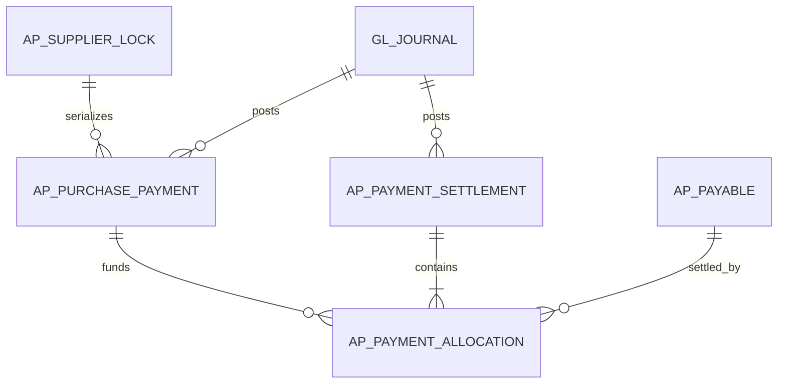

FI-owned payment and settlement hold permanent company/type/source ID, saved version/fingerprint, supplier, base currency, business date, state, journal ID and audit identity. A payment stores positive original and unapplied base amounts plus a bank/reference key unique within company and bank, including soft-deleted Posted history. Each allocation links one FI settlement, payment and payable, with positive base amount and posting reference. FI-owned relationships have FKs and indexed FK columns; MD supplier/bank/account and PUR invoice IDs are scalar cross-module references without FK or navigation. `(company_id, settlement_id, payable_id)` is unique; `(company_id, payment_id, payable_id)` is not, since separate partial settlements are valid. Indexes support `(company_id, supplier_id)` open AP totals and ordered payment/payable locks. SQL checks constrain positive `decimal(19,4)` and nonnegative stored balances; the SQL transaction enforces aggregate caps. Business dates use `date`, currency `char(3)` and audit time UTC+8 `datetime2(6)`. WU-FI-006a selects exact schema, reversible migration and REQ_DS43 IDs with real SQL tests; this design creates no table.

## WU-FI-007d other collection (conceptual)

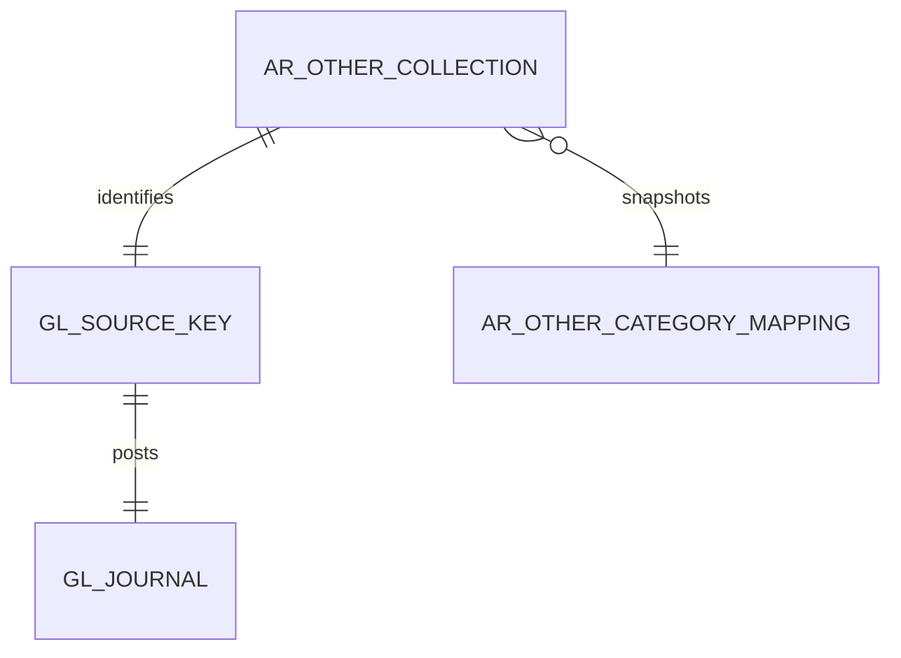

The planned FI-owned document retains company, payer description, scalar MD category/bank IDs, reference, business date, base currency, positive base amount, state/version, immutable posting fingerprint, category/account snapshot, source key, journal ID and audit identity. FI owns the category-to-income-account mapping; category, bank and account validation uses MD public contracts without cross-module FK/navigation. FI FKs and indexed FK columns connect only FI-owned rows. Permanent unique `(company_id, source_type, source_id)` and `(company_id, bank_id, reference)` constraints retain Posted history across soft deletion. A company/bank/reference index supports duplicate checks and ordered SQL locks. Amount is `decimal(19,4)`, currency `char(3)`, business date `date`, timestamp UTC+8 `datetime2(6)`. No conceptual relation to AR receivable or collection allocation exists. Exact schema, checks, reversible migration and REQ_DS43 allocation belong to WU-FI-007a; no table is deployed here.

## WU-FI-008d other payment (conceptual)

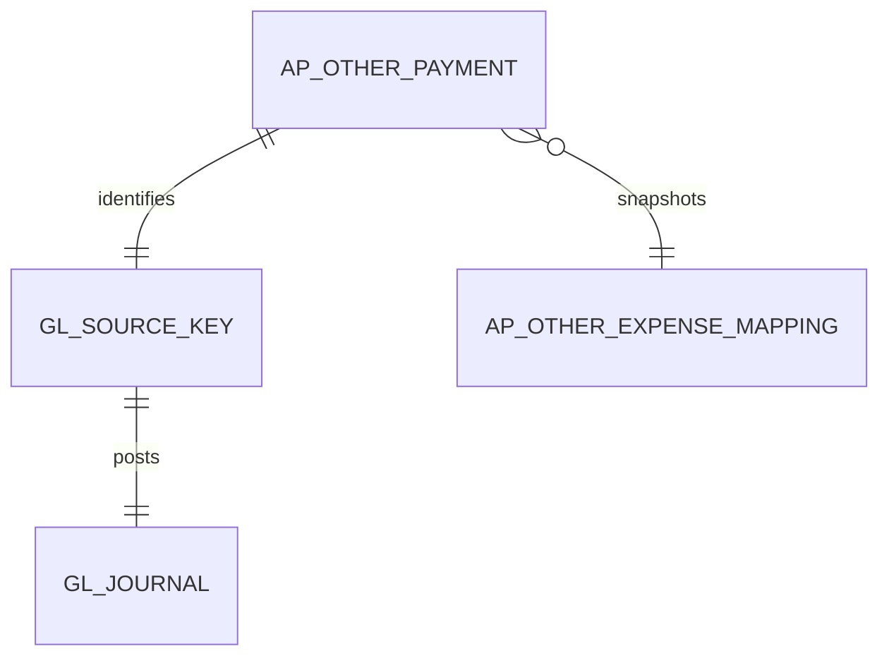

The FI-owned payment retains company, payee description, scalar MD expense-category and bank IDs, reference, business date, base currency, positive base amount, state/version, permanent source key and fingerprint, mapped expense-account snapshot, journal ID and audit identity. FI owns category-to-expense mapping; MD category, bank and account are checked through public contracts without cross-module FK/navigation. Only FI-owned rows have FKs and indexed FK columns. Permanent unique `(company_id, source_type, source_id)` and withdrawal-direction `(company_id, bank_id, reference)` keys survive soft deletion. There is no relationship to AP payable or payment allocation; a supplier ID is descriptive only. Amount uses `decimal(19,4)`, currency `char(3)`, business date `date` and audit timestamp UTC+8 `datetime2(6)`. WU-FI-008a owns exact schema, constraints, reversible migration and REQ_DS43 IDs after real SQL red tests; no table is deployed here.

## WU-FI-009d statement projection (conceptual, no new table)

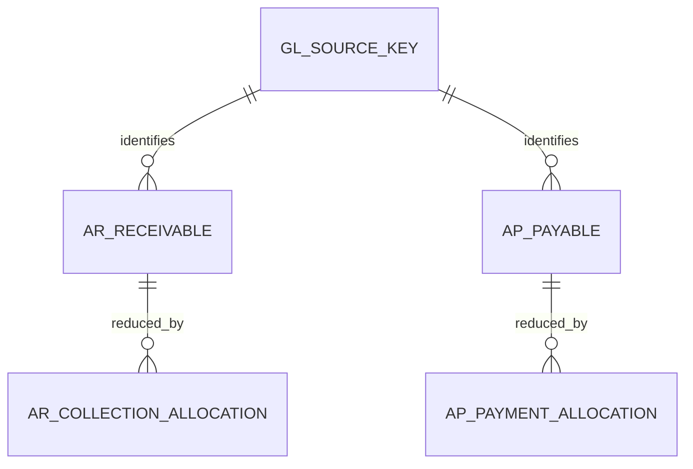

FI projects saved positive AR/AP sources, signed credit sources and committed allocations into one ordered movement stream per company and partner. It is not a persisted statement or mutable balance table. WU-FI-009a must prove a durable posting cutoff across concurrent writes and indexes for `(company_id, partner_id, business_date, posting_sequence, source_id)` paging and historical opening aggregation. FI-owned FKs are indexed; cross-module IDs remain scalars. Existing source and allocation migrations own their actual REQ_DS43 IDs. If a cutoff needs new storage, 009a allocates an ID with a reversible migration and two-connection SQL proof. No schema is deployed here.

## WU-FI-010d cash-book projection (conceptual, no new table)

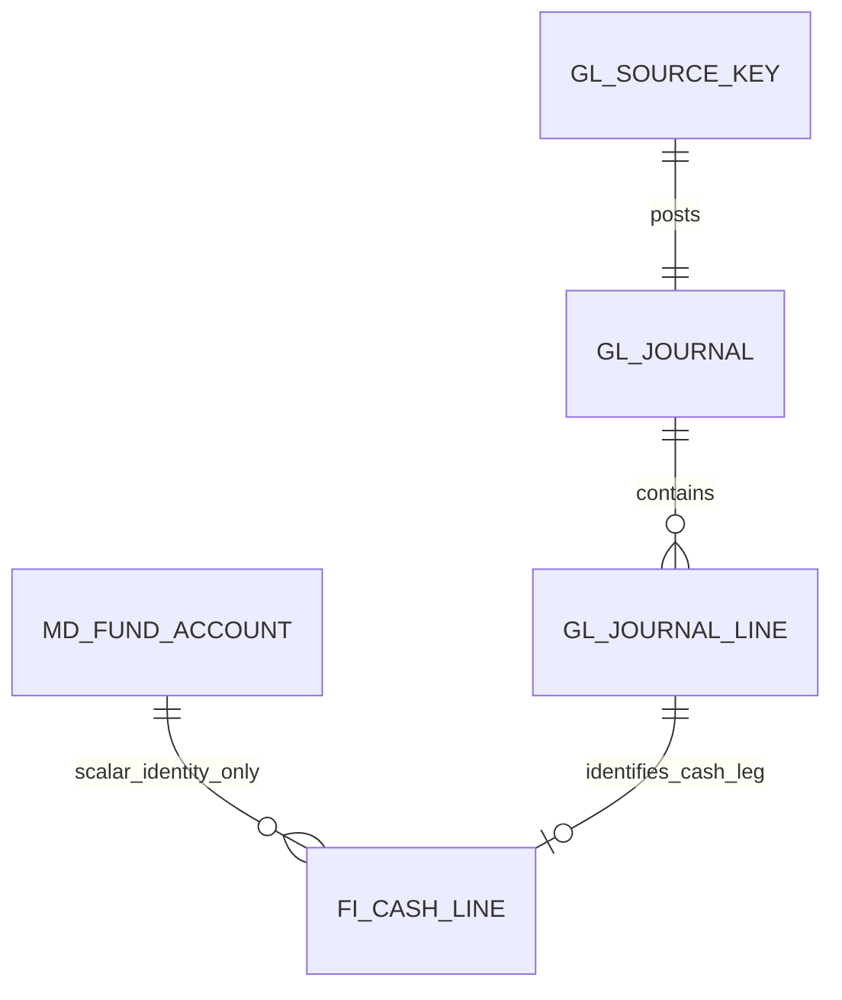

`MD_FUND_ACCOUNT` is a conceptual cross-module reference: FI stores only its scalar ID and never adds an EF navigation or database FK to MD. A qualifying cash-side GL line must preserve company, fund-account ID, mapped GL account ID, journal/line ID, source key, saved business date, posting time, debit/credit and signed company-base amount. The exact schema may use immutable line fields or a same-transaction FI projection; WU-FI-010a chooses after failing real SQL tests, allocates any required `REQ_DS43` ID, adds indexed `(company_id, fund_account_id, business_date, posting_time, journal_id, line_id)` access and a reversible migration. FI-owned FK columns receive indexes; a permanent unique journal/line key prevents projection duplication. Opening balances and external bank rows are not placed in `md_fund_account`. The read cutoff may need durable FI storage and must prove commit-order consistency before paging. No schema is deployed here.

## WU-FI-011d bank reconciliation (conceptual)

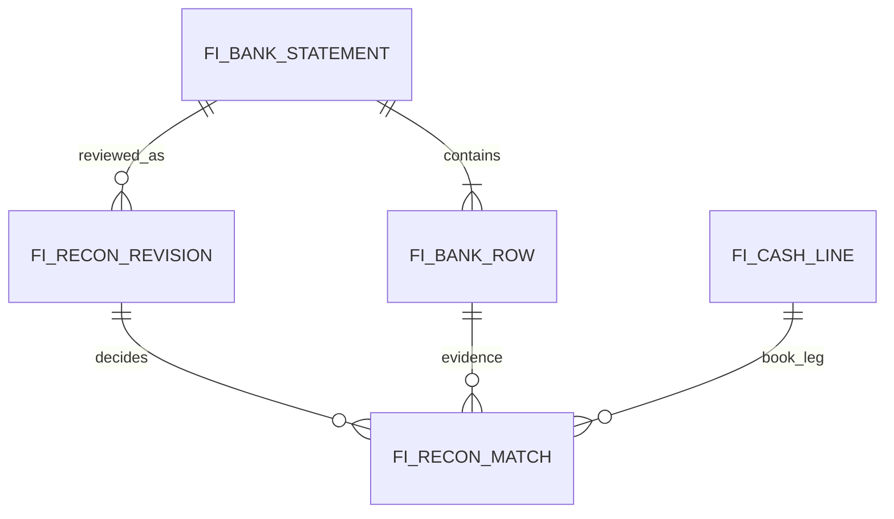

All proposed tables are FI-owned. `FI_BANK_STATEMENT` keeps company, scalar MD fund-account ID, external statement ID, range, currency, opening/closing, original file digest, revision, import actor/time and state. `FI_BANK_ROW` keeps durable bank transaction ID, row number, date, description, debit/credit, running balance, canonical payload hash and import outcome/reason. `FI_RECON_REVISION` keeps version, status, frozen evidence digest and FI committed cutoff, bank/book totals, reviewer, audit and superseded revision. `FI_RECON_MATCH` records one bank row and optional FI cash leg, disposition, reason, actor/time and approval version. Same-module FK columns need indexes; MD fund-account ID stays scalar without FK/navigation. Permanent row identity includes rejected and superseded history, while a corrected bank revision preserves old evidence. Unique active match constraints and fund-account/date and row-identity indexes require two-connection SQL proof. All amounts use `decimal(19,4)`; dates use `date`, timestamps UTC+8 `datetime2(6)`, currency `char(3)`. WU-FI-011a chooses exact table names, checks, reversible migration and `REQ_DS43` IDs after real-SQL failing tests. No schema is deployed here.
## WU-FI-012d fixed asset model (conceptual)

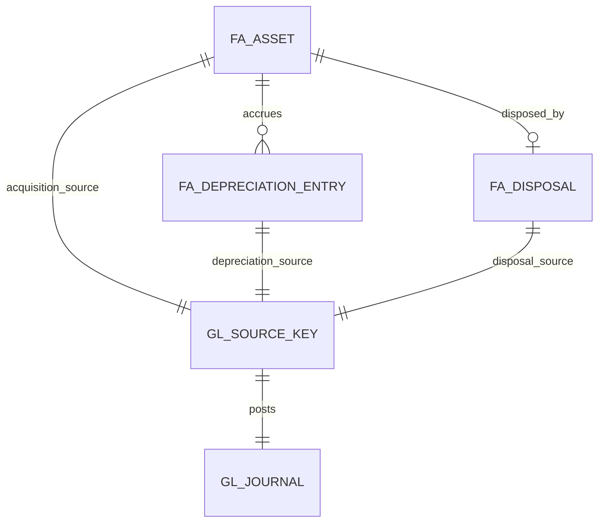

All proposed `fa_` entities belong to FI. Asset keeps company, permanent code, scalar MD class ID, cost/residual, life months, acquisition/in-service dates, base currency, source/version/state and audit. Depreciation entry keeps asset, accounting period, amount, cumulative amount, source/fingerprint, journal and audit; disposal keeps asset, proceeds, saved pre-disposal cost/accumulated depreciation, gain/loss, source and journal. The card's net book value is calculated from committed entries, not directly updated as a GL balance. FI-owned FKs and indexes cover asset/depreciation/disposal/journal links; `(company_id, asset_code)`, acquisition source, `(company_id, asset_id, period_id)` and disposal asset/source remain unique across soft deletion. MD IDs remain scalar without FK/navigation. Amounts are `decimal(19,4)`, dates `date`, audit times UTC+8 `datetime2(6)`, currency `char(3)`; `rowversion` or existing version policy protects edits. WU-FI-012a/b/c allocate actual `REQ_DS43` IDs, constraints, indexes and reversible migrations after failing real SQL tests. No schema is deployed here.

## WU-FI-013d tax source and return model (conceptual)

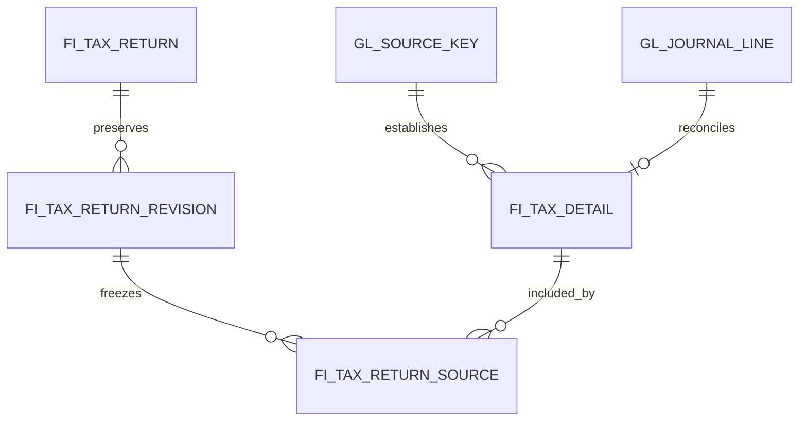

All proposed tax records are FI-owned. Tax detail stores company/regime, scalar SD/PUR source and line IDs, saved tax code/treatment/policy versions, signed taxable base, gross and claimable tax, tax date/period, fingerprint and Posted GL links. A return identifies company/regime/period; its revisions retain committed cutoff, source manifest digest, output/input/adjustment/net totals, reconciliation, reviewer and distinct external filing evidence. Revision-source membership fixes included amounts. FI-owned FK and access indexes cover source, tax date/period and revision; external MD/SD/PUR IDs are scalar without FK/navigation. Permanent source uniqueness includes soft-deleted history. Amounts use decimal(19,4), dates date, UTC+8 audit datetime2(6), currency char(3). WU-FI-013a selects actual tables, reversible migration, cutoff mechanism and REQ_DS43 IDs after failing two-connection SQL tests. No schema is deployed here.

## WU-FI-014d conceptual FX structure (no migration)

FI-owned exposure records retain source module/type/ID/version, partner and side (AR/AP), original/base currency, original gross, historical base gross, transaction rate ID/value/date, precision, committed source/journal IDs and audit. FI-owned allocation difference records retain receipt/payment and exposure IDs, original amount discharged, historical base discharged, saved settlement rate/base, signed realised amount, overlay released, GL source/journal and immutable fingerprint. FI-owned valuation revision and per-exposure detail retain period, approved policy and closing rate snapshot, durable committed cutoff/manifest, open original amount, historical and current carrying base, target base, delta, status, reviewer and GL link. Same-module FKs are indexed; SD/PUR/MD IDs stay scalar with no cross-module FK/navigation. Permanent source uniqueness includes soft-deleted history, and active valuation per exposure/period has SQL-enforced uniqueness. Decimal amounts are `decimal(19,4)`, rates `decimal(19,8)`, dates `date`, audit times UTC+8 `datetime2(6)`, currency `char(3)`; versions protect draft/revision edits. WU-FI-014a selects exact schema, cutoff implementation, constraints and reversible migration after failing two-connection SQL tests; `REQ_DS43` IDs are not allocated here.

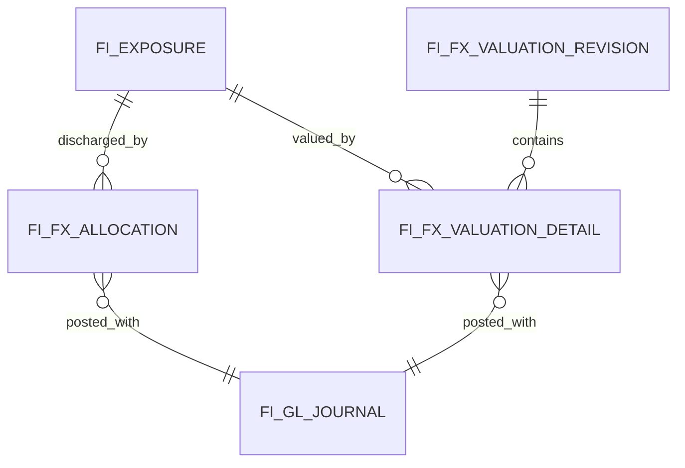

## WU-FI-015d conceptual close structure (no migration)

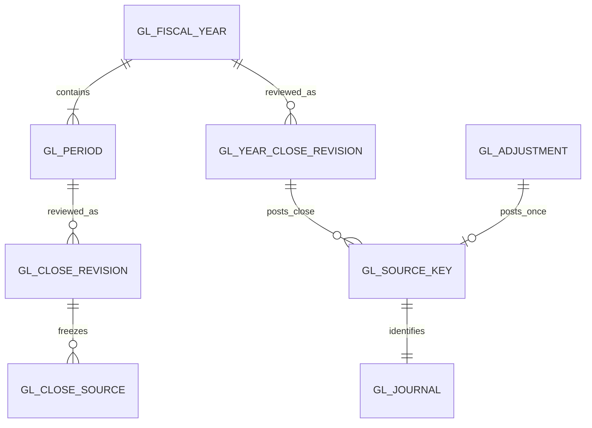

FI-owned fiscal year/period stores company, inclusive dates, calendar policy ID/version, state/version and audit. Close revision stores company, period/year, committed cutoff and manifest digest, source-family counts, differences, blocker/waiver evidence, actor/reviewer, state transition and superseded revision. Manifest membership records immutable FI source key/journal and external module source ID/version/fingerprint as scalar values; it has no cross-module FK/navigation. Adjustment stores type, reason/evidence, saved date, policy/account mapping version, workflow/version and permanent posting identity. Year close retains linked close/carry-forward source and next-year identity. FI-owned FKs are indexed; SQL uniqueness protects company/year, company/period range, revision number, source membership and permanent `(company, fiscalYear, sourceType)` keys across soft deletion. Month/day and gapless-year checks require two-connection SQL verification; a check constraint alone cannot prevent overlapping periods. Dates use `date`, money `decimal(19,4)`, timestamps UTC+8 `datetime2(6)` via `IClock`. WU-FI-015a allocates `REQ_DS43` IDs, exact tables, indexes and reversible migration after failing real-SQL tests. No schema is deployed here.
