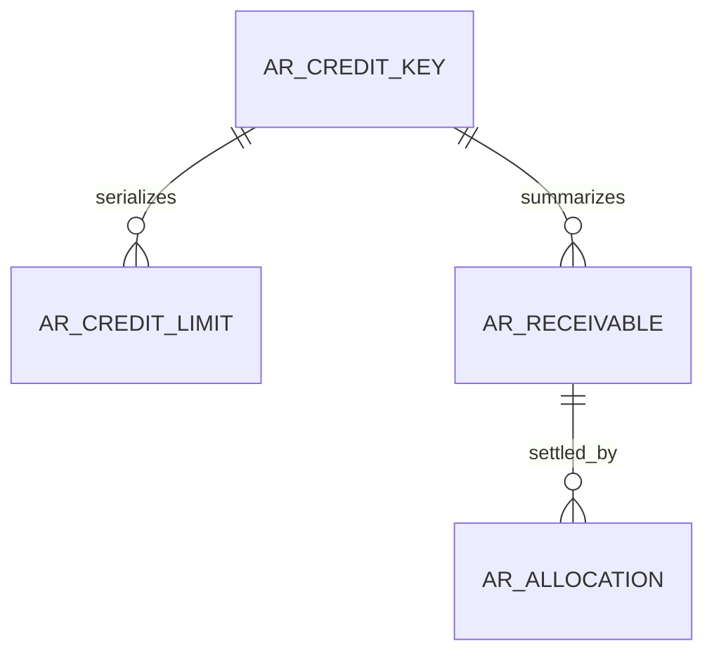
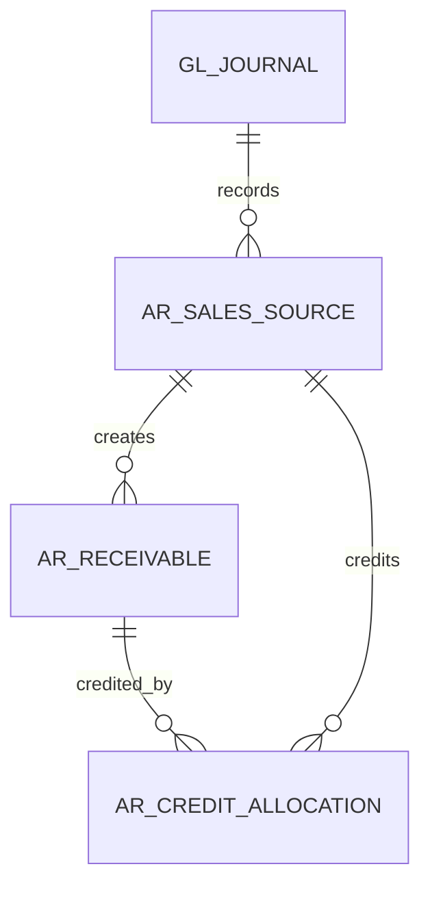
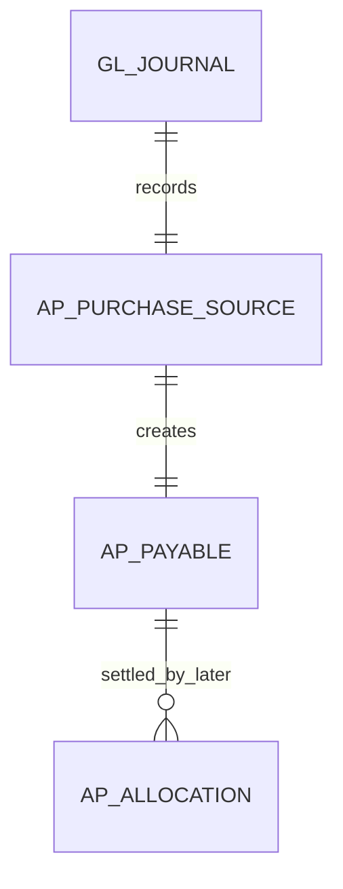
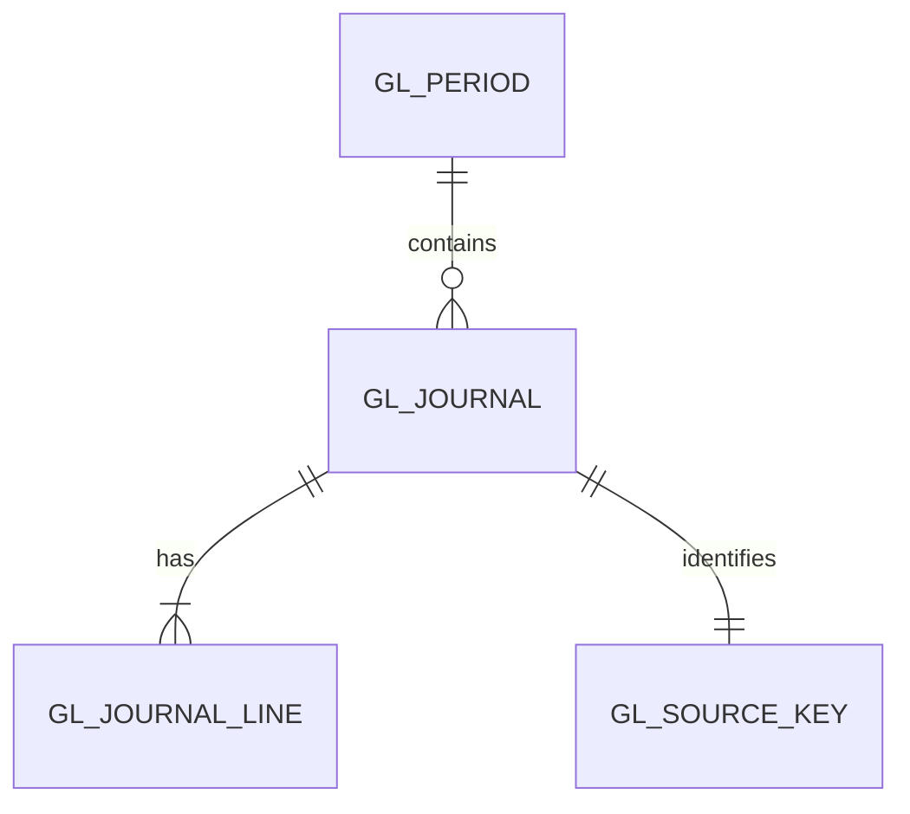
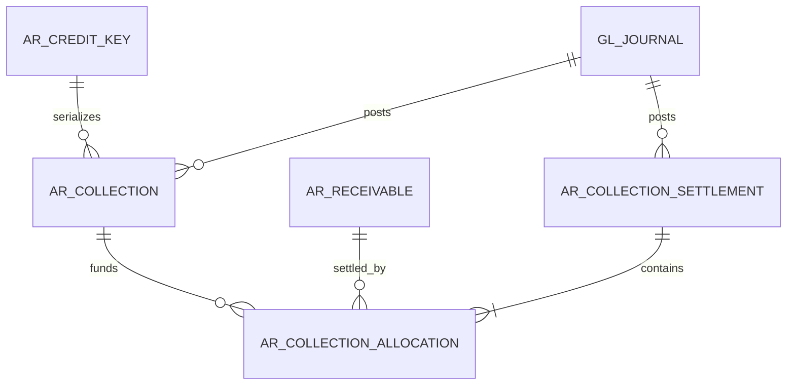
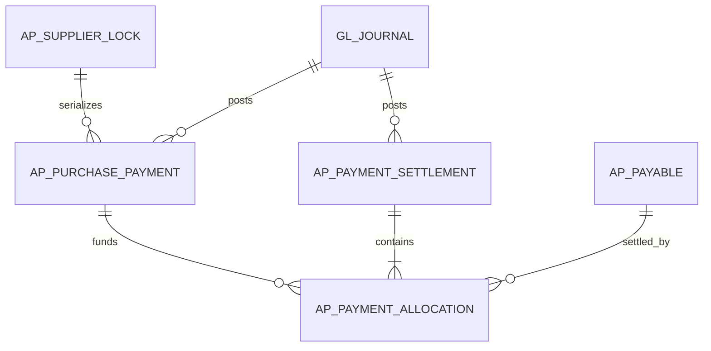
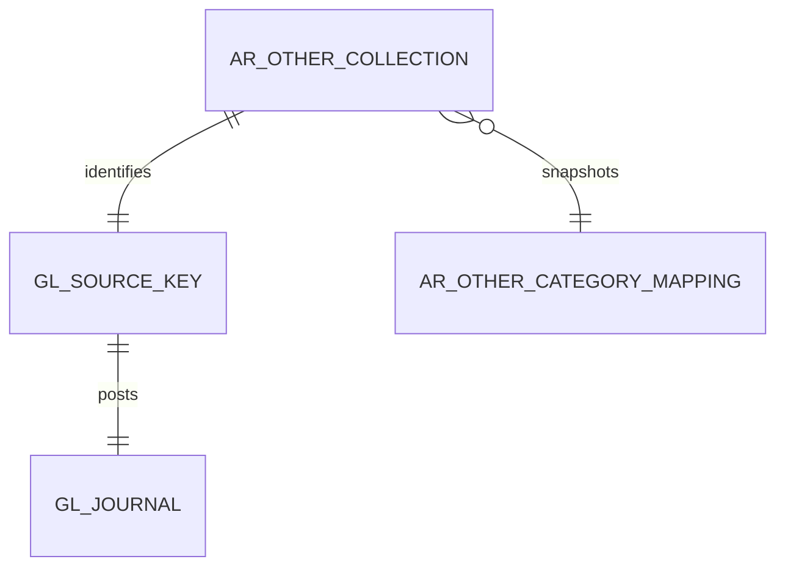
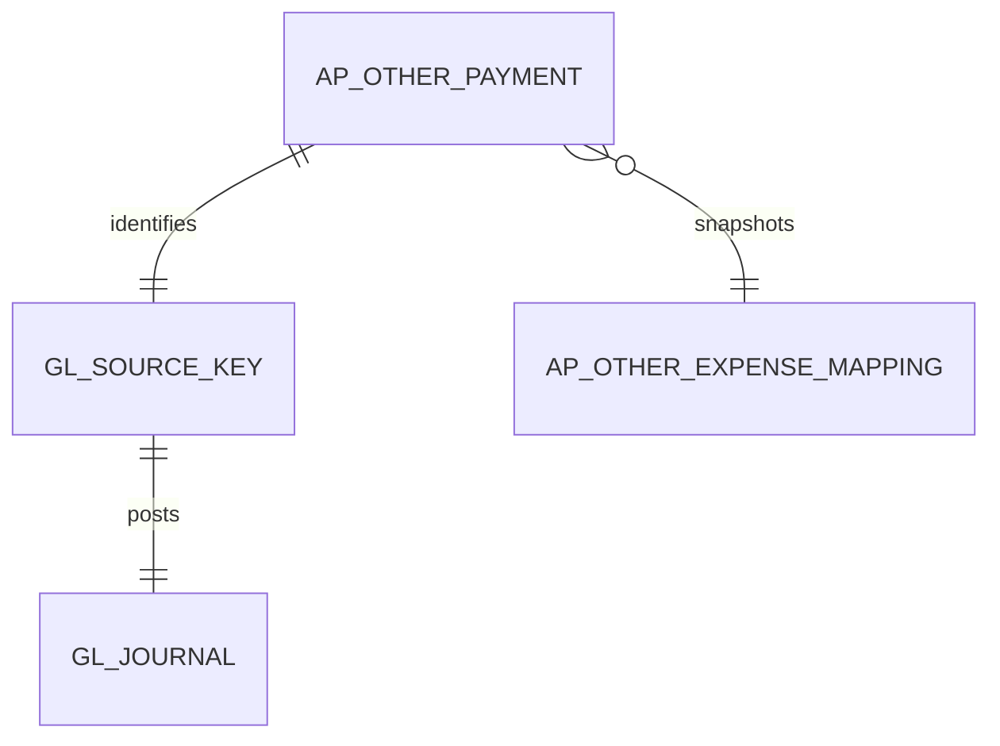

# FI data structure (planned)

WU-FI-000d creates no table and allocates no REQ_DS43 ID. WU-FI-001a will allocate IDs when the migration and real SQL validation exist.

Planned ownership: a permanent company/customer lock key, versioned effective limits, immutable posted receivable sources and settlement allocations. IDs for MD company/customer are scalar cross-module references without database FK or EF navigation. FI-owned foreign keys and indexes are required for limit intervals, source uniqueness, company/customer exposure and allocations. Amounts use `decimal(19,4)`, currency `char(3)`, business dates `date`, timestamps `datetime2(6)` in UTC+8. The exact schema, constraints and reversible migration belong to WU-FI-001a/b; the diagram is conceptual and does not assert deployed tables.

## WU-FI-002d sales source model (conceptual)

`AR_SALES_SOURCE` retains company, source module/type/ID/version, canonical fingerprint, posting and GL IDs, currency, original/base net/tax/gross, customer and immutable actor/time. Invoice receivables retain original and open balances; credit allocations reference FI-owned receivables and SD invoice-line scalar IDs. The source key is unique across soft deletion; allocation lookup indexes start with company and original receivable ID. FI-owned rows may have FKs to each other; SD and MD IDs are scalars with no cross-module FK/navigation. Money is `decimal(19,4)` and quantity precision is confirmed against saved SD source at migration design. WU-FI-002a will select exact tables, FK/index names and allocate REQ_DS43 IDs only with migration and SQL tests; no table exists from this design unit.

## WU-FI-003d purchase payable source model (conceptual)

The planned source stores company, PUR invoice scalar ID/version, canonical fingerprint, supplier scalar ID, source currency and saved original/base net/tax/gross, posting time and FI journal/payable IDs. A permanent unique source key covers soft-deleted history. FI-owned payable and later allocation rows may have FI FKs; PUR, MD and SYS IDs have no cross-module FK or navigation. Indexes must support `(company_id, source_type, source_id)` uniqueness and `(company_id, supplier_id, posting_date, id)` payable reads. Amounts use `decimal(19,4)`, currency `char(3)`, business date `date`, and UTC+8 timestamp `datetime2(6)`. WU-FI-003a chooses the exact schema, reversible migration, constraints and REQ_DS43 IDs with real SQL tests; this diagram does not assert deployed tables.

## WU-FI-004d GL foundation (conceptual)

Planned `gl_period` has company, inclusive start/end dates, state and version; `(company_id, start_date, end_date)` supports overlap and posting-date lookup, with a company SQL lock enforcing nonoverlap. Planned `gl_source_key` has a permanent unique `(company_id, source_module, source_type, source_id)` key plus fingerprint/version and journal ID. Planned `gl_journal` holds company, period, saved business date, base currency, source and actor/time; planned `gl_journal_line` holds sequence, scalar MD account reference/snapshot, positive base debit or credit and optional saved document-currency components. FI-owned relationships get FKs and indexed FK columns; MD/SYS/SD/PUR IDs have no cross-module FK/navigation. Header and lines are immutable once Posted. `date`, `decimal(19,4)`, `char(3)` and UTC+8 `datetime2(6)` follow the database convention. Exact schema, check constraints, reversible migration and REQ_DS43 IDs belong to WU-FI-004a with real SQL tests; none are deployed by this design unit.

## WU-FI-005d sales collection and settlement (conceptual)

Planned receipt and settlement each retain a permanent company/type/source ID, saved version/fingerprint, customer, base currency, business date, state, journal ID and audit identity. Receipt stores positive posted/base amount and a unique bank reference within company/bank, including soft-deleted Posted history. Allocation stores FI receipt, settlement and receivable IDs, positive base amount and immutable posting reference. FI-owned relationships need FKs and indexed FK columns; MD bank/account and SD invoice IDs remain scalars without cross-module FK/navigation. Unique `(company_id, receipt_id, receivable_id)` is inappropriate because separate valid settlements may apply the same receipt to the same invoice over time; uniqueness is per settlement/receivable row. Indexes must support customer credit totals and ordered receipt/receivable locking. SQL checks enforce positive DECIMAL(19,4) and immutable source keys; transaction locks enforce aggregate balance caps. WU-FI-005a selects exact tables, reversible migration and REQ_DS43 IDs with real SQL tests. No table exists from this design unit.

## WU-FI-006d purchase payment and AP settlement (conceptual)

FI-owned payment and settlement hold permanent company/type/source ID, saved version/fingerprint, supplier, base currency, business date, state, journal ID and audit identity. A payment stores positive original and unapplied base amounts plus a bank/reference key unique within company and bank, including soft-deleted Posted history. Each allocation links one FI settlement, payment and payable, with positive base amount and posting reference. FI-owned relationships have FKs and indexed FK columns; MD supplier/bank/account and PUR invoice IDs are scalar cross-module references without FK or navigation. `(company_id, settlement_id, payable_id)` is unique; `(company_id, payment_id, payable_id)` is not, since separate partial settlements are valid. Indexes support `(company_id, supplier_id)` open AP totals and ordered payment/payable locks. SQL checks constrain positive `decimal(19,4)` and nonnegative stored balances; the SQL transaction enforces aggregate caps. Business dates use `date`, currency `char(3)` and audit time UTC+8 `datetime2(6)`. WU-FI-006a selects exact schema, reversible migration and REQ_DS43 IDs with real SQL tests; this design creates no table.

## WU-FI-007d other collection (conceptual)

The planned FI-owned document retains company, payer description, scalar MD category/bank IDs, reference, business date, base currency, positive base amount, state/version, immutable posting fingerprint, category/account snapshot, source key, journal ID and audit identity. FI owns the category-to-income-account mapping; category, bank and account validation uses MD public contracts without cross-module FK/navigation. FI FKs and indexed FK columns connect only FI-owned rows. Permanent unique `(company_id, source_type, source_id)` and `(company_id, bank_id, reference)` constraints retain Posted history across soft deletion. A company/bank/reference index supports duplicate checks and ordered SQL locks. Amount is `decimal(19,4)`, currency `char(3)`, business date `date`, timestamp UTC+8 `datetime2(6)`. No conceptual relation to AR receivable or collection allocation exists. Exact schema, checks, reversible migration and REQ_DS43 allocation belong to WU-FI-007a; no table is deployed here.

## WU-FI-008d other payment (conceptual)

The FI-owned payment retains company, payee description, scalar MD expense-category and bank IDs, reference, business date, base currency, positive base amount, state/version, permanent source key and fingerprint, mapped expense-account snapshot, journal ID and audit identity. FI owns category-to-expense mapping; MD category, bank and account are checked through public contracts without cross-module FK/navigation. Only FI-owned rows have FKs and indexed FK columns. Permanent unique `(company_id, source_type, source_id)` and withdrawal-direction `(company_id, bank_id, reference)` keys survive soft deletion. There is no relationship to AP payable or payment allocation; a supplier ID is descriptive only. Amount uses `decimal(19,4)`, currency `char(3)`, business date `date` and audit timestamp UTC+8 `datetime2(6)`. WU-FI-008a owns exact schema, constraints, reversible migration and REQ_DS43 IDs after real SQL red tests; no table is deployed here.
