# FI data structure (planned)

WU-FI-001a checkpoint has no deployed FI table and allocates no REQ_DS43 ID. The public credit value contract exists. `FinanceCreditSchemaTests` now specifies provisional table names `ar_credit_key`, `ar_credit_limit` and `ar_posted_receivable` and their essential indexes/checks; the schema below remains conceptual until the real SQL red test, a reversible migration and database verification are complete.

WU-FI-000d creates no table and allocates no REQ_DS43 ID. WU-FI-001a will allocate IDs when the migration and real SQL validation exist.

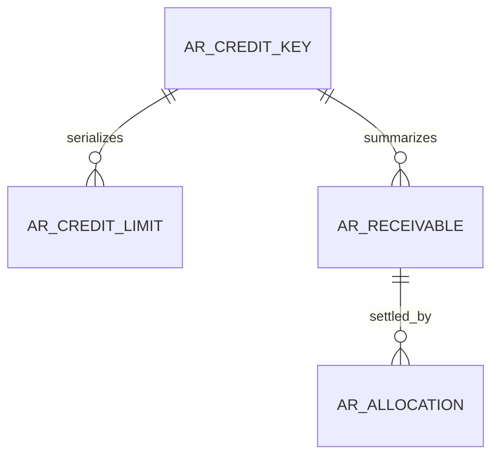

Planned ownership: a permanent company/customer lock key, versioned effective limits, immutable posted receivable sources and settlement allocations. IDs for MD company/customer are scalar cross-module references without database FK or EF navigation. FI-owned foreign keys and indexes are required for limit intervals, source uniqueness, company/customer exposure and allocations. Amounts use `decimal(19,4)`, currency `char(3)`, business dates `date`, timestamps `datetime2(6)` in UTC+8. The exact schema, constraints and reversible migration belong to WU-FI-001a/b; the diagram is conceptual and does not assert deployed tables.

### WU-FI-001a SQL acceptance detail (2026-10-29; pending red test)

| Planned table | Required columns and constraints | Required access path |
|---|---|---|
| `ar_credit_key` | `id bigint identity` PK; `company_id`, `customer_id` positive bigint and immutable. Keep the row permanently after any limit is deactivated so concurrent transactions share one lock target. No MD FK. | Unique `(company_id, customer_id)` over all rows; lock by this key with an update lock held to caller commit/rollback. |
| `ar_credit_limit` | `id bigint identity` PK; FI-owned `credit_key_id` FK; scalar `company_id`, `customer_id`; `base_currency char(3)`; `effective_from date`, `effective_to date` inclusive; `amount decimal(19,4)` nonnegative; `status`, positive `version`, audit identity/time. SQL checks reject reversed dates and negative amount. Historical rows remain after deactivation. | Indexed `(company_id, customer_id, effective_from, effective_to)` and indexed FI FK. The key lock plus overlap query prevents two active approved periods from matching one date, including shared endpoints. |
| `ar_posted_receivable` | `id bigint identity` PK; FI-owned `credit_key_id` FK; scalar `company_id`, `customer_id`; immutable `source_type`, `source_id`; `base_currency char(3)`; `original_base_amount`, `open_base_amount decimal(19,4)`; posted business date and audit time. SQL checks keep `0 <= open_base_amount <= original_base_amount`. This baseline cannot itself claim an SD invoice is posted; WU-FI-002a owns source verification and GL linkage. | Unique `(company_id, source_type, source_id)` including historical rows; indexed `(company_id, customer_id)` and FI FK for exposure sum. |

All FI writes first obtain the permanent key in the caller's SQL transaction; the snapshot reads approved effective limit and committed open AR under that same lock. SQL checks protect individual rows; interval exclusion and AR aggregate invariants require transaction-level tests. FI-CREDIT-007/010/018 must prove overlap, two-connection serialization and rollback before this schema is considered delivered. Exact physical columns may be refined by the red/green tests, and REQ_DS43 IDs are allocated only with a verified migration.

## WU-FI-002d sales source model (conceptual)

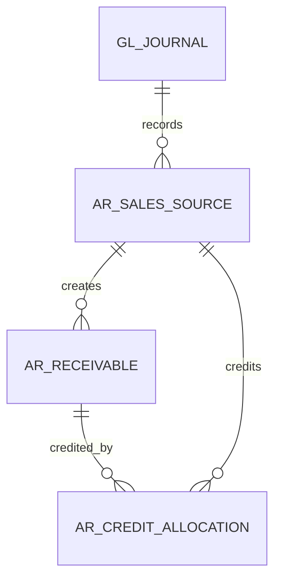

`AR_SALES_SOURCE` retains company, source module/type/ID/version, canonical fingerprint, posting and GL IDs, currency, original/base net/tax/gross, customer and immutable actor/time. Invoice receivables retain original and open balances; credit allocations reference FI-owned receivables and SD invoice-line scalar IDs. The source key is unique across soft deletion; allocation lookup indexes start with company and original receivable ID. FI-owned rows may have FKs to each other; SD and MD IDs are scalars with no cross-module FK/navigation. Money is `decimal(19,4)` and quantity precision is confirmed against saved SD source at migration design. WU-FI-002a will select exact tables, FK/index names and allocate REQ_DS43 IDs only with migration and SQL tests; no table exists from this design unit.

## WU-FI-003d purchase payable source model (conceptual)

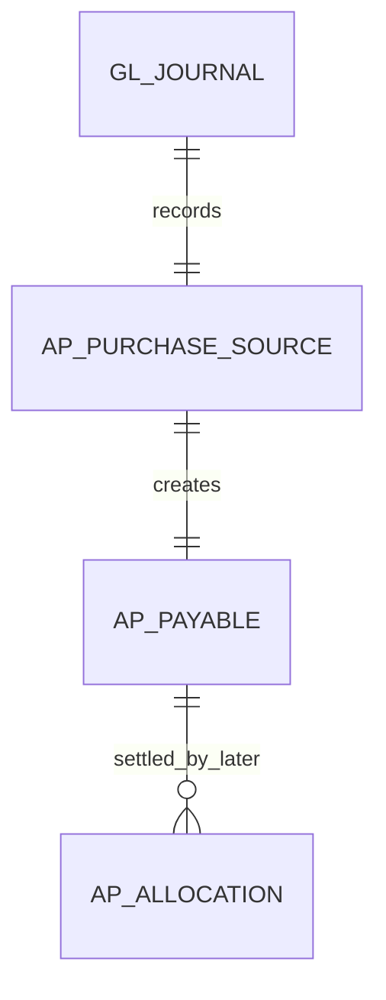

The planned source stores company, PUR invoice scalar ID/version, canonical fingerprint, supplier scalar ID, source currency and saved original/base net/tax/gross, posting time and FI journal/payable IDs. A permanent unique source key covers soft-deleted history. FI-owned payable and later allocation rows may have FI FKs; PUR, MD and SYS IDs have no cross-module FK or navigation. Indexes must support `(company_id, source_type, source_id)` uniqueness and `(company_id, supplier_id, posting_date, id)` payable reads. Amounts use `decimal(19,4)`, currency `char(3)`, business date `date`, and UTC+8 timestamp `datetime2(6)`. WU-FI-003a chooses the exact schema, reversible migration, constraints and REQ_DS43 IDs with real SQL tests; this diagram does not assert deployed tables.

## WU-FI-004d GL foundation (conceptual)

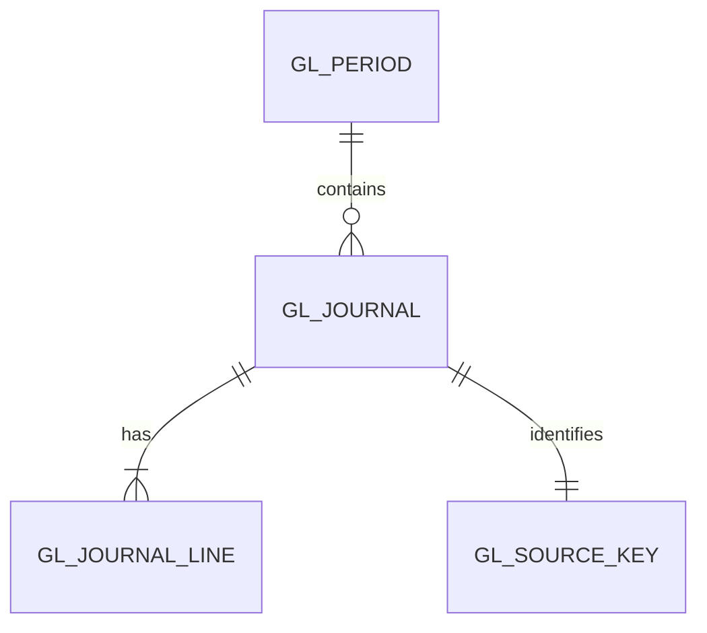

Planned `gl_period` has company, inclusive start/end dates, state and version; `(company_id, start_date, end_date)` supports overlap and posting-date lookup, with a company SQL lock enforcing nonoverlap. Planned `gl_source_key` has a permanent unique `(company_id, source_module, source_type, source_id)` key plus fingerprint/version and journal ID. Planned `gl_journal` holds company, period, saved business date, base currency, source and actor/time; planned `gl_journal_line` holds sequence, scalar MD account reference/snapshot, positive base debit or credit and optional saved document-currency components. FI-owned relationships get FKs and indexed FK columns; MD/SYS/SD/PUR IDs have no cross-module FK/navigation. Header and lines are immutable once Posted. `date`, `decimal(19,4)`, `char(3)` and UTC+8 `datetime2(6)` follow the database convention. Exact schema, check constraints, reversible migration and REQ_DS43 IDs belong to WU-FI-004a with real SQL tests; none are deployed by this design unit.

## WU-FI-005d sales collection and settlement (conceptual)

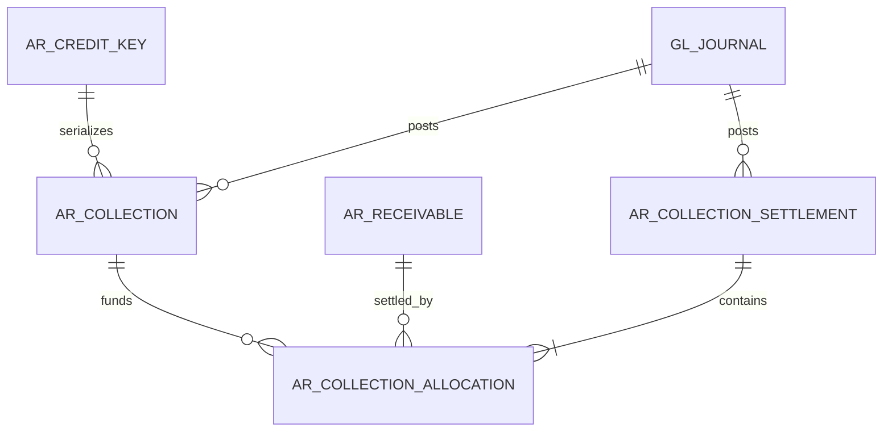

Planned receipt and settlement each retain a permanent company/type/source ID, saved version/fingerprint, customer, base currency, business date, state, journal ID and audit identity. Receipt stores positive posted/base amount and a unique bank reference within company/bank, including soft-deleted Posted history. Allocation stores FI receipt, settlement and receivable IDs, positive base amount and immutable posting reference. FI-owned relationships need FKs and indexed FK columns; MD bank/account and SD invoice IDs remain scalars without cross-module FK/navigation. Unique `(company_id, receipt_id, receivable_id)` is inappropriate because separate valid settlements may apply the same receipt to the same invoice over time; uniqueness is per settlement/receivable row. Indexes must support customer credit totals and ordered receipt/receivable locking. SQL checks enforce positive DECIMAL(19,4) and immutable source keys; transaction locks enforce aggregate balance caps. WU-FI-005a selects exact tables, reversible migration and REQ_DS43 IDs with real SQL tests. No table exists from this design unit.

## WU-FI-006d purchase payment and AP settlement (conceptual)

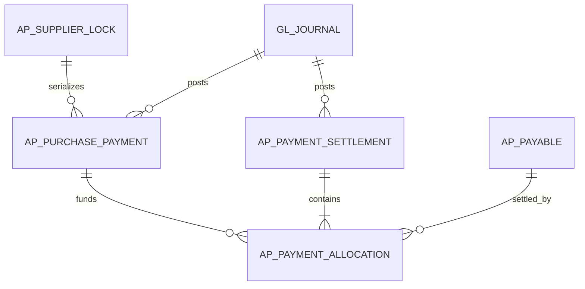

FI-owned payment and settlement hold permanent company/type/source ID, saved version/fingerprint, supplier, base currency, business date, state, journal ID and audit identity. A payment stores positive original and unapplied base amounts plus a bank/reference key unique within company and bank, including soft-deleted Posted history. Each allocation links one FI settlement, payment and payable, with positive base amount and posting reference. FI-owned relationships have FKs and indexed FK columns; MD supplier/bank/account and PUR invoice IDs are scalar cross-module references without FK or navigation. `(company_id, settlement_id, payable_id)` is unique; `(company_id, payment_id, payable_id)` is not, since separate partial settlements are valid. Indexes support `(company_id, supplier_id)` open AP totals and ordered payment/payable locks. SQL checks constrain positive `decimal(19,4)` and nonnegative stored balances; the SQL transaction enforces aggregate caps. Business dates use `date`, currency `char(3)` and audit time UTC+8 `datetime2(6)`. WU-FI-006a selects exact schema, reversible migration and REQ_DS43 IDs with real SQL tests; this design creates no table.

## WU-FI-007d other collection (conceptual)

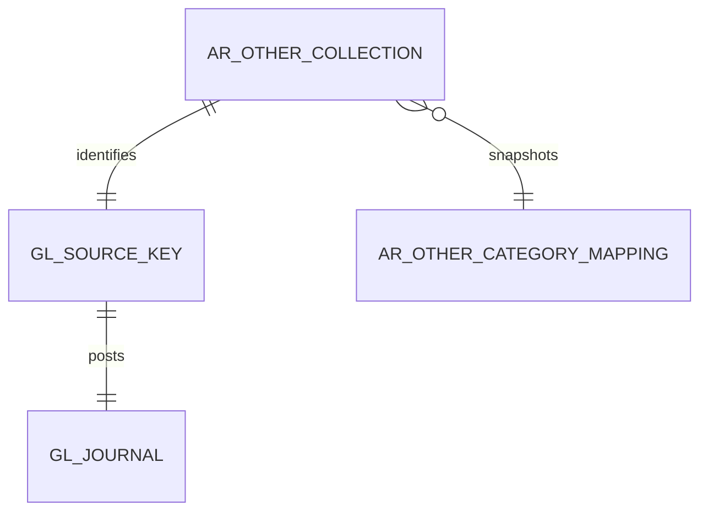

The planned FI-owned document retains company, payer description, scalar MD category/bank IDs, reference, business date, base currency, positive base amount, state/version, immutable posting fingerprint, category/account snapshot, source key, journal ID and audit identity. FI owns the category-to-income-account mapping; category, bank and account validation uses MD public contracts without cross-module FK/navigation. FI FKs and indexed FK columns connect only FI-owned rows. Permanent unique `(company_id, source_type, source_id)` and `(company_id, bank_id, reference)` constraints retain Posted history across soft deletion. A company/bank/reference index supports duplicate checks and ordered SQL locks. Amount is `decimal(19,4)`, currency `char(3)`, business date `date`, timestamp UTC+8 `datetime2(6)`. No conceptual relation to AR receivable or collection allocation exists. Exact schema, checks, reversible migration and REQ_DS43 allocation belong to WU-FI-007a; no table is deployed here.

## WU-FI-008d other payment (conceptual)

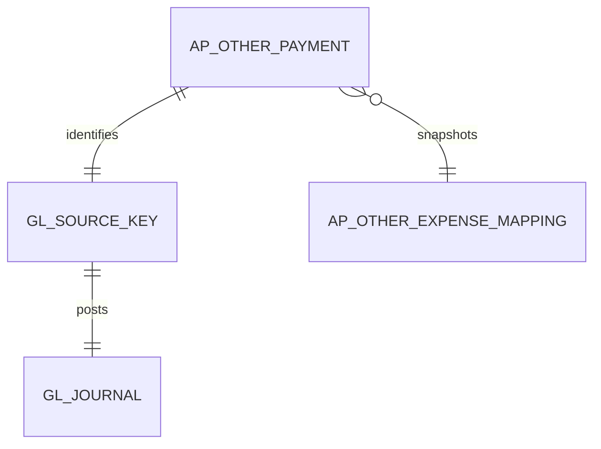

The FI-owned payment retains company, payee description, scalar MD expense-category and bank IDs, reference, business date, base currency, positive base amount, state/version, permanent source key and fingerprint, mapped expense-account snapshot, journal ID and audit identity. FI owns category-to-expense mapping; MD category, bank and account are checked through public contracts without cross-module FK/navigation. Only FI-owned rows have FKs and indexed FK columns. Permanent unique `(company_id, source_type, source_id)` and withdrawal-direction `(company_id, bank_id, reference)` keys survive soft deletion. There is no relationship to AP payable or payment allocation; a supplier ID is descriptive only. Amount uses `decimal(19,4)`, currency `char(3)`, business date `date` and audit timestamp UTC+8 `datetime2(6)`. WU-FI-008a owns exact schema, constraints, reversible migration and REQ_DS43 IDs after real SQL red tests; no table is deployed here.

## WU-FI-009d statement projection (conceptual, no new table)

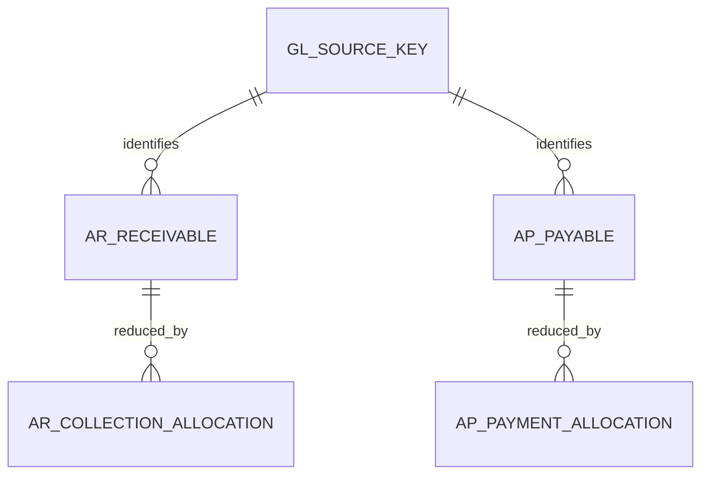

FI projects saved positive AR/AP sources, signed credit sources and committed allocations into one ordered movement stream per company and partner. It is not a persisted statement or mutable balance table. WU-FI-009a must prove a durable posting cutoff across concurrent writes and indexes for `(company_id, partner_id, business_date, posting_sequence, source_id)` paging and historical opening aggregation. FI-owned FKs are indexed; cross-module IDs remain scalars. Existing source and allocation migrations own their actual REQ_DS43 IDs. If a cutoff needs new storage, 009a allocates an ID with a reversible migration and two-connection SQL proof. No schema is deployed here.

## WU-FI-010d cash-book projection (conceptual, no new table)

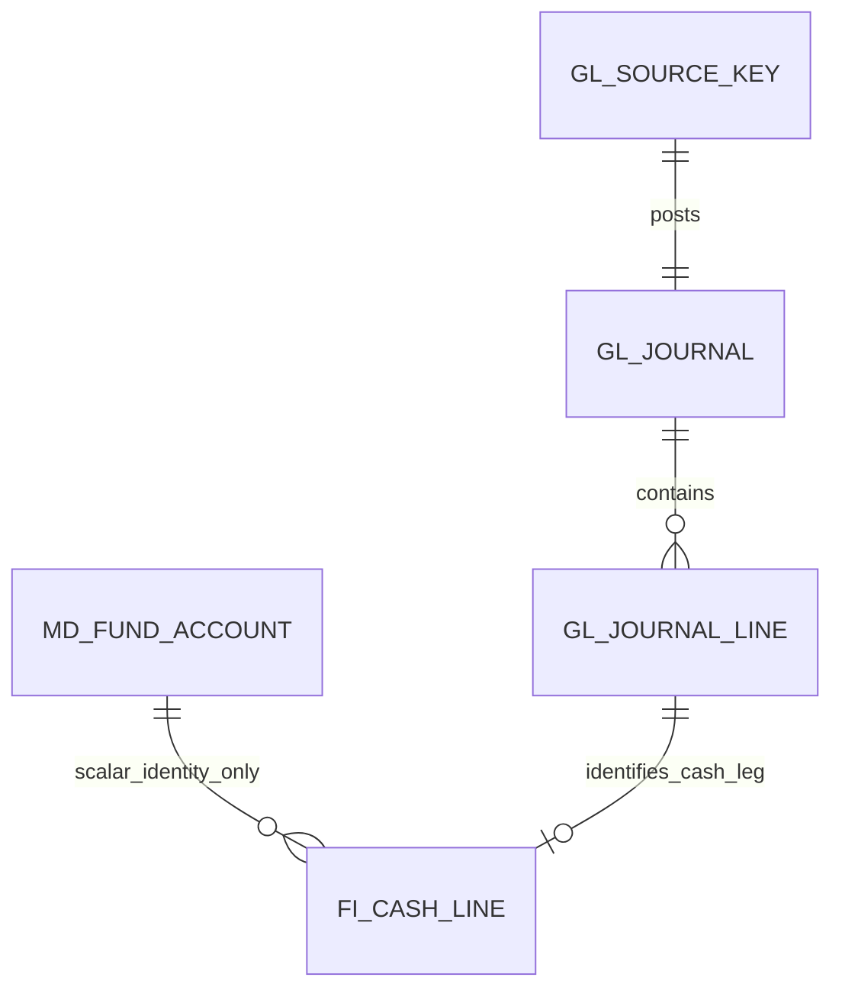

`MD_FUND_ACCOUNT` is a conceptual cross-module reference: FI stores only its scalar ID and never adds an EF navigation or database FK to MD. A qualifying cash-side GL line must preserve company, fund-account ID, mapped GL account ID, journal/line ID, source key, saved business date, posting time, debit/credit and signed company-base amount. The exact schema may use immutable line fields or a same-transaction FI projection; WU-FI-010a chooses after failing real SQL tests, allocates any required `REQ_DS43` ID, adds indexed `(company_id, fund_account_id, business_date, posting_time, journal_id, line_id)` access and a reversible migration. FI-owned FK columns receive indexes; a permanent unique journal/line key prevents projection duplication. Opening balances and external bank rows are not placed in `md_fund_account`. The read cutoff may need durable FI storage and must prove commit-order consistency before paging. No schema is deployed here.

## WU-FI-011d bank reconciliation (conceptual)

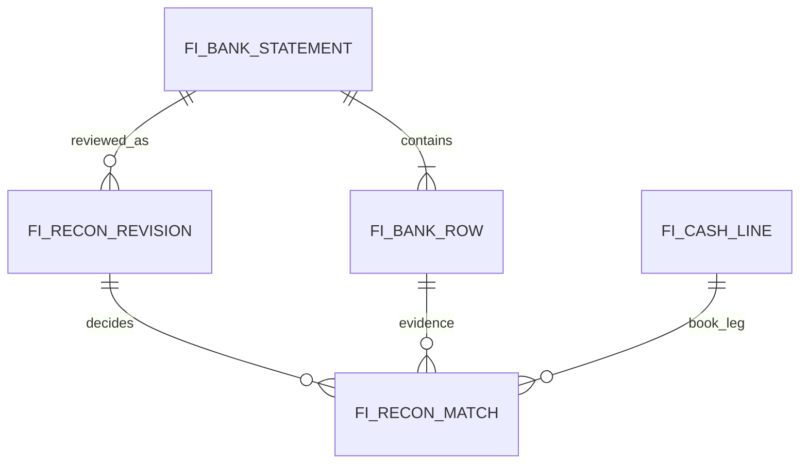

All proposed tables are FI-owned. `FI_BANK_STATEMENT` keeps company, scalar MD fund-account ID, external statement ID, range, currency, opening/closing, original file digest, revision, import actor/time and state. `FI_BANK_ROW` keeps durable bank transaction ID, row number, date, description, debit/credit, running balance, canonical payload hash and import outcome/reason. `FI_RECON_REVISION` keeps version, status, frozen evidence digest and FI committed cutoff, bank/book totals, reviewer, audit and superseded revision. `FI_RECON_MATCH` records one bank row and optional FI cash leg, disposition, reason, actor/time and approval version. Same-module FK columns need indexes; MD fund-account ID stays scalar without FK/navigation. Permanent row identity includes rejected and superseded history, while a corrected bank revision preserves old evidence. Unique active match constraints and fund-account/date and row-identity indexes require two-connection SQL proof. All amounts use `decimal(19,4)`; dates use `date`, timestamps UTC+8 `datetime2(6)`, currency `char(3)`. WU-FI-011a chooses exact table names, checks, reversible migration and `REQ_DS43` IDs after real-SQL failing tests. No schema is deployed here.
## WU-FI-012d fixed asset model (conceptual)

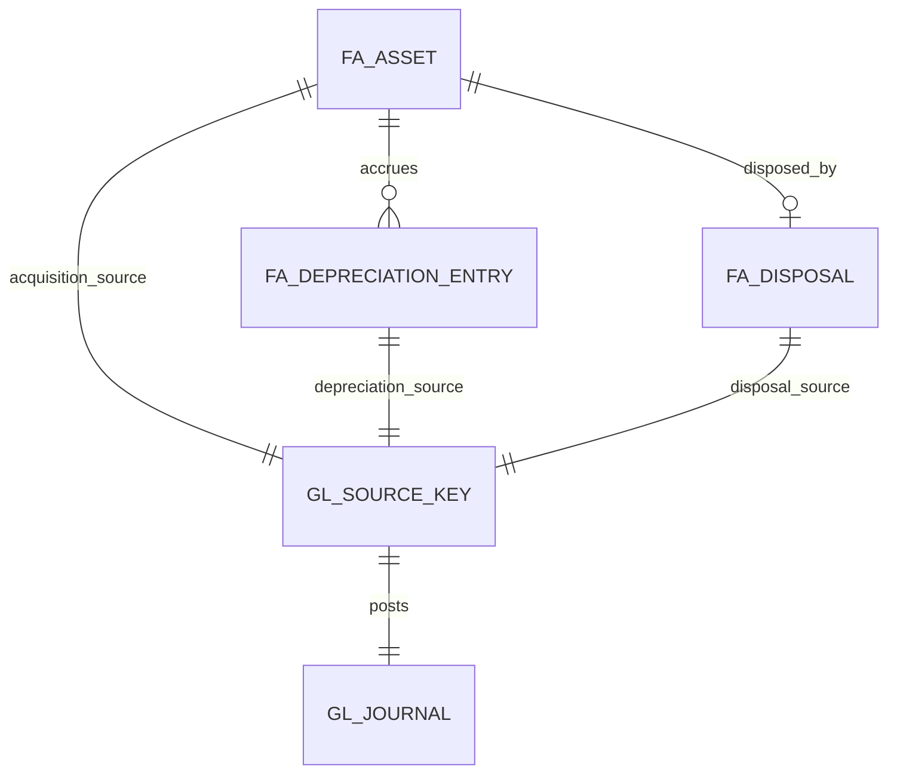

All proposed `fa_` entities belong to FI. Asset keeps company, permanent code, scalar MD class ID, cost/residual, life months, acquisition/in-service dates, base currency, source/version/state and audit. Depreciation entry keeps asset, accounting period, amount, cumulative amount, source/fingerprint, journal and audit; disposal keeps asset, proceeds, saved pre-disposal cost/accumulated depreciation, gain/loss, source and journal. The card's net book value is calculated from committed entries, not directly updated as a GL balance. FI-owned FKs and indexes cover asset/depreciation/disposal/journal links; `(company_id, asset_code)`, acquisition source, `(company_id, asset_id, period_id)` and disposal asset/source remain unique across soft deletion. MD IDs remain scalar without FK/navigation. Amounts are `decimal(19,4)`, dates `date`, audit times UTC+8 `datetime2(6)`, currency `char(3)`; `rowversion` or existing version policy protects edits. WU-FI-012a/b/c allocate actual `REQ_DS43` IDs, constraints, indexes and reversible migrations after failing real SQL tests. No schema is deployed here.

## WU-FI-013d tax source and return model (conceptual)

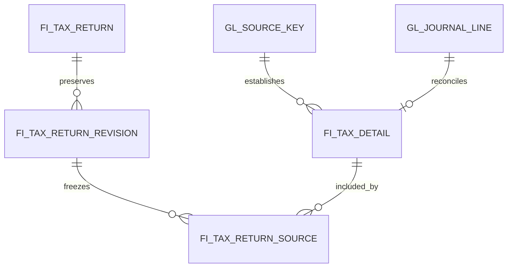

All proposed tax records are FI-owned. Tax detail stores company/regime, scalar SD/PUR source and line IDs, saved tax code/treatment/policy versions, signed taxable base, gross and claimable tax, tax date/period, fingerprint and Posted GL links. A return identifies company/regime/period; its revisions retain committed cutoff, source manifest digest, output/input/adjustment/net totals, reconciliation, reviewer and distinct external filing evidence. Revision-source membership fixes included amounts. FI-owned FK and access indexes cover source, tax date/period and revision; external MD/SD/PUR IDs are scalar without FK/navigation. Permanent source uniqueness includes soft-deleted history. Amounts use decimal(19,4), dates date, UTC+8 audit datetime2(6), currency char(3). WU-FI-013a selects actual tables, reversible migration, cutoff mechanism and REQ_DS43 IDs after failing two-connection SQL tests. No schema is deployed here.

## WU-FI-014d conceptual FX structure (no migration)

FI-owned exposure records retain source module/type/ID/version, partner and side (AR/AP), original/base currency, original gross, historical base gross, transaction rate ID/value/date, precision, committed source/journal IDs and audit. FI-owned allocation difference records retain receipt/payment and exposure IDs, original amount discharged, historical base discharged, saved settlement rate/base, signed realised amount, overlay released, GL source/journal and immutable fingerprint. FI-owned valuation revision and per-exposure detail retain period, approved policy and closing rate snapshot, durable committed cutoff/manifest, open original amount, historical and current carrying base, target base, delta, status, reviewer and GL link. Same-module FKs are indexed; SD/PUR/MD IDs stay scalar with no cross-module FK/navigation. Permanent source uniqueness includes soft-deleted history, and active valuation per exposure/period has SQL-enforced uniqueness. Decimal amounts are `decimal(19,4)`, rates `decimal(19,8)`, dates `date`, audit times UTC+8 `datetime2(6)`, currency `char(3)`; versions protect draft/revision edits. WU-FI-014a selects exact schema, cutoff implementation, constraints and reversible migration after failing two-connection SQL tests; `REQ_DS43` IDs are not allocated here.

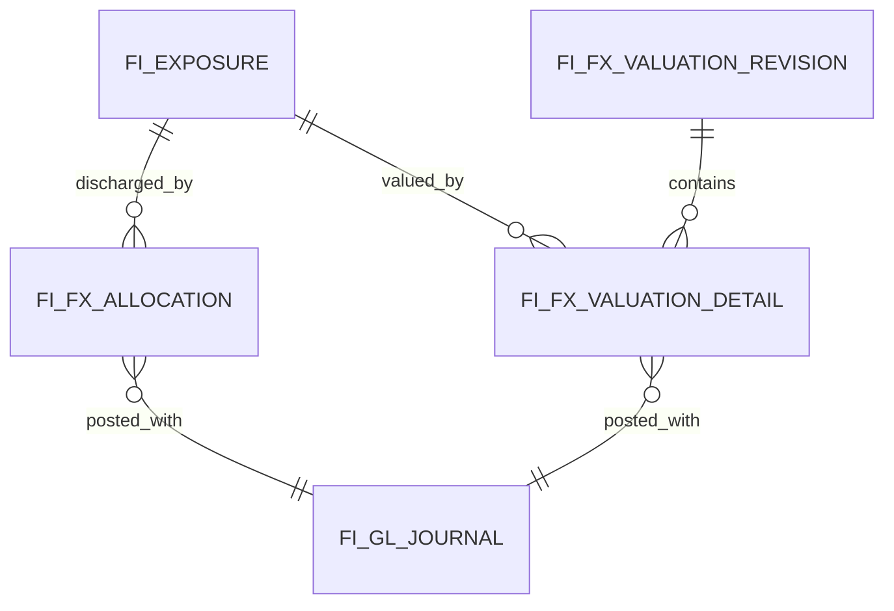

## WU-FI-015d conceptual close structure (no migration)

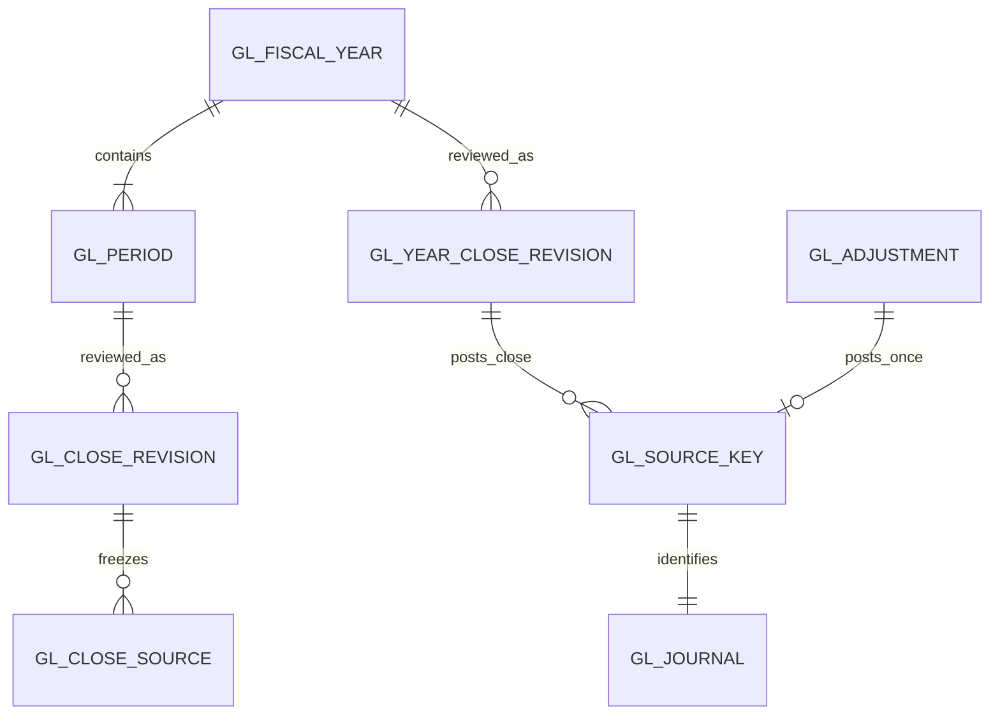

FI-owned fiscal year/period stores company, inclusive dates, calendar policy ID/version, state/version and audit. Close revision stores company, period/year, committed cutoff and manifest digest, source-family counts, differences, blocker/waiver evidence, actor/reviewer, state transition and superseded revision. Manifest membership records immutable FI source key/journal and external module source ID/version/fingerprint as scalar values; it has no cross-module FK/navigation. Adjustment stores type, reason/evidence, saved date, policy/account mapping version, workflow/version and permanent posting identity. Year close retains linked close/carry-forward source and next-year identity. FI-owned FKs are indexed; SQL uniqueness protects company/year, company/period range, revision number, source membership and permanent `(company, fiscalYear, sourceType)` keys across soft deletion. Month/day and gapless-year checks require two-connection SQL verification; a check constraint alone cannot prevent overlapping periods. Dates use `date`, money `decimal(19,4)`, timestamps UTC+8 `datetime2(6)` via `IClock`. WU-FI-015a allocates `REQ_DS43` IDs, exact tables, indexes and reversible migration after failing real-SQL tests. No schema is deployed here.
