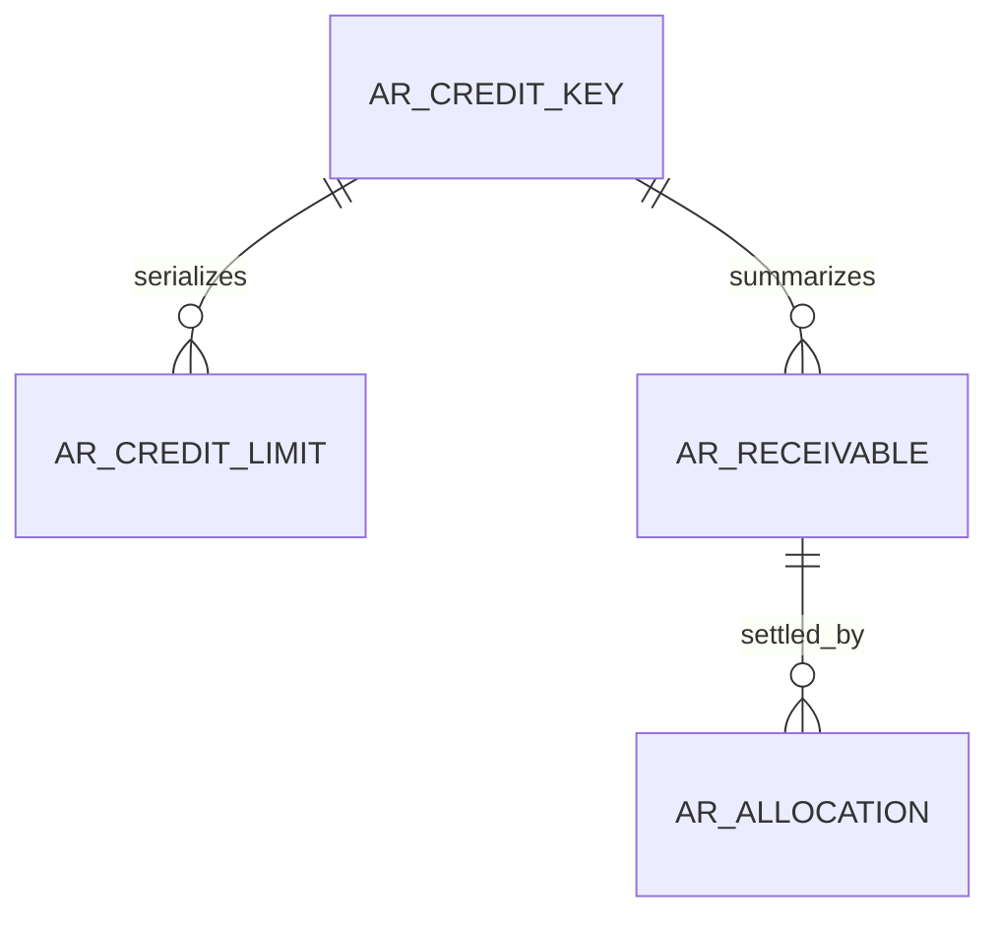
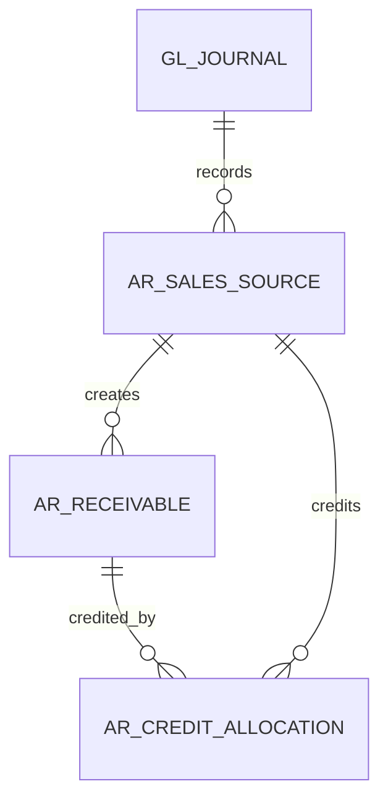
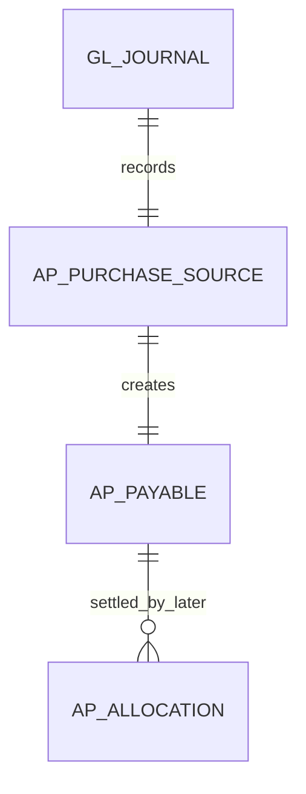

# FI data structure (planned)

WU-FI-000d creates no table and allocates no REQ_DS43 ID. WU-FI-001a will allocate IDs when the migration and real SQL validation exist.

Planned ownership: a permanent company/customer lock key, versioned effective limits, immutable posted receivable sources and settlement allocations. IDs for MD company/customer are scalar cross-module references without database FK or EF navigation. FI-owned foreign keys and indexes are required for limit intervals, source uniqueness, company/customer exposure and allocations. Amounts use `decimal(19,4)`, currency `char(3)`, business dates `date`, timestamps `datetime2(6)` in UTC+8. The exact schema, constraints and reversible migration belong to WU-FI-001a/b; the diagram is conceptual and does not assert deployed tables.

## WU-FI-002d sales source model (conceptual)

`AR_SALES_SOURCE` retains company, source module/type/ID/version, canonical fingerprint, posting and GL IDs, currency, original/base net/tax/gross, customer and immutable actor/time. Invoice receivables retain original and open balances; credit allocations reference FI-owned receivables and SD invoice-line scalar IDs. The source key is unique across soft deletion; allocation lookup indexes start with company and original receivable ID. FI-owned rows may have FKs to each other; SD and MD IDs are scalars with no cross-module FK/navigation. Money is `decimal(19,4)` and quantity precision is confirmed against saved SD source at migration design. WU-FI-002a will select exact tables, FK/index names and allocate REQ_DS43 IDs only with migration and SQL tests; no table exists from this design unit.

## WU-FI-003d purchase payable source model (conceptual)

The planned source stores company, PUR invoice scalar ID/version, canonical fingerprint, supplier scalar ID, source currency and saved original/base net/tax/gross, posting time and FI journal/payable IDs. A permanent unique source key covers soft-deleted history. FI-owned payable and later allocation rows may have FI FKs; PUR, MD and SYS IDs have no cross-module FK or navigation. Indexes must support `(company_id, source_type, source_id)` uniqueness and `(company_id, supplier_id, posting_date, id)` payable reads. Amounts use `decimal(19,4)`, currency `char(3)`, business date `date`, and UTC+8 timestamp `datetime2(6)`. WU-FI-003a chooses the exact schema, reversible migration, constraints and REQ_DS43 IDs with real SQL tests; this diagram does not assert deployed tables.
