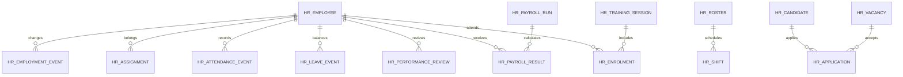

# HR — Planned data structure

WU-HR-000d allocates no `REQ_DS43` and makes no migration. Candidate company-scoped aggregates are employee/employment event, workforce assignment, shift/roster/attendance event, leave grant/request/event, payroll run/employee result/component, vacancy/candidate/application, performance review and training session/enrolment. Implementation units will define columns, decimal scales, check constraints, uniqueness (including soft-deleted codes), foreign-key indexes, audit fields, optimistic versions and reversible migrations. Cross-module SYS and FI IDs are values without EF navigation or database foreign keys.

SYS identities, organisational units, approval and audit; FI journals and payment facts remain owner data. HR stores confirmed IDs, versions, command keys and source cutoffs only. Sensitive fields need explicit encryption, masking, retention and access design in their implementation unit.
