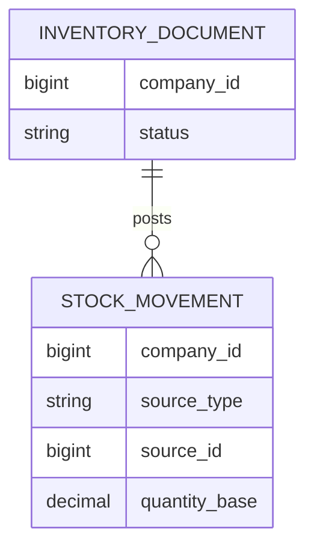

# INV 資料結構

WU-INV-001 沒有新增資料表；`inv_stock_movement` 在 WU-INV-003 建立後分配 REQ_DS43 ID，並更新實際欄位與 ER 圖。設計基線：所有交易表含 `company_id`，異動帳只增不改，來源行唯一，數量 `decimal(19,6)`。詳細約束見 ADR-051。

此圖為設計模型，非已建資料表；實體與同公司鍵由 WU-INV-003 落實。
