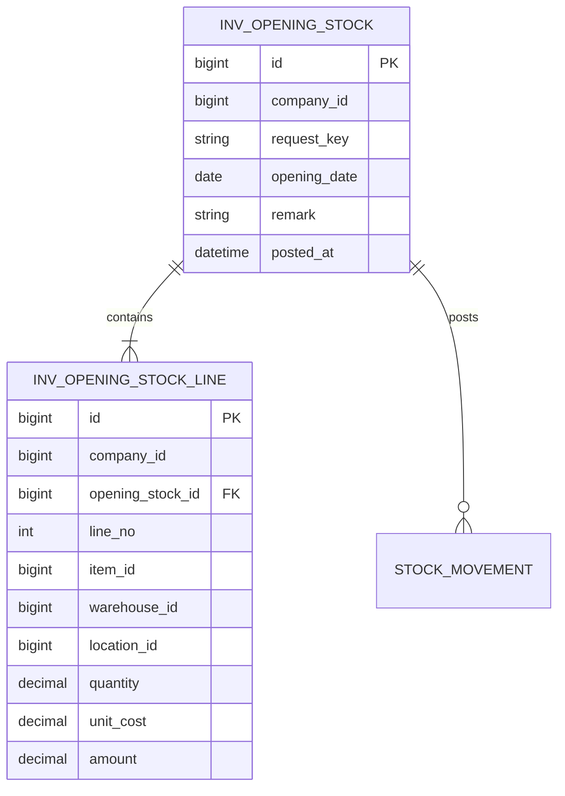
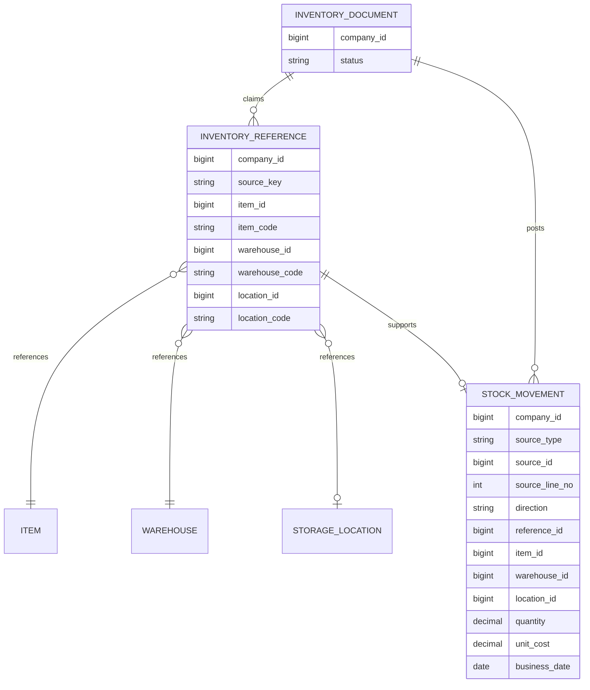
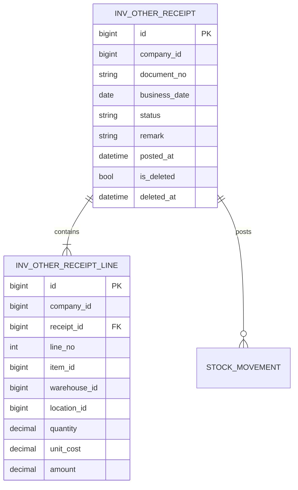
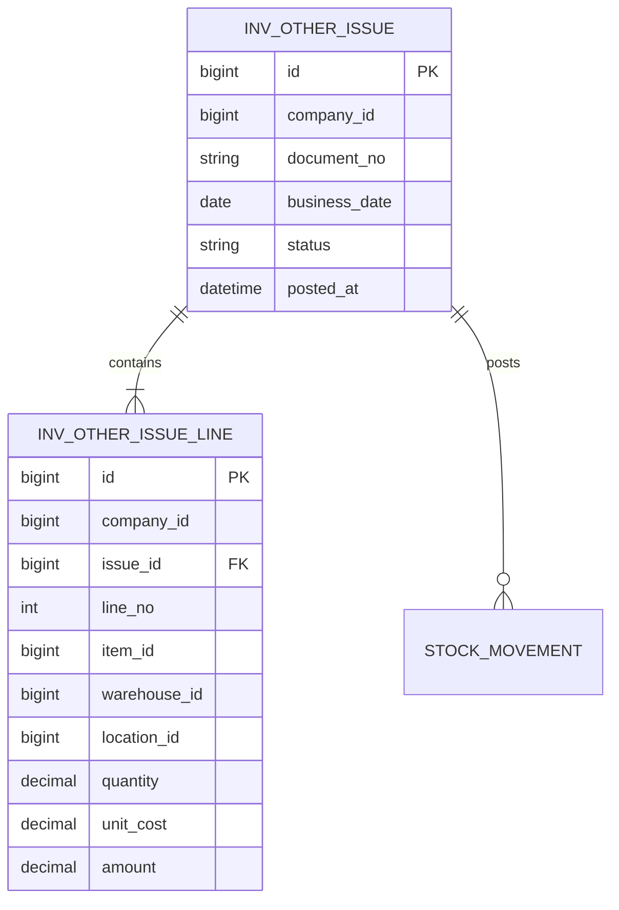

# INV 資料結構

## WU-INV-007a 物料期初庫存

| Requirement ID | Version | Table Name | Description | Author | Related REQ_F |
|---|---|---|---|---|---|
| REQ_DS43.140 | 1.0 | inv_opening_stock | This table stores immutable product initial stock batches with the idempotent request key, opening date and posting time. | Developer | REQ_F4115.23.1, REQ_F4115.23.3, REQ_F4115.23.4 |
| REQ_DS43.141 | 1.0 | inv_opening_stock_line | This table stores one opening quantity and unit cost per item, warehouse and optional location. | Developer | REQ_F4115.23.1, REQ_F4115.23.2, REQ_F4115.23.3, REQ_F4115.23.4 |

`inv_opening_stock` 含通用審計、版本與 `custom_fields`（ISJSON 檢查）；`(company_id, request_key)` 唯一，`request_key varchar(64)`；`(company_id, opening_date, id)` 支援列表排序。`inv_opening_stock_line` 以 `(company_id, opening_stock_id)` 複合 FK 指向表頭，`(company_id, opening_stock_id, line_no)` 唯一；`ux_inv_opening_stock_line_balance_key`（`company_id, item_id, warehouse_id, location_id`）不帶篩選條件的唯一索引，令每個結存鍵（含無儲位）只有一筆期初；另建公司／倉庫／儲位索引。`quantity`、`unit_cost decimal(19,6)`，`amount decimal(19,4)`；CHECK 保證數量為正、單價與金額非負、行號為正。物料、倉庫、儲位為跨模組 ID，不建 FK。批次以 `source_type = OPENING_STOCK`、`source_id = id` 寫入 `inv_stock_movement`，MD 不存數量。

WU-INV-006 查詢沿用 `inv_stock_movement`（REQ_DS43.135）與其公司／結存鍵、公司／業務日期索引，不新增資料表或可修改彙總。結存按物料、倉庫、儲位分組；明細按業務日期及 ID 穩定分頁。對應 REQ_F4115.1.1–2。

WU-INV-002 新增 `inv_reference`；WU-INV-003 新增 `inv_stock_movement`。所有交易表含 `company_id`，異動帳只增不改，來源行唯一，數量 `decimal(19,6)`。詳細約束見 ADR-051、ADR-053。

| Requirement ID | Version | Table Name | Description | Author | Related REQ_F |
|---|---|---|---|---|---|
| REQ_DS43.134 | 1.0 | inv_reference | This table stores immutable inventory source references to master items, warehouses and optional locations. | Developer | REQ_F4115.21.3 |
| REQ_DS43.135 | 1.0 | inv_stock_movement | This table stores append-only inventory receipts and issues from approved source documents. | Developer | REQ_F4115.22.1, REQ_F4115.22.2, REQ_F4115.22.3, REQ_F4115.1.1, REQ_F4115.1.2 |
| REQ_DS43.136 | 1.0 | inv_other_receipt | This table stores company-scoped other receipt headers, document numbers and approval state. | Developer | REQ_F4115.2.1, REQ_F4115.2.2, REQ_F4115.2.3, REQ_F4115.2.4, REQ_F4115.2.5, REQ_F4115.2.6 |
| REQ_DS43.137 | 1.0 | inv_other_receipt_line | This table stores the ordered item, warehouse, optional location, quantity and cost snapshot of each other receipt. | Developer | REQ_F4115.2.1, REQ_F4115.2.2, REQ_F4115.2.3, REQ_F4115.2.4 |
| REQ_DS43.138 | 1.0 | inv_other_issue | This table stores company-scoped other issue headers, document numbers and approval state. | Developer | REQ_F4115.3.1, REQ_F4115.3.2, REQ_F4115.3.3, REQ_F4115.3.4, REQ_F4115.3.5, REQ_F4115.3.6 |
| REQ_DS43.139 | 1.0 | inv_other_issue_line | This table stores ordered stock issue lines with quantity and estimated approval amount. | Developer | REQ_F4115.3.1, REQ_F4115.3.2, REQ_F4115.3.3, REQ_F4115.3.4 |

`inv_reference` 的每個來源鍵在公司內唯一；物料、倉庫、儲位 ID 與代碼快照在 guard 保護下同時寫入。`company_id + item_code`、`company_id + warehouse_code + location_code` 索引用於 MD Usage 判斷；各引用 ID 亦有公司複合索引。跨模組不建 FK。引用保留歷史，即使來源單據作廢亦不可刪除。`location_id` 與 `location_code` 必須同時為空或同時有值。通用審計欄位由 interceptor 寫入。

`STOCK_MOVEMENT` 已落實；圖中的 `INVENTORY_DOCUMENT` 是後續單據概念，未建表。跨模組線為應用層參照，不是 SQL 外鍵。異動帳以 `(company_id, reference_id)` 複合外鍵連到引用，來源行以 `(company_id, source_type, source_id, source_line_no, direction)` 唯一。結存索引 `(company_id, item_id, warehouse_id, location_id)` INCLUDE `direction, quantity`；另有公司與業務日期、倉庫與儲位索引。`quantity > 0`、方向及成本 CHECK 防止非法列；trigger 拒絕 UPDATE、DELETE。

## 其他入庫（WU-INV-004a，migration `Inventory_OtherReceipt`）

`inv_other_receipt`：`id`、`company_id`、`document_no varchar(30)`、`business_date date`、`status varchar(30)`、`remark nvarchar(500)`、`custom_fields nvarchar(max)`（ISJSON 檢查）、`posted_at datetime2(6)`、`is_deleted bit`、`deleted_at datetime2(6)`，以及共同審計／版本欄位。`(company_id, document_no)` 唯一（含已刪草稿，單號不重用）；`(company_id, business_date, id)` 及 `(company_id, status, id)` 支援列表篩選與排序；`(company_id, id)` 為明細複合 FK 的備用鍵。CHECK：狀態只可為 `Draft`／`PendingApproval`／`Rejected`／`Posted`；`posted_at` 只在 `Posted` 有值；`is_deleted` 與 `deleted_at` 一致且只有草稿可刪（ADR-055）。

`inv_other_receipt_line`：`id`、`company_id`、`receipt_id`、`line_no`、`item_id`、`warehouse_id`、`location_id`、`quantity decimal(19,6)`、`unit_cost decimal(19,6)`、`amount decimal(19,4)` 與共同審計／版本欄位。`(company_id, receipt_id)` 以複合 FK 指向表頭（同公司）；唯一索引 `(company_id, receipt_id, line_no)` 同時覆蓋該 FK。`quantity > 0`、`unit_cost >= 0`、`amount >= 0`、`line_no > 0` 由 CHECK 保護；物料、倉庫、儲位跨模組只存 ID，不建 SQL FK。`(company_id, item_id)`、`(company_id, warehouse_id, location_id)` 索引用於查詢與引用判斷。`amount` = 數量 × 單價取 4 位，表頭金額為明細加總。

圖中的過帳關聯由 `source_type = OTHER_RECEIPT`、`source_id = receipt.id` 與來源行號實現，不另建異動帳到表頭的 SQL FK。

## 其他出庫（WU-INV-005a，migration `Inventory_OtherIssue`）

`inv_other_issue` 與入庫表頭相同的審計、版本、軟刪除及狀態約束；公司內單號永久唯一，日期與狀態各有公司複合索引。`inv_other_issue_line` 以 `(company_id, issue_id)` 複合 FK 指向表頭，`(company_id, issue_id, line_no)` 唯一；物料、倉庫及儲位只存跨模組 ID，另建公司與物料、公司與倉庫／儲位索引。`quantity decimal(19,6) > 0`；`unit_cost decimal(19,6) >= 0` 與 `amount decimal(19,4) >= 0` 是審批用估算快照，異動帳出庫 `unit_cost` 為 null，成本估值留 WU-INV-014。CHECK 保證行號、JSON、狀態及過帳時間合法。

異動帳以 `source_type = OTHER_ISSUE`、`source_id = issue.id` 連回來源，不建 SQL FK；同公司與來源行的防重放由過帳服務保證。
