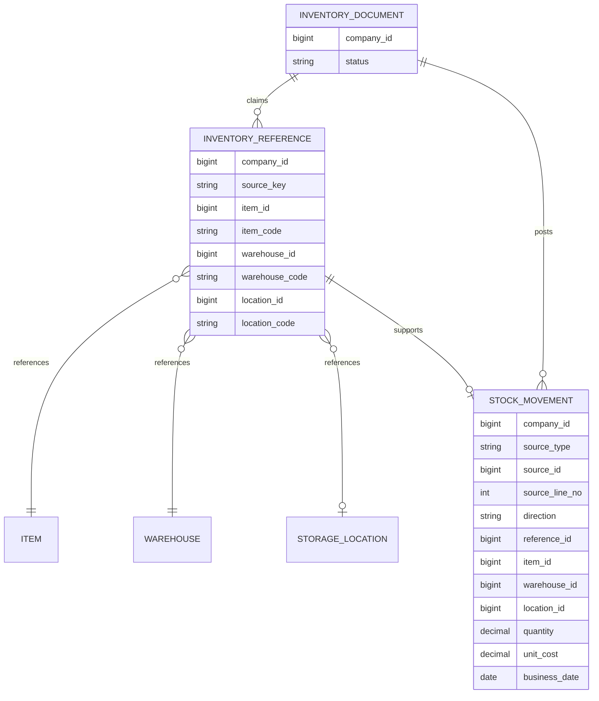

# INV 資料結構

WU-INV-002 新增 `inv_reference`；WU-INV-003 新增 `inv_stock_movement`。所有交易表含 `company_id`，異動帳只增不改，來源行唯一，數量 `decimal(19,6)`。詳細約束見 ADR-051、ADR-053。

| Requirement ID | Version | Table Name | Description | Author | Related REQ_F |
|---|---|---|---|---|---|
| REQ_DS43.134 | 1.0 | inv_reference | This table stores immutable inventory source references to master items, warehouses and optional locations. | Developer | REQ_F4115.21.3 |
| REQ_DS43.135 | 1.0 | inv_stock_movement | This table stores append-only inventory receipts and issues from approved source documents. | Developer | REQ_F4115.22.1, REQ_F4115.22.2, REQ_F4115.22.3 |

`inv_reference` 的每個來源鍵在公司內唯一；物料、倉庫、儲位 ID 與代碼快照在 guard 保護下同時寫入。`company_id + item_code`、`company_id + warehouse_code + location_code` 索引用於 MD Usage 判斷；各引用 ID 亦有公司複合索引。跨模組不建 FK。引用保留歷史，即使來源單據作廢亦不可刪除。`location_id` 與 `location_code` 必須同時為空或同時有值。通用審計欄位由 interceptor 寫入。

`STOCK_MOVEMENT` 已落實；圖中的 `INVENTORY_DOCUMENT` 是後續單據概念，未建表。跨模組線為應用層參照，不是 SQL 外鍵。異動帳以 `(company_id, reference_id)` 複合外鍵連到引用，來源行以 `(company_id, source_type, source_id, source_line_no, direction)` 唯一。結存索引 `(company_id, item_id, warehouse_id, location_id)` INCLUDE `direction, quantity`；另有公司與業務日期、倉庫與儲位索引。`quantity > 0`、方向及成本 CHECK 防止非法列；trigger 拒絕 UPDATE、DELETE。
