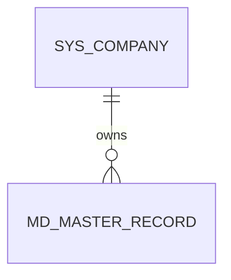
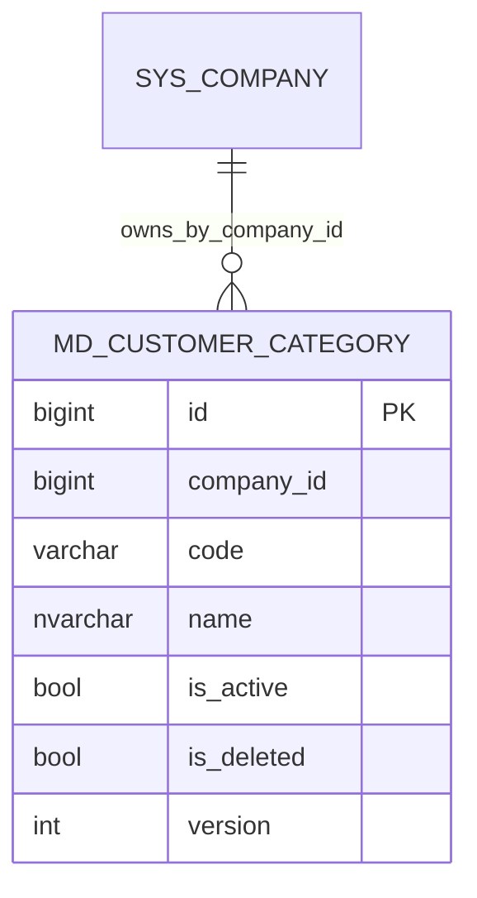
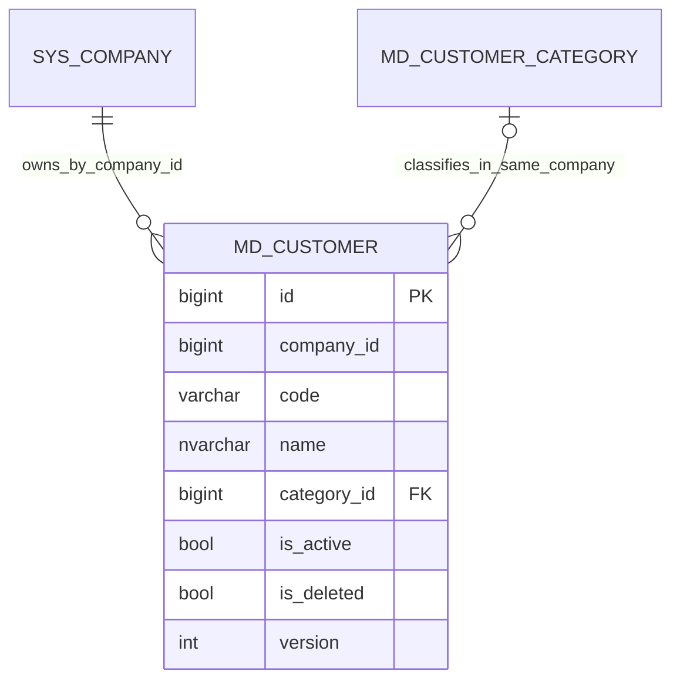
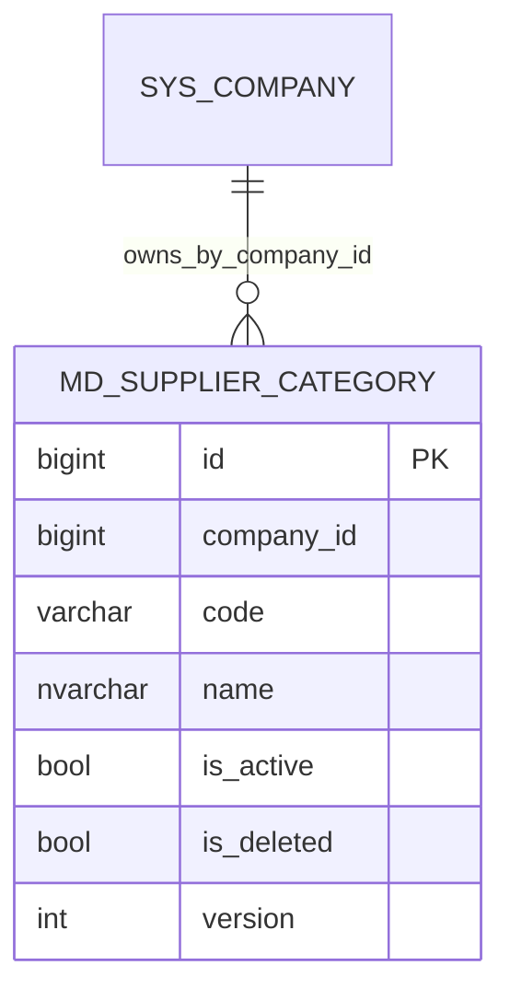
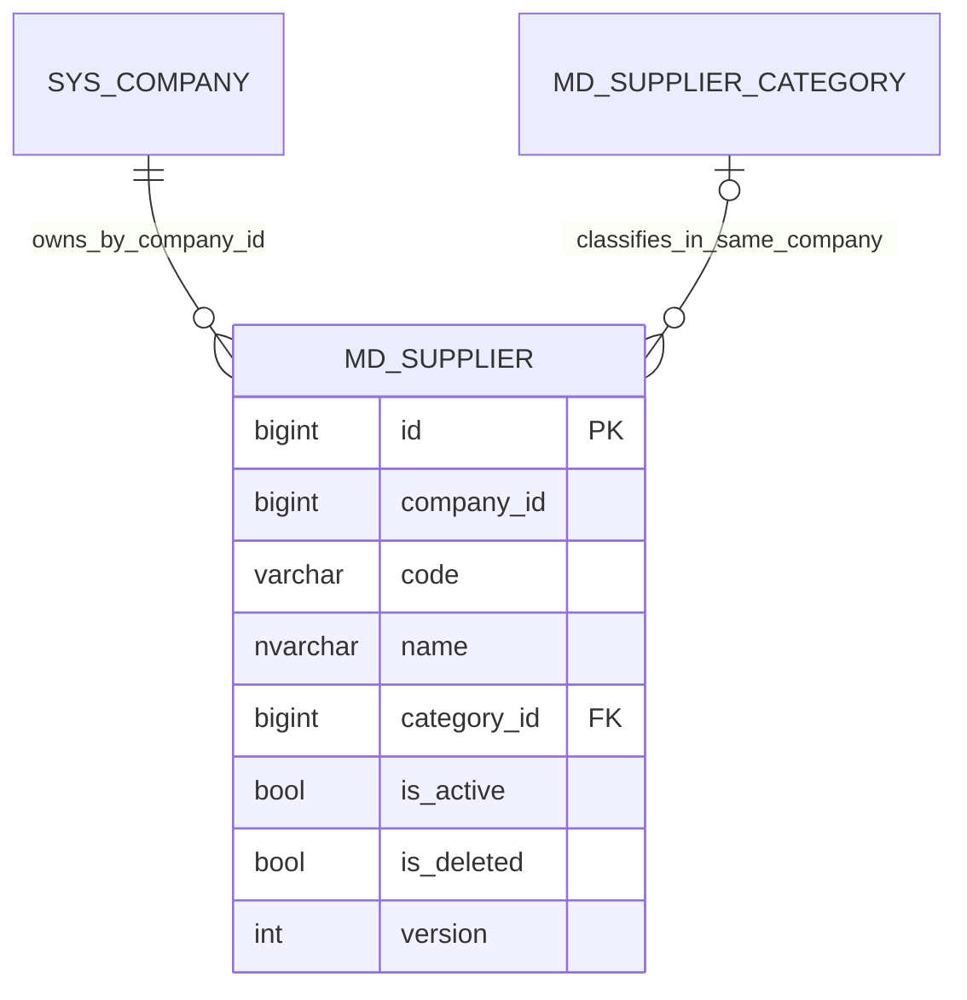
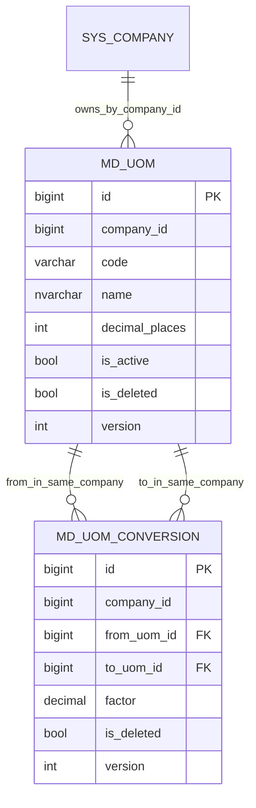
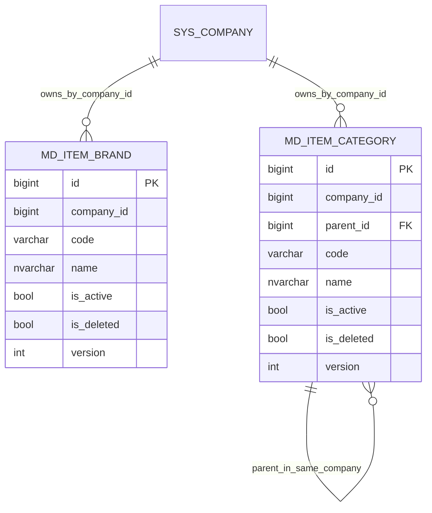
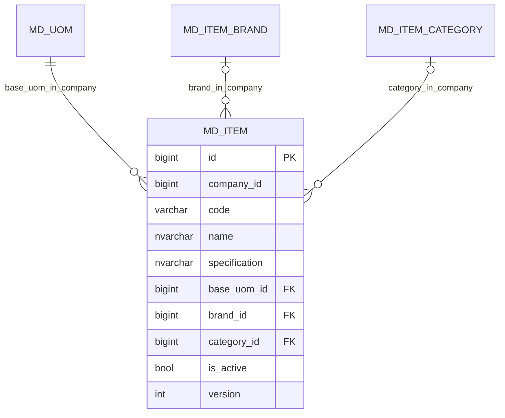
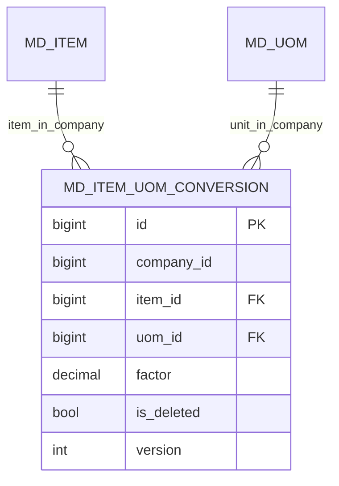
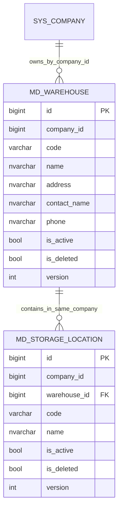

# MD 資料結構

WU-MD-001 為模組與權限基線，沒有新增資料表或 migration。後續主檔表均須有 `company_id`、審計與版本欄位，並採用共用 EF 公司篩選；相關工作單元建立實體時補入 ER 圖與 `REQ_DS43`。

`MD_MASTER_RECORD` 為後續主檔的概念佔位，並非本輪建立的實體或表。

## WU-MD-002

| Requirement ID | Version | Table Name | Description | Author | Related REQ_F |
|---|---|---|---|---|---|
| REQ_DS43.105 | 1.0 | md_customer_category | This table stores customer categories within a company. | Developer | REQ_F4118.8.1, REQ_F4118.8.2, REQ_F4118.8.3, REQ_F4118.8.4 |

`id` bigint identity 主鍵；`company_id` bigint 非空；`code` varchar(30) 非空、公司內唯一（含軟刪除）；`name` nvarchar(200) 非空；`is_active`、`is_deleted` bit；`custom_fields` nvarchar(max) 可空且須為 JSON；審計欄位及 `version` 遵循第 6 節。唯一索引 `(company_id, code)` 同時支援公司查詢；列表索引 `(company_id, name)` 支援名稱排序。`company_id` 是 SYS 公司 ID，但不跨模組建 navigation 或 FK，授權與存在性由應用層保證。

## WU-MD-003

| Requirement ID | Version | Table Name | Description | Author | Related REQ_F |
|---|---|---|---|---|---|
| REQ_DS43.106 | 1.0 | md_customer | This table stores customer master records within a company. | Developer | REQ_F4118.1.1, REQ_F4118.1.2, REQ_F4118.1.3 |

`md_customer` 使用 `id` bigint identity 主鍵、`company_id` bigint、`code` varchar(30)、`name` nvarchar(200)、可空 `category_id`、`is_active`／`is_deleted`、`version`、審計欄位與可空且檢查 JSON 的 `custom_fields`。唯一索引 `(company_id, code)` 包含軟刪除資料；分類以 `(company_id, category_id)` 複合外鍵參照 `md_customer_category` 的 `(company_id, id)`，阻止跨公司及刪除已引用分類。未建跨模組 SYS FK。

## WU-MD-006

| Requirement ID | Version | Table Name | Description | Author | Related REQ_F |
|---|---|---|---|---|---|
| REQ_DS43.107 | 1.0 | md_supplier_category | This table stores supplier categories within a company. | Developer | REQ_F4118.9.1, REQ_F4118.9.2, REQ_F4118.9.3, REQ_F4118.9.4 |

欄位與 `md_customer_category` 相同（BlueWhale VendorType，REQ_DS43.69）：`id` bigint identity 主鍵；`company_id` bigint；`code` varchar(30)，公司內唯一（含軟刪除）；`name` nvarchar(200)；`is_active`、`is_deleted`；可空且檢查 JSON 的 `custom_fields`；審計欄位及 `version`。唯一索引 `ux_md_supplier_category_company_id_code`、名稱排序索引 `ix_md_supplier_category_company_id_name`。另建唯一約束 `ak_md_supplier_category_company_id_id`，供 WU-MD-007 的 `md_supplier` 以 `(company_id, category_id)` 複合外鍵參照，在資料庫層阻止跨公司分類。兩種分類共用 EF 設定 `MasterCategoryModel` 與領域基底 `MasterCategory`。

## WU-MD-007

| Requirement ID | Version | Table Name | Description | Author | Related REQ_F |
|---|---|---|---|---|---|
| REQ_DS43.108 | 1.0 | md_supplier | This table stores supplier master records within a company. | Developer | REQ_F4118.2.1, REQ_F4118.2.2, REQ_F4118.2.3 |

欄位與 `md_customer` 相同（BlueWhale Vendor，REQ_DS43.72）：`id` bigint identity 主鍵、`company_id` bigint、`code` varchar(30)、`name` nvarchar(200)、可空 `category_id`、`is_active`／`is_deleted`、`version`、審計欄位與可空且檢查 JSON 的 `custom_fields`。唯一索引 `ux_md_supplier_company_id_code`（含軟刪除）、名稱索引 `ix_md_supplier_company_id_name`；分類以複合外鍵 `fk_md_supplier_md_supplier_category_company_id_category_id`（`(company_id, category_id)` → `ak_md_supplier_category_company_id_id`）參照，阻止跨公司及刪除已引用分類。客戶與供應商共用領域基底 `BusinessPartner<TCategory>` 及 EF 設定 `BusinessPartnerModel`；migration `MasterData_Supplier` 只新增此表，`md_customer` 結構不變。

## WU-MD-010

| Requirement ID | Version | Table Name | Description | Author | Related REQ_F |
|---|---|---|---|---|---|
| REQ_DS43.109 | 1.0 | md_uom | This table stores units of measurement within a company. | Developer | REQ_F4118.13.1, REQ_F4118.13.2, REQ_F4118.13.3, REQ_F4118.13.4 |
| REQ_DS43.110 | 1.0 | md_uom_conversion | This table stores conversion factors between units of measurement within a company. | Developer | REQ_F4118.13.1, REQ_F4118.13.2, REQ_F4118.13.3, REQ_F4118.13.4 |

`md_uom`（BlueWhale unit，REQ_DS43.85）沿用分類欄位（`id`、`company_id`、`code` varchar(30)、`name` nvarchar(200)、`is_active`／`is_deleted`、`version`、審計欄位、檢查 JSON 的 `custom_fields`），另加 `decimal_places` int（檢查 `ck_md_uom_decimal_places`：0–6）。唯一索引 `ux_md_uom_company_id_code`（含軟刪除）、名稱索引；備用鍵 `ak_md_uom_company_id_id` 供換算複合外鍵。

`md_uom_conversion`（MyERP 新增，BlueWhale 無對應）：`id` bigint identity、`company_id`、`from_uom_id`、`to_uom_id`、`factor` decimal(15,6)、`is_deleted`、`version`、審計欄位。檢查 `ck_md_uom_conversion_factor`（大於 0）與 `ck_md_uom_conversion_units`（兩端不同）；過濾唯一索引 `ux_md_uom_conversion_company_id_from_uom_id_to_uom_id`（`is_deleted = 0`）；兩條複合外鍵 `(company_id, from_uom_id)`／`(company_id, to_uom_id)` 參照 `ak_md_uom_company_id_id`，阻止跨公司單位。反向、循環換算由服務以換算圖及 applock 阻止（ADR-034）。migration `MasterData_Uom`。

## WU-MD-011

| Requirement ID | Version | Table Name | Description | Author | Related REQ_F |
|---|---|---|---|---|---|
| REQ_DS43.111 | 1.0 | md_item_brand | This table stores item brands within a company. | Developer | REQ_F4118.11.1, REQ_F4118.11.2, REQ_F4118.11.3, REQ_F4118.11.4 |
| REQ_DS43.112 | 1.0 | md_item_category | This table stores the item category tree within a company. | Developer | REQ_F4118.10.1, REQ_F4118.10.2, REQ_F4118.10.3, REQ_F4118.10.4 |

`md_item_brand`（BlueWhale Brand REQ_DS43.3／GoodsBrand REQ_DS43.52，兩表重複，合併為一張）沿用分類欄位（`id`、`company_id`、`code` varchar(30)、`name` nvarchar(200)、`is_active`／`is_deleted`、`version`、審計欄位、檢查 JSON 的 `custom_fields`）；唯一索引 `ux_md_item_brand_company_id_code`（含軟刪除）、名稱索引；備用鍵 `ak_md_item_brand_company_id_id` 供物料（WU-MD-012）複合外鍵。

`md_item_category`（BlueWhale GoodsType，REQ_DS43.44）沿用分類欄位，另加 `parent_id` bigint null。複合外鍵 `(company_id, parent_id)` 參照自身備用鍵 `ak_md_item_category_company_id_id`（NO ACTION），資料庫層阻止跨公司掛載；檢查 `ck_md_item_category_parent`（`parent_id <> id`）；索引 `ix_md_item_category_company_id_parent_id`。不可成環、最多 5 層、上層須啟用、有子分類不可刪除由服務以公司級 applock（`md_item_category:{companyId}`）序列化檢查。分類圖片（REQ_DS43.39）留給 WU-MD-013。migration `MasterData_ItemBrandCategory`。

## WU-MD-012a 物料主檔

| Requirement ID | Version | Table Name | Description | Author | Related REQ_F |
|---|---|---|---|---|---|
| REQ_DS43.113 | 1.0 | md_item | This table stores company item masters without inventory balances. | Developer | REQ_F4118.3.1, REQ_F4118.3.2, REQ_F4118.3.3, REQ_F4118.3.5 |

`md_item`：`id` bigint identity；`company_id` bigint；`code` varchar(30) 公司內永久唯一（含軟刪除）；`name` nvarchar(200)；`specification` nvarchar(500) 可空；`base_uom_id` bigint 必填；`brand_id`／`category_id` bigint 可空；`is_active`／`is_deleted`、`version` 與審計欄位。索引 `(company_id, code)` 唯一、`(company_id, name)` 供列表排序；基本單位、品牌、分類均以 `(company_id, id)` 複合外鍵參照，阻止跨公司參照。migration `MasterData_Item`。不存庫存數量或成本。

## WU-MD-012c 物料專屬換算

| Requirement ID | Version | Table Name | Description | Author | Related REQ_F |
|---|---|---|---|---|---|
| REQ_DS43.114 | 1.0 | md_item_uom_conversion | This table stores item-specific conversion factors from alternate units to the item base unit within a company. | Developer | REQ_F4118.3.5 |

`md_item_uom_conversion`：`id` bigint identity；`company_id` bigint；`item_id` bigint；`uom_id` bigint（換算單位，不可等於物料基本單位，由服務檢查）；`factor` decimal(15,6)（1 換算單位 = factor 基本單位，check `factor > 0`）；`is_deleted`、`version` 與審計欄位。過濾唯一索引 `ux_md_item_uom_conversion_company_id_item_id_uom_id`（`is_deleted = 0`），索引 `(company_id, uom_id)` 供單位刪除檢查；物料與單位均以 `(company_id, id)` 複合外鍵參照（`md_item` 新增唯一約束 `ak_md_item_company_id_id`），阻止跨公司。migration `MasterData_ItemUomConversion`。決策見 ADR-035。

## WU-MD-015

| Requirement ID | Version | Table Name | Description | Author | Related REQ_F |
|---|---|---|---|---|---|
| REQ_DS43.115 | 1.0 | md_warehouse | This table stores warehouses within a company. | Developer | REQ_F4118.4.1, REQ_F4118.4.2, REQ_F4118.4.3, REQ_F4118.4.4 |
| REQ_DS43.116 | 1.0 | md_storage_location | This table stores storage locations (bins) within a warehouse. | Developer | REQ_F4118.4.5 |

`md_warehouse` 沿用分類基底欄位（`code` varchar(30) 公司內唯一含軟刪除、`name` nvarchar(200)、`custom_fields` JSON 檢查），另加可空 `address` nvarchar(300)、`contact_name` nvarchar(100)、`phone` nvarchar(50)；唯一約束 `ak_md_warehouse_company_id_id (company_id, id)` 供儲位複合外鍵。`md_storage_location` 有 `warehouse_id` bigint、`code` varchar(30)、`name` nvarchar(200)、啟用、軟刪除、版本與審計欄位；唯一索引 `(company_id, warehouse_id, code)` 包含軟刪除資料，同時支援按倉庫查詢；`(company_id, warehouse_id)` 複合外鍵 `fk_md_storage_location_md_warehouse_company_id_warehouse_id` 阻止跨公司掛載。兩表都沒有數量或金額欄位，庫存只由 INV 異動帳維護（ADR-036）。

