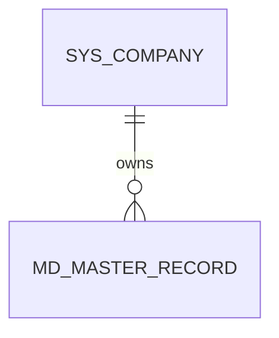
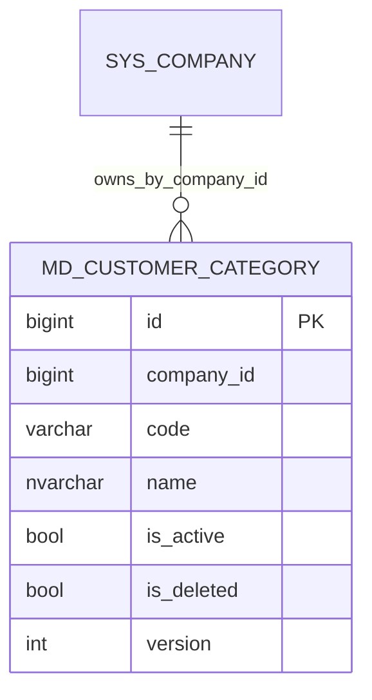

# MD 資料結構

WU-MD-001 為模組與權限基線，沒有新增資料表或 migration。後續主檔表均須有 `company_id`、審計與版本欄位，並採用共用 EF 公司篩選；相關工作單元建立實體時補入 ER 圖與 `REQ_DS43`。

`MD_MASTER_RECORD` 為後續主檔的概念佔位，並非本輪建立的實體或表。

## WU-MD-002

| Requirement ID | Version | Table Name | Description | Author | Related REQ_F |
|---|---|---|---|---|---|
| REQ_DS43.105 | 1.0 | md_customer_category | This table stores customer categories within a company. | Developer | REQ_F4118.8.1, REQ_F4118.8.2, REQ_F4118.8.3, REQ_F4118.8.4 |

`id` bigint identity 主鍵；`company_id` bigint 非空；`code` varchar(30) 非空、公司內唯一（含軟刪除）；`name` nvarchar(200) 非空；`is_active`、`is_deleted` bit；`custom_fields` nvarchar(max) 可空且須為 JSON；審計欄位及 `version` 遵循第 6 節。唯一索引 `(company_id, code)` 同時支援公司查詢；列表索引 `(company_id, name)` 支援名稱排序。`company_id` 是 SYS 公司 ID，但不跨模組建 navigation 或 FK，授權與存在性由應用層保證。

