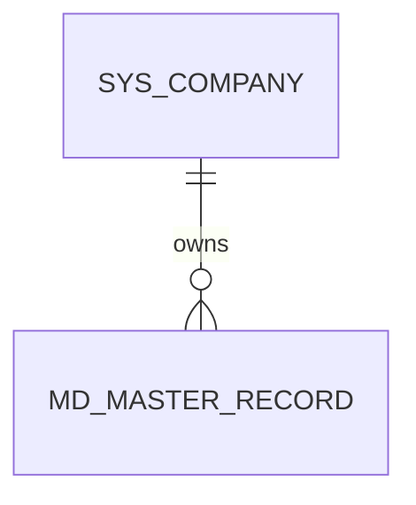
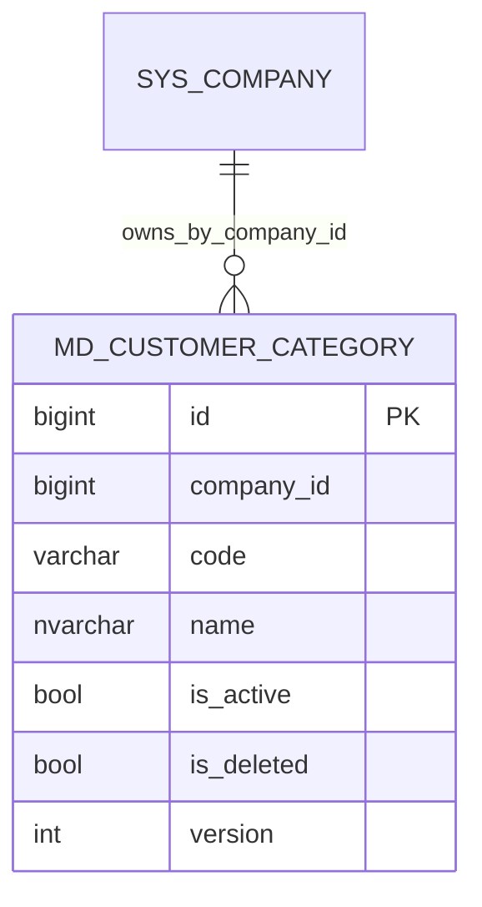
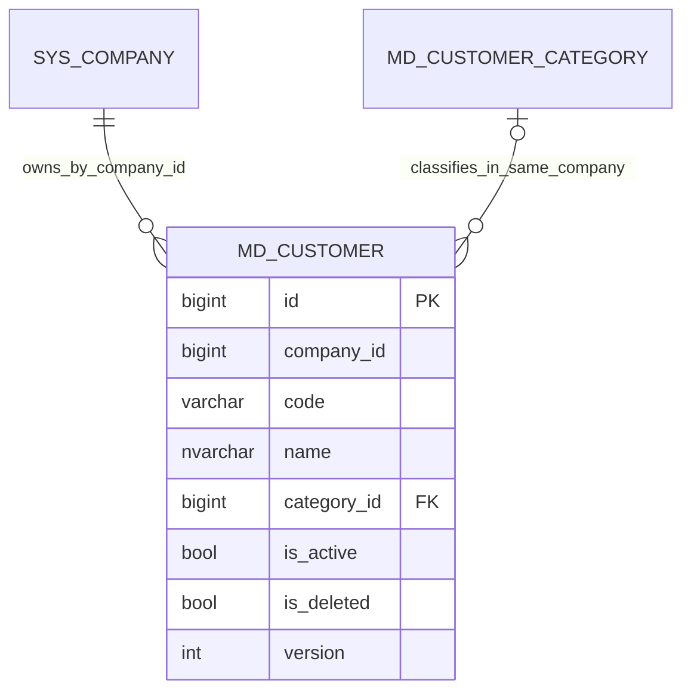
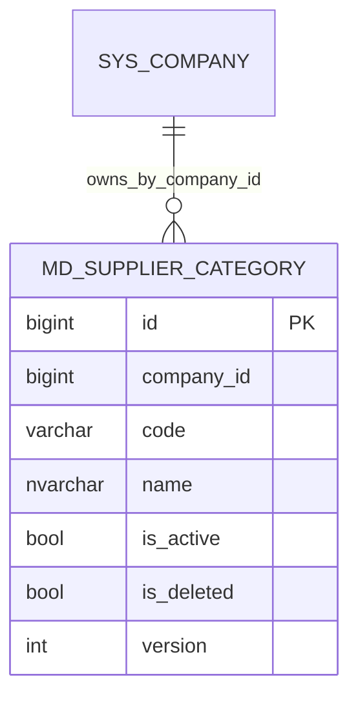
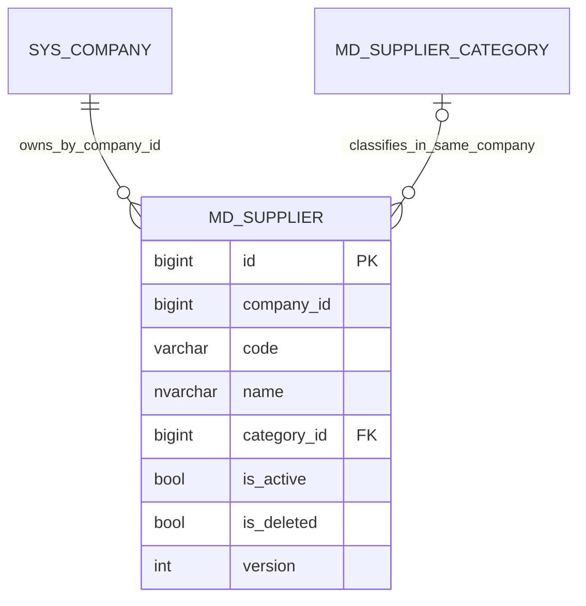

# MD 資料結構

WU-MD-001 為模組與權限基線，沒有新增資料表或 migration。後續主檔表均須有 `company_id`、審計與版本欄位，並採用共用 EF 公司篩選；相關工作單元建立實體時補入 ER 圖與 `REQ_DS43`。

`MD_MASTER_RECORD` 為後續主檔的概念佔位，並非本輪建立的實體或表。

## WU-MD-002

| Requirement ID | Version | Table Name | Description | Author | Related REQ_F |
|---|---|---|---|---|---|
| REQ_DS43.105 | 1.0 | md_customer_category | This table stores customer categories within a company. | Developer | REQ_F4118.8.1, REQ_F4118.8.2, REQ_F4118.8.3, REQ_F4118.8.4 |

`id` bigint identity 主鍵；`company_id` bigint 非空；`code` varchar(30) 非空、公司內唯一（含軟刪除）；`name` nvarchar(200) 非空；`is_active`、`is_deleted` bit；`custom_fields` nvarchar(max) 可空且須為 JSON；審計欄位及 `version` 遵循第 6 節。唯一索引 `(company_id, code)` 同時支援公司查詢；列表索引 `(company_id, name)` 支援名稱排序。`company_id` 是 SYS 公司 ID，但不跨模組建 navigation 或 FK，授權與存在性由應用層保證。

## WU-MD-003

| Requirement ID | Version | Table Name | Description | Author | Related REQ_F |
|---|---|---|---|---|---|
| REQ_DS43.106 | 1.0 | md_customer | This table stores customer master records within a company. | Developer | REQ_F4118.1.1, REQ_F4118.1.2, REQ_F4118.1.3 |

`md_customer` 使用 `id` bigint identity 主鍵、`company_id` bigint、`code` varchar(30)、`name` nvarchar(200)、可空 `category_id`、`is_active`／`is_deleted`、`version`、審計欄位與可空且檢查 JSON 的 `custom_fields`。唯一索引 `(company_id, code)` 包含軟刪除資料；分類以 `(company_id, category_id)` 複合外鍵參照 `md_customer_category` 的 `(company_id, id)`，阻止跨公司及刪除已引用分類。未建跨模組 SYS FK。

## WU-MD-006

| Requirement ID | Version | Table Name | Description | Author | Related REQ_F |
|---|---|---|---|---|---|
| REQ_DS43.107 | 1.0 | md_supplier_category | This table stores supplier categories within a company. | Developer | REQ_F4118.9.1, REQ_F4118.9.2, REQ_F4118.9.3, REQ_F4118.9.4 |

欄位與 `md_customer_category` 相同（BlueWhale VendorType，REQ_DS43.69）：`id` bigint identity 主鍵；`company_id` bigint；`code` varchar(30)，公司內唯一（含軟刪除）；`name` nvarchar(200)；`is_active`、`is_deleted`；可空且檢查 JSON 的 `custom_fields`；審計欄位及 `version`。唯一索引 `ux_md_supplier_category_company_id_code`、名稱排序索引 `ix_md_supplier_category_company_id_name`。另建唯一約束 `ak_md_supplier_category_company_id_id`，供 WU-MD-007 的 `md_supplier` 以 `(company_id, category_id)` 複合外鍵參照，在資料庫層阻止跨公司分類。兩種分類共用 EF 設定 `MasterCategoryModel` 與領域基底 `MasterCategory`。

## WU-MD-007

| Requirement ID | Version | Table Name | Description | Author | Related REQ_F |
|---|---|---|---|---|---|
| REQ_DS43.108 | 1.0 | md_supplier | This table stores supplier master records within a company. | Developer | REQ_F4118.2.1, REQ_F4118.2.2, REQ_F4118.2.3 |

欄位與 `md_customer` 相同（BlueWhale Vendor，REQ_DS43.72）：`id` bigint identity 主鍵、`company_id` bigint、`code` varchar(30)、`name` nvarchar(200)、可空 `category_id`、`is_active`／`is_deleted`、`version`、審計欄位與可空且檢查 JSON 的 `custom_fields`。唯一索引 `ux_md_supplier_company_id_code`（含軟刪除）、名稱索引 `ix_md_supplier_company_id_name`；分類以複合外鍵 `fk_md_supplier_md_supplier_category_company_id_category_id`（`(company_id, category_id)` → `ak_md_supplier_category_company_id_id`）參照，阻止跨公司及刪除已引用分類。客戶與供應商共用領域基底 `BusinessPartner<TCategory>` 及 EF 設定 `BusinessPartnerModel`；migration `MasterData_Supplier` 只新增此表，`md_customer` 結構不變。

