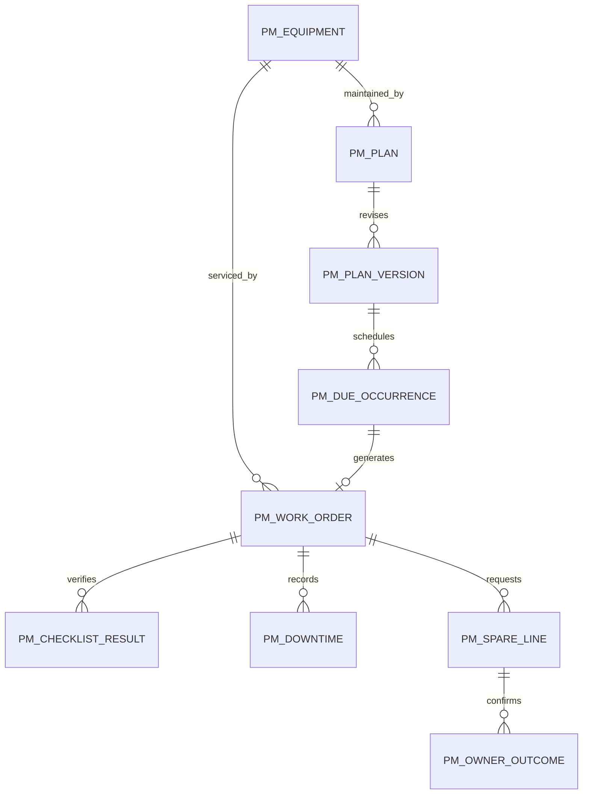

# PM — Planned data structure

WU-PM-000d assigns no `REQ_DS43` and adds no migration. Candidate PM aggregates are equipment, plan/version, meter reading, due occurrence, work order, checklist result, downtime event, spare request/line and owner outcome. Implementation units specify real columns, decimal scales, unique/foreign keys, indexes, check constraints and reversible migrations. All PM aggregates are company-scoped, audited and versioned. Cross-module IDs have no SQL foreign key or EF navigation.

FI asset and GL entries, INV reservations and movements, MD items and locations, and SYS approvals remain owner data. PM stores immutable source IDs, versions and confirmation tokens for traceability only.
