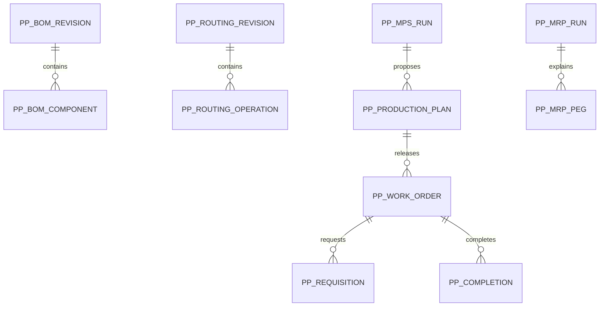

# PP — Planned data structure

No PP migration or `REQ_DS43` allocation in WU-PP-000d. Candidate PP-owned aggregates are BOM group/revision/component, routing revision/operation, MPS run and demand snapshot, MRP run/peg/proposal, production plan, work order, requisition/line, completion/line and work-centre calendar/progress. All company and site keys are scoped; MD, SYS, SD, PUR and INV references are IDs without cross-module foreign keys. Exact columns, indexes, consistency constraints and requirement IDs belong to each migration slice.

The diagram is conceptual, not an implemented schema. INV movement references are stored as confirmed external IDs; the stock movement remains INV-owned.
