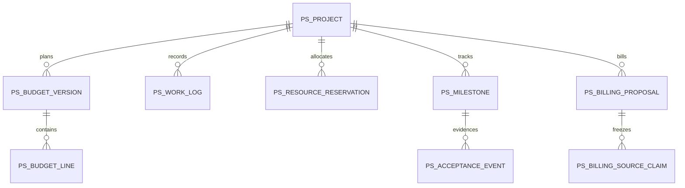

# PS — Planned data structure

WU-PS-000d allocates no `REQ_DS43` and creates no migration. Candidate company-scoped aggregates: project and state event, budget version and line, work log and correction, resource reservation, milestone and acceptance event, billing proposal and source claim. Implementation units must define decimal scales, FK indexes, unique keys including soft-deleted codes, optimistic versions, audit fields and reversible migrations. Cross-module customer, employee, SYS approval, SD invoice and FI journal IDs are scalar references without EF navigation or database FK.

PS saves confirmed owner IDs, versions and cutoff tokens. It never stores copied HR employment, SD invoice or FI posted facts as authoritative records.
