# PUR 資料結構

## WU-PUR-007c2 採購退貨 schema

| Requirement ID | Version | Table Name | Description | Author | 追溯 |
|---|---|---|---|---|---|
| REQ_DS43.223 | 1.0 | pur_purchase_return | 保存同公司採購單來源、永久唯一單號、業務日、Draft／PendingApproval／Rejected／Posted、資料範圍、軟刪、custom_fields 與審計。 | Developer | REQ_F4114.7.1～3 |
| REQ_DS43.224 | 1.0 | pur_purchase_return_line | 保存同公司退貨表頭與原收貨行、原 INV movement ID、物料／倉儲／儲位、六位正數量及過帳時才寫入的 OriginalUnitCost 快照。 | Developer | REQ_F4114.7.2～3 |
| REQ_DS43.225 | 1.0 | pur_purchase_return_line_tracking | 保存退貨行批號或單件序號及六位數量。 | Developer | REQ_F4114.7.2～3 |

三表均有 `id BIGINT IDENTITY`、`company_id`、建立／更新審計與 `version`；表頭單號 `NVARCHAR(50)` 在公司內永久唯一（軟刪亦不釋放），`custom_fields NVARCHAR(MAX)`。行的 `original_movement_id` 及物料／倉儲／儲位只存外部 ID，不建跨模組 FK。`(company_id,id)` alternate key 用於同公司 FK；表頭→採購單、行→表頭／收貨行、追蹤→行均有同公司 FK 與查詢索引；單內行號及行內追蹤序號唯一。CHECK 拒絕非正來源、數量或行號、負成本、無效狀態及不合法批序號。收貨行原有 `posted_returned`／`pending_return_reserved` 及 `ck_pur_receipt_line_quantities` 已防止兩者與開票／匹配量合計超過已收量，本切片不重建欄位。退貨服務在 007c3／c4 加鎖與重驗，資料庫 FK 只保證同公司存在，Posted 來源狀態與原 movement 一致性由應用／INV 契約驗。

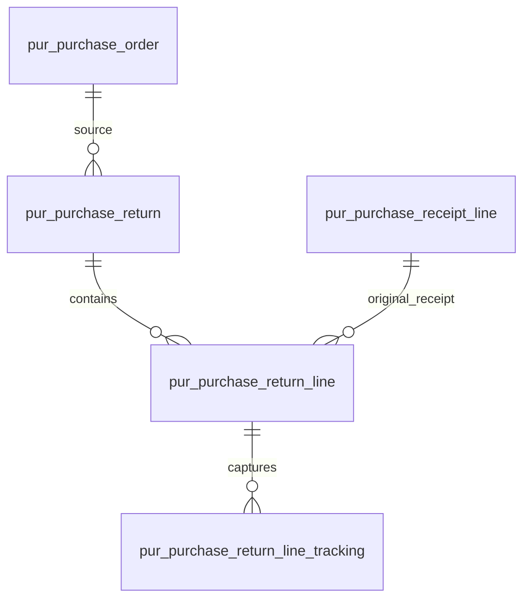

WU-PUR-007b2（2026-11-28T16:28:11+08:00，ADR-221）：新增 REQ_DS43.222 `pur_purchase_receipt_line_tracking`（migration `Purchasing_ReceiptLineTracking`，可逆）：`company_id`、`line_id`（FK `(company_id,line_id)` → `pur_purchase_receipt_line(company_id,id)` ON DELETE CASCADE）、`seq_no`、`lot_no nvarchar(50)`／`serial_no nvarchar(100)` 擇一、`quantity decimal(19,6)`、批號專用 `manufacture_date`／`expiry_date date` 與審計欄。CHECK：批號或序號擇一且非空、序號量 1 且無日期、量 > 0、seq_no > 0、有效期限 ≥ 生產日期；唯一索引 `(company_id,line_id,seq_no)` 兼作 FK 索引。草稿可不完整，SUBMIT 才要求合計等於行量；INV 過帳時建立 inv_lot／inv_serial。ER：`pur_purchase_receipt_line ||--o{ pur_purchase_receipt_line_tracking : "lot/serial capture"`。

WU-PUR-007a8（2026-11-28T15:19:42+08:00，ADR-218）：migration `Purchasing_ReceiptDraftSnapshots` 於 `pur_purchase_receipt` 加可空 `owner_id`／`branch_id`／`department_id`（SYS 資料範圍快照，索引 `(company_id,owner_id,id)`），`pur_purchase_receipt_line` 加可空 `unit_cost decimal(19,6)`（本位幣未稅單位成本快照 = 訂單行 base_net ÷ quantity，六位四捨五入）。舊來源列保持 NULL，可逆。

WU-PUR-008b4（2026-11-27T04:36:46+08:00，ADR-208）在 REQ_DS43.184 `pur_purchase_invoice` 增加可空欄位 `posted_at datetime2(6)`、`posted_from_version int`、`fi_purchase_source_id bigint`、`fi_payable_id bigint`、`fi_journal_id bigint`（FI 參照只存 ID，不建跨模組 FK）及 CHECK `ck_pur_invoice_posted`：status = Posted 時五欄皆有值且 ID／版本 > 0（以 `ISNULL(x,0) > 0` 避免 NULL 比較為 UNKNOWN 而通過），其他狀態五欄皆 NULL。Migration `20261126170236_Purchasing_InvoicePosting`（Down 刪 CHECK 與欄位）。

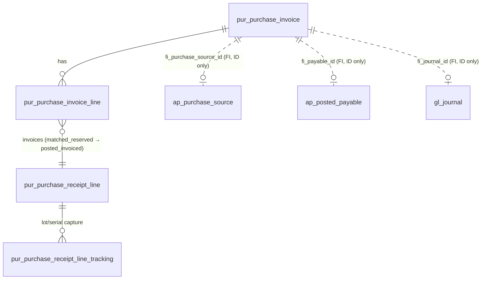

WU-PUR-008a51 沿用 REQ_DS43.183～185 與 008a50 的同公司來源 FK，無 schema 變更。發票表頭 `version` 由共用稽核攔截器在每次 EDIT 遞增；SQL IDENTITY 是 POST 回應 ID 的唯一來源。

WU-PUR-008a36 沿用 REQ_DS43.183～185 的持有列、發票表頭和行模型，沒有 schema 變更；實體圖與持有列共用同一發票 ID。

WU-PUR-008a35 沿用 REQ_DS43.183 的持有列欄位與索引；離線組裝只產生新列或既有追蹤列的 `is_active` 變更，不改 schema。真實 SQL Up／Down 與同交易寫入仍屬 008a。

## WU-PUR-008a32 Draft 發票表頭與行

| Requirement ID | Version | Table Name | Description | Author | 追溯 |
|---|---|---|---|---|---|
| REQ_DS43.184 | 1.0 | pur_purchase_invoice | 保存採購發票 Draft 表頭、供應商號碼與原幣四位總額。 | Developer | REQ_F4114.8.2, REQ_F4114.8.6 |
| REQ_DS43.185 | 1.0 | pur_purchase_invoice_line | 保存發票逐行收貨來源、六位數量與單價、四位原幣價稅。 | Developer | REQ_F4114.8.2, REQ_F4114.8.3 |

表頭以 `id BIGINT IDENTITY` 為主鍵；公司、供應商、採購單為正數 ID，原幣 `CHAR(3)`，業務日 `DATE`，顯示號與 BIN2 正規鍵各 `NVARCHAR(80)`，狀態 `VARCHAR(30)`，三項總額 `DECIMAL(19,4)`，另有軟刪、審計與版本欄位。`(company_id,id)` 為行的同模組複合參照鍵；公司加供應商或採購單與狀態索引供查詢；WU-PUR-008a55i 加非唯一索引 `ix_pur_purchase_invoice_company_id_business_date_id`（`company_id,business_date,id`，migration `Purchasing_InvoiceListDateIndex`），讓列表預設 `-businessDate`（再按 id）及日期區間篩選可索引搜尋並反向掃描取首頁，無須整公司排序。號碼永久唯一性由 `pur_purchase_invoice_number_claim` 負責。

行以 `id BIGINT IDENTITY` 為主鍵，`(company_id,invoice_id)` 參照表頭；`(company_id,invoice_id,line_no)` 唯一且支援行讀取，`(company_id,receipt_line_id)` 支援來源查詢。`Purchasing_InvoiceSourceLinks` 新增同模組、同公司發票→採購單與發票行→收貨行複合 FK，收貨行新增 `(company_id,id)` alternate key；其他跨模組來源 ID 仍為標量，不設 FK。數量與單價 `DECIMAL(19,6)`，稅率 `DECIMAL(9,4)`，淨額、稅額、含稅額 `DECIMAL(19,4)`；CHECK 限定正數來源、非負價稅及淨額加稅額等於含稅額。兩表均有審計與版本欄位。新關聯 migration 真實 SQL Down／Up 已驗，Draft 寫入交易與 HTTP 留 008a51／52。

## WU-PUR-008a29 供應商發票號永久持有表

| Requirement ID | Version | Table Name | Description | Author | Related REQ_F |
|---|---|---|---|---|---|
| REQ_DS43.183 | 1.0 | pur_purchase_invoice_number_claim | 保存發票活動與歷史正規化號碼鍵；改號及軟刪均不釋放舊鍵。 | Developer | REQ_F4114.8.2, REQ_F4114.8.6 |

`id BIGINT IDENTITY` 主鍵；`company_id`、`supplier_id`、`invoice_id` 均為正數 BIGINT；`number_key NVARCHAR(80) COLLATE Latin1_General_100_BIN2` 不可空；`is_active BIT` 表示目前表頭號碼。另有標準建立／更新審計欄位及 `version`。`(company_id,supplier_id,number_key)` 不過濾軟刪的唯一索引保障永久佔用；`(company_id,invoice_id,number_key)` 唯一索引阻止同張重複鍵；`(company_id,invoice_id,is_active)` 只在 active 為 1 時唯一，確保每張發票最多一個活動鍵；`(company_id,supplier_id,invoice_id)` 用於持有者讀取。資料表沒有軟刪旗標或軟刪篩選。同一張可有多個歷史鍵。008a42 另以可逆 migration `Purchasing_InvoiceClaimIdentityLink` 補 `(company_id,invoice_id)` 至發票表頭的同模組 FK，讓 EF 暫存鍵在保存時傳播實際 ID；無跨模組 FK。真實 SQL Up／Down、同交易及競態驗收仍屬 008a。

WU-PUR-008a30：`is_active` 切換採停用舊列後啟用／插入目標列的順序；歷史列不刪除。寫入者須在同一交易更新發票表頭及持有列，並以唯一索引封住兩個交易同時取得同鍵的競態。本輪只驗離線計畫，未套用 SQL。

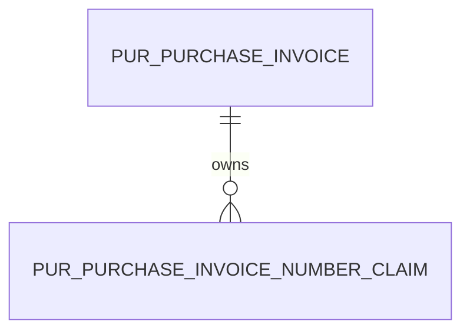

## WU-PUR-008d 發票與三單比對預定模型（尚未建表）

`pur_purchase_invoice` 保存公司、供應商、同一採購單、原幣、業務日、供應商發票號及其正規化鍵、Draft／Matched／Disputed／Rejected／Posted 狀態、版本、FI 應付來源 ID 與審計；正規化鍵由 BR-PUR-036a 產生，永久唯一佔用由 008a29 的 `pur_purchase_invoice_number_claim` 承擔。`pur_purchase_invoice_line` 保存收貨行、訂單行、基本單位六位數量、原幣單價及四位價稅額、訂單基準快照、差額和匹配狀態；`pur_invoice_resolution` 保存每行價／稅差異的接受或拒絕、理由、操作者、決定時間與當時版本。除號碼持有表外，正式表名、欄位及 REQ_DS43 ID 在 008a migration 分配，008d 沒有新增資料庫物件。
WU-PUR-008a21 的離線價格來源以收貨行 ID 關聯已保存訂單行 ID、物料、單價及稅率；輸出的基準／差異供規劃中的 `pur_purchase_invoice_line` 保存和 MATCH 重驗。此切片不新增資料表或 migration，正式欄位與 REQ_DS43 仍由 008a 分配。

收貨行增加 `matched_reserved_quantity` 和 `invoiced_quantity`，兩者 `DECIMAL(19,6)` 且非負；CHECK 保護兩者加 Posted 退貨及 Pending 退貨預留不超收貨量。發票狀態轉換與量轉換共用一個 SQL 交易，來源行升冪鎖。`(company_id,supplier_id,normalized_invoice_no)` 永久唯一，`(company_id,receipt_line_id)`、`(company_id,order_id,status,id)` 為查詢索引；同模組 FK 及每個 FK 欄位另建索引。FI、MD、SYS、INV 只存 ID，無跨模組 FK；FI 應付來源唯一性由 FI 契約保證。Posted 行、差異決定及來源鍵不可刪改；Down migration 和雙連線競態要在真實 SQL 驗收。

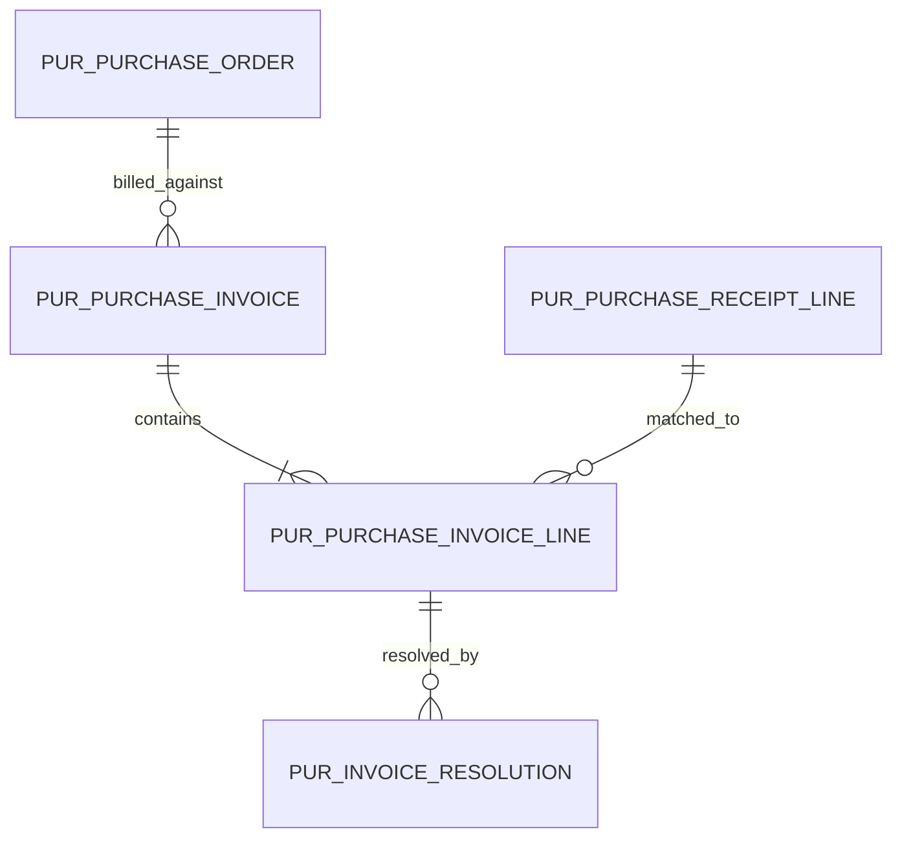

圖中 FI 應付僅為保存的外部 ID，沒有跨模組 FK。FI 原幣／本位幣確定金額由已保存訂單匯率與發票行價稅快照形成；不能由 FI 重新查 PUR 表。

## WU-PUR-007d 收貨與退貨原設計基線（交付狀態見上方 007a／007b／007c2）

WU-PUR-007a7（2026-11-28T13:01:04+08:00，ADR-218）：沿用既有發票來源用 `pur_purchase_receipt`／`pur_purchase_receipt_line`，加可空 `document_no`／`business_date`（保留歷史來源列）、草稿行 `quantity`／`warehouse_id`；採購單行加非空預設零的 `posted_received`／`pending_receipt_reserved`，migration 在加容量約束前由同公司有效 Posted 收貨行回填已收量。`(company_id,document_no)` 非空單號永久唯一。訂單行 SQL CHECK 守住兩量非負及總和不超訂單量；收貨行允許舊式正數已收行或正數草稿量加正數倉庫，保留退貨／開票量約束。`Purchasing_ReceiptDraftFoundation` 可逆；草稿 API、成本、儲位及追蹤欄仍待 007a8／007b。下文為原 007d 預案，未實作欄位不可視為已交付。

`pur_purchase_receipt`／`pur_purchase_receipt_line` 保存公司、單號、採購單與其行、業務日、倉儲／儲位、基本單位六位數量、本位幣未稅六位單位成本、批序號快照、狀態 Draft／PendingApproval／Rejected／Posted、版本、SYS 審批 ID 與審計。`pur_purchase_return`／`pur_purchase_return_line` 保存原 Posted 入庫行及 INV movement ID、原入庫成本／追蹤快照、退貨量和相同生命週期。實際退貨表欄位與 REQ_DS43.223～225 見上方 007c2。

採購單行要能在同交易維護待審收貨預留量與已過帳收貨量；入庫行要能維護待審退貨預留量與已過帳退貨量。各量以 `DECIMAL(19,6)`、非負及不超來源量 CHECK 保護。按 `(company_id,order_line_id)` 與 `(company_id,receipt_line_id)` 建查詢索引；同公司 PUR 內 FK 與每個 FK 欄位索引手動建立。對 MD／SYS／INV 只存 ID，不建跨模組 FK；`(company_id,document_no)` 永久唯一，來源行號在單據內唯一。已過帳來源連結和 movement ID 不可刪改。DB 交易與鎖序按 BR-PUR-028／032，migration 必須可 Down，並以真實 SQL 驗證約束、併發及隔離。

WU-PUR-007a3／007a4／007a6 僅規定待審／已收量轉移的離線原值與目標值及保存快照身份，不新增資料表或 migration；實際來源行兩種數量欄位、單據預留與已過帳證據仍由 007a／007b 建立並以真實 SQL 驗收。

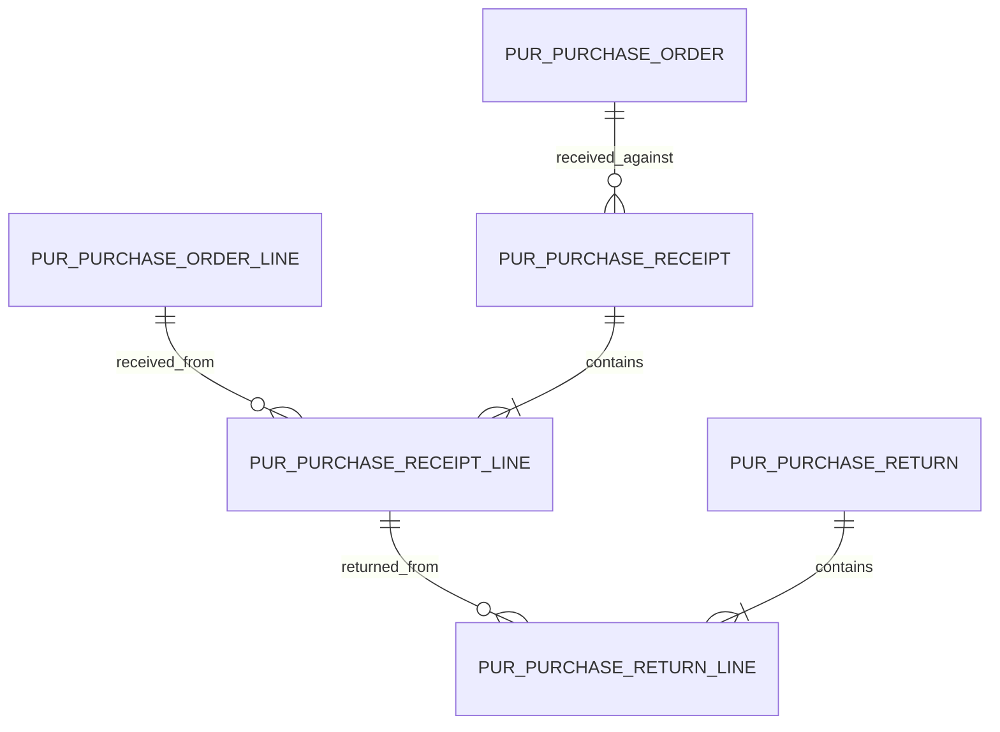

INV movement 與 SYS approval 僅為保存的外部 ID；圖中不畫跨模組 FK。Posted 後 INV 異動不可變，退貨新增另一方向異動。007a／007b 建表前要先解決 005e4／006a 的採購單行實體依賴。

## WU-PUR-006d 採購單與請購餘量設計（既有來源表待擴充）

2026-11-28T03:25:14+08:00，WU-PUR-006a 結構切片已在既有訂單表追加可空 `remark`、`original_net/tax/gross`，非空且預設 false 的 `requisition_consumption_active`，以及請購行同公司 FK、狀態／業務日索引與原幣金額 CHECK；舊發票來源列保持可讀。消耗計數沿用 `ordered_quantity`（ADR-213）。人工交易 API 與提交／釋回尚未交付。

`pur_purchase_order` 與 `pur_purchase_order_line` 已由發票來源工作單元建表，分配 REQ_DS43.186／187；005e4 須擴充這兩表並新增 `pur_order_source`，不得重建或建立第二個 EF 映射。006d 不分配新 ID，005e4 只為新來源連結分配 ID，既有兩表按變更記錄遞增版本。採購單表頭狀態已有 Draft／PendingApproval／Approved／Rejected／Cancelled，`deleted_at` 僅供未提交草稿軟刪；行待補 `requisition_line_id?`、基本單位數量與商業快照。轉單行的 `award_id` 經不可變來源連結追溯，禁止在編輯時替換或刪除。人工行沒有決標來源，可選同公司已核准請購行。

請購的已轉量沿用 `pur_requisition_line.ordered_quantity`（ADR-213），最初值為零；`remaining = quantity - ordered_quantity`，資料庫 CHECK 已限 `0 <= ordered_quantity <= quantity`。005e4 只建草稿時不增加它。提交時按請購行 ID 升冪取得更新鎖；先聚合同一請購行在本訂單的全部行，再核對餘量，逐行增加已轉量及寫 SYS 審批實例。駁回或允許的取消同交易按保存的訂單行精確扣回一次。訂單表頭保存 `requisition_consumption_active` 以防重複釋回；其狀態與請購已轉量在同一 SQL 交易中轉換。未引用請購的人工行不影響已轉量。

既有請購行欄位、索引與 CHECK 由後續 migration 補齊，`REQ_DS43.162` 版本屆時遞增；不新增跨模組 FK。訂單對請購行可用同公司複合 FK，對 MD／SYS 只存 ID 並走公開契約。查詢索引至少涵蓋 `(company_id,requisition_line_id)` 的訂單行、`(company_id,status,business_date,id)` 的訂單表頭；所有 FK 欄位另建索引。SQL 約束與應用服務共同守住精度、非負餘量及來源不可重用；不可變來源連結不得因取消或軟刪被移除。採購入庫關聯由 WU-PUR-007 建立，取消前須經其公開契約檢查沒有已保存入庫，不直接讀 INV 表。

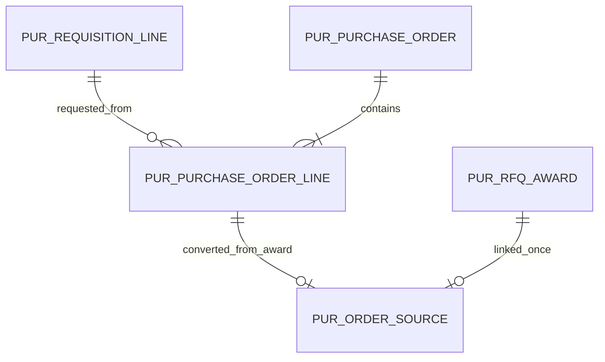

WU-PUR-005f3e 只增加按 QUOTE 權限投影既有 `pur_rfq` 保存行／邀請及 MD 公開選項的唯讀契約；不新增欄位、索引、關聯或 migration，以下 ER 圖保持不變。

WU-PUR-005f2c 的 CSV／列印只讀現有 `pur_rfq`、行及邀請快照；沒有新增欄位、索引、migration 或跨模組資料表存取。

## WU-PUR-005e4 轉單草稿設計（資料結構 migration 已建，CONVERT 待實作）

既有 `pur_purchase_order`、`pur_purchase_order_line` 分別已配 REQ_DS43.186／187 並供三單比對、發票過帳使用，005e4 只擴充兩表；新建 `pur_order_source` 一表並為其分配下一個 REQ_DS43 ID。表頭需補 SYS 永久唯一單號、詢價 ID、業務日、擁有人／分店／部門、原幣與本位幣總額；保留已有的 `supplier_id`、`currency`、`base_currency_code`、`exchange_rate`、狀態、審計及版本，不更名或移除。單據只能來自同一詢價的一個供應商；不同決標行若原幣不同則拒絕同單轉換。行保留既有 `purchase_order_id`、`material_id`、數量、單價、稅率，補可空請購行 ID 及決標稅率／匯率、逐行金額快照。新欄對既有來源夾具須可平滑遷移，避免破壞發票流程。來源連結保存訂單行 ID 與決標 ID，`(company_id,award_id)` 永久唯一，不因日後取消訂單而刪除。

新來源表用 `bigint identity`、`company_id`、審計時間／用戶及 `version`；同公司複合 FK 連結既有訂單行與決標，不對 MD／SYS 建 FK。為既有表補 `(company_id,document_no)` 永久唯一，沿用既有 `(company_id,purchase_order_id,line_no)` 唯一索引。每個新 FK 欄位建索引。SQL CHECK 限正數 ID／數量、非負價格與金額及金額守恆；005e4 新建訂單只能為 Draft。Application 在送 SQL 前拒絕超六位小數，以免 SQL 自動取整。來源連結不允許 UPDATE／DELETE。migration 的 Down 先刪新來源表，再撤回新增欄位／約束，保留既有兩表及所有發票資料；須以真實 SQL 驗證升級、還原與既有發票回歸。

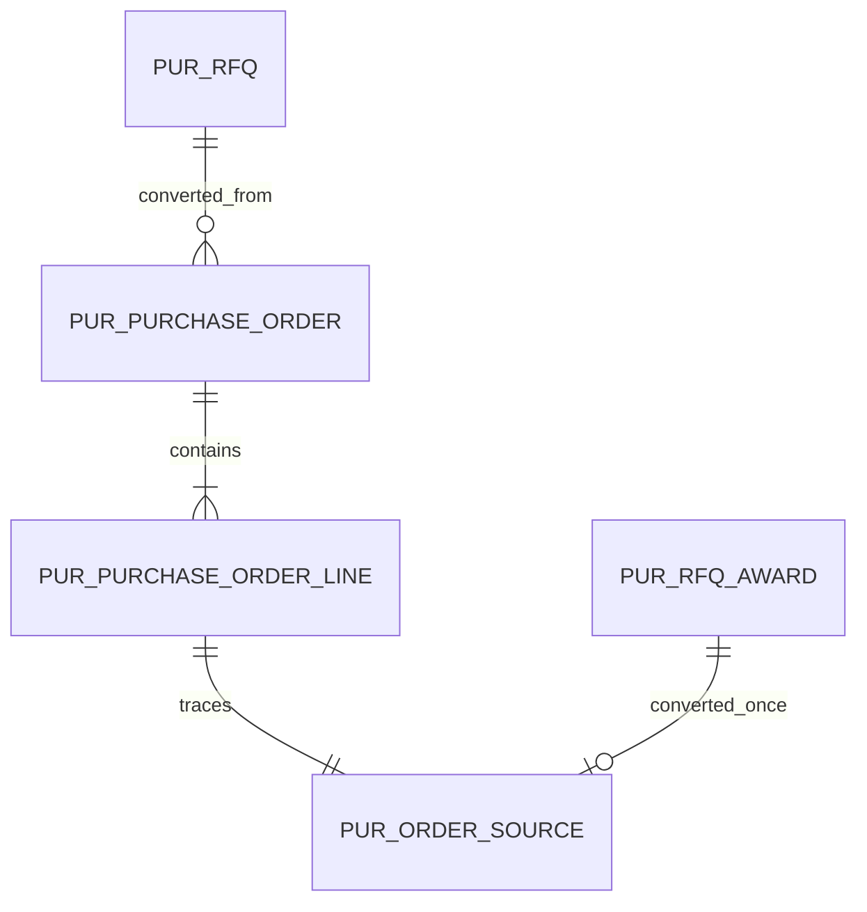

## WU-PUR-005e3 決標快照

`Purchasing_RfqAward` migration 新增 `pur_rfq_award`（REQ_DS43.169），每個詢價行只容一筆決標；`(company_id,rfq_line_id)` 唯一且有同公司詢價行、報價行複合外鍵。表保存詢價／報價／供應商來源 ID、理由、數量、原幣六位單價、原幣及本位幣代碼、稅率 ID／百分比／生效期間、匯率 ID／數值／生效期間、比較業務日與本位幣淨額／稅額／含稅額。MD ID 僅供追溯，不建跨模組外鍵；索引涵蓋來源、供應商及稅率／匯率查詢。SQL CHECK 限正數數量／匯率、非負價格／金額及金額加總；觸發器禁止 UPDATE／DELETE，Down 可逆刪表。應用服務在同交易驗報價行確屬目前報價與詢價，鎖詢價表頭並遞增版本，避免同版兩個決標同時通過。

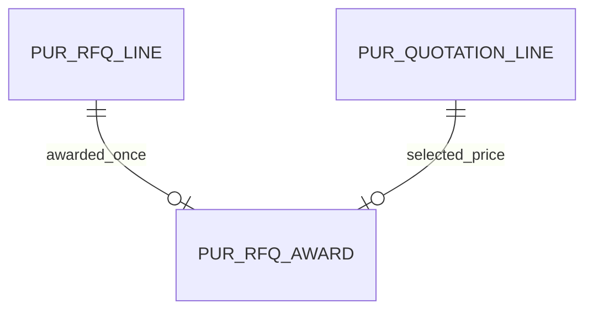

| Requirement ID | Version | Table Name | Description | Author | Related REQ_F |
|---|---|---|---|---|---|
| REQ_DS43.169 | 1.0 | pur_rfq_award | This table stores immutable per-line quotation awards and dated commercial snapshots. | Developer | REQ_F4114.6.2 |

## WU-PUR-005e1 比價依賴的主檔快照契約

本切片不新增 PUR 資料表或 REQ_DS43 ID。後續比價／決標只經 MD 公開契約取得匯率與稅率值、生效期間及來源 ID；不得建立指向 MD 表的 PUR 外鍵或直接讀其表。決標快照表於 005e3 落地；採購單草稿表留 005e4。

## WU-PUR-005d1 供應商報價版本資料表

`Purchasing_SupplierQuotation` migration 建立 `pur_supplier_quotation`、`pur_quotation_revision`、`pur_quotation_line`（REQ_DS43.166～168）。報價表頭以同公司 `(rfq_id,supplier_id)` 唯一，複合 FK 指向詢價邀請；狀態為 Active／Withdrawn／Awarded，`current_revision_no` 是應用服務在同交易維護的目前修訂號。修訂版存報價日、有效期與備註；行存詢價行 ID、六位小數原幣單價、三字元幣別和 MD 稅率 ID。MD 引用只存 ID，不建跨模組 FK；005d3 寫入時須驗證其有效性與幣別。版本及行以 SQL 觸發器拒絕 UPDATE／DELETE，修訂必須新增版本；撤回只改表頭狀態。報價與修訂／行均有審計和版本欄位。

同公司複合 FK 鎖定報價所屬邀請、修訂所屬表頭及行所屬修訂／詢價行；同一修訂的詢價行唯一。行的 `rfq_line_id` 是否屬於報價表頭的同一詢價，仍須由 005d3 Application 同交易驗證。`decimal(19,6)` 可能自行取整，API 另需先拒絕超六位。索引支援公司／詢價／供應商、狀態、修訂號、詢價行及稅率查詢。可逆 migration 的 Down 移除三表及新複合鍵。

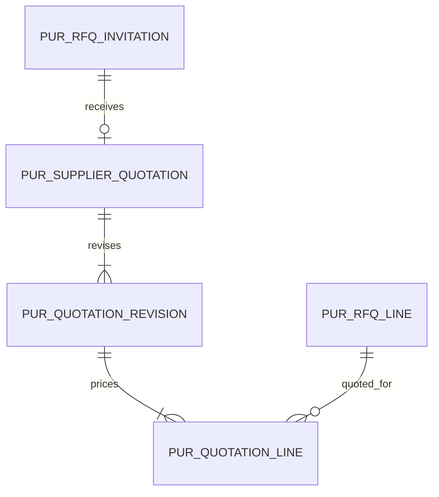

| Requirement ID | Version | Table Name | Description | Author | Related REQ_F |
|---|---|---|---|---|---|
| REQ_DS43.166 | 1.0 | pur_supplier_quotation | This table stores one company-scoped supplier quotation header per RFQ invitation. | Developer | REQ_F4114.5.1, REQ_F4114.5.2, REQ_F4114.5.3, REQ_F4114.5.4 |
| REQ_DS43.167 | 1.0 | pur_quotation_revision | This table stores immutable dated quotation revisions. | Developer | REQ_F4114.5.1, REQ_F4114.5.2, REQ_F4114.5.3 |
| REQ_DS43.168 | 1.0 | pur_quotation_line | This table stores immutable per-line prices, currencies and tax references. | Developer | REQ_F4114.5.1, REQ_F4114.5.2, REQ_F4114.5.3 |

## WU-PUR-005b 詢價草稿資料表

`Purchasing_RfqDraft` migration 已建立 `pur_rfq`、`pur_rfq_line`、`pur_rfq_invitation`。表頭保存永久唯一的公司單號、業務日、回覆期限、負責人及組織歸屬、草稿／已發送／關閉狀態、送出時間和軟刪欄位。行保存物料、可空的同公司請購行來源、需求日及 `decimal(19,6)` 數量；邀請保存 MD 供應商 ID，發送時填入代碼／名稱和時間快照。三表均有 `bigint identity` 主鍵、公司、審計及版本欄位。MD／SYS 引用只有 ID，沒有跨模組 FK；請購來源使用 `(company_id,requisition_line_id)` 複合 FK。此切片只有持久化模型，草稿 API 與引用有效性檢查留 005c。

`(company_id,document_no)` 永久唯一，即使草稿軟刪仍不能重用；`(company_id,rfq_id,line_no)` 及 `(company_id,rfq_id,supplier_id)` 唯一。子表以 `(company_id,rfq_id)` 複合 FK 指向表頭，禁止跨公司拼接；已發送資料無級聯刪除。日期、狀態、正數 ID／數量及邀請快照完整性有 SQL CHECK。索引涵蓋公司／日期、狀態、負責人、分店、部門列表及子表的物料、來源請購行、供應商查詢。前端和 Application 仍需在送 SQL 前拒絕多於六位小數，因 SQL `decimal(19,6)` 可能自行取整。

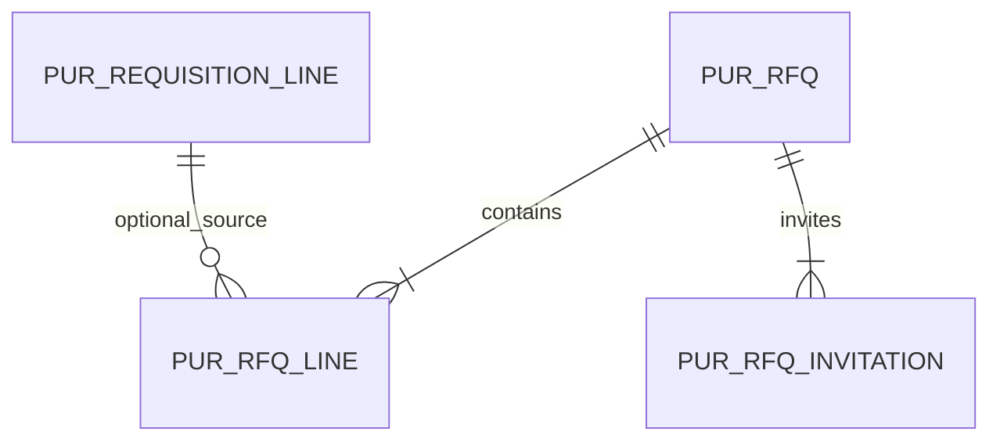

| Requirement ID | Version | Table Name | Description | Author | Related REQ_F |
|---|---|---|---|---|---|
| REQ_DS43.163 | 1.0 | pur_rfq | This table stores company-scoped requests for quotation, document numbers, deadlines and send state. | Developer | REQ_F4114.4.1, REQ_F4114.4.2, REQ_F4114.4.3, REQ_F4114.4.4, REQ_F4114.4.5, REQ_F4114.4.6 |
| REQ_DS43.164 | 1.0 | pur_rfq_line | This table stores item demand, quantities and optional requisition line references for requests for quotation. | Developer | REQ_F4114.4.1, REQ_F4114.4.2, REQ_F4114.4.3, REQ_F4114.4.4 |
| REQ_DS43.165 | 1.0 | pur_rfq_invitation | This table stores invited supplier IDs and send-time name snapshots. | Developer | REQ_F4114.4.1, REQ_F4114.4.2, REQ_F4114.4.4 |

## WU-PUR-005a 詢價至轉單資料模型預案（尚未建表）

此段是 WU-PUR-005b／d／e 的建模契約；詢價三表已在 005b 落地，報價三表在 005d 落地，決標表在 005e3 落地；採購單既有兩表已擴充，005e4 新增來源連結表與 REQ_DS43.213，CONVERT 寫入流程待實作。詢價表頭保存公司、單號、業務日期、回覆期限、負責人／分店／部門、狀態、版本及審計；詢價行保存 MD 物料 ID、請購行 ID（可空）、基本單位數量與需求日期；邀請表保存供應商 ID 及發送快照。報價表頭保存詢價及供應商、有效期、目前修訂號與狀態；報價版本與行保存不可變的價格、幣別、稅別及原始商務條件。決標行保存詢價行／報價版本行與換算快照、理由；轉單狀態由 005e4 的獨立來源連結表示。採購單完整工作流程由 006 補足。

同模組子表使用 `(company_id,parent_id)` 複合 FK 與索引；公司單號永久唯一，邀請名單 `(company_id,rfq_id,supplier_id)` 唯一，報價同一詢價／供應商只有一筆目前有效表頭，修訂版本以 `(company_id,quotation_id,revision_no)` 唯一；決標來源行及轉單來源以唯一約束防重。所有 FK 欄位另有查詢索引。MD／SYS ID 僅存 ID，透過其公開契約驗證，不建立跨模組 FK。金額 `decimal(19,4)`、單價 `decimal(19,6)`、數量 `decimal(19,6)`、匯率 `decimal(19,8)`，業務日期 `date`，建立／修訂時間 `datetime2(6)`；具體 SQL CHECK、可逆 migration 與索引效能在建表切片驗證。

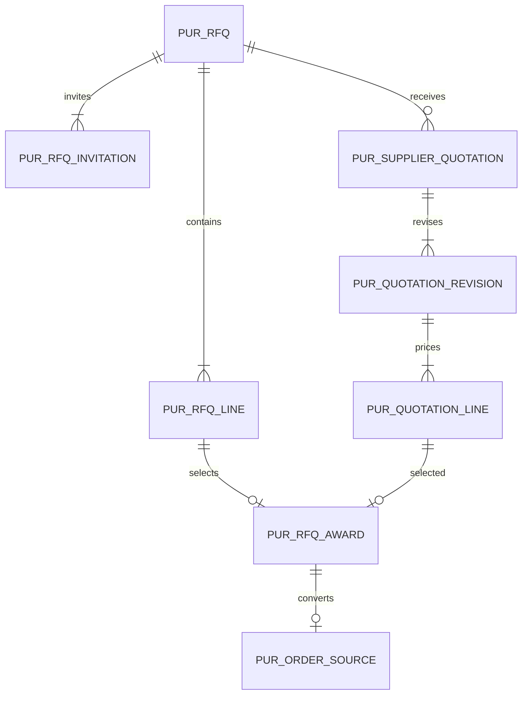

詢價不消耗請購餘量；決標也不消耗。後續採購單提交時才以行鎖及請購累計量約束核實剩餘數量。詢價或報價被引用後保留歷史，不級聯刪除；軟刪限未發送草稿。所有表具公司、建立者／建立時間、更新者／更新時間、版本與軟刪欄位（適用時），遵循第 6 節。

## WU-PUR-002a 請購資料表

`Purchasing_RequisitionDraft` migration 建立 `pur_requisition` 表頭及 `pur_requisition_line` 明細。表頭有公司、SYS 單號、業務日期、請購人 ID、狀態、備註、審計、版本及軟刪欄位；明細有公司、表頭 ID、行號、MD 物料 ID、需求日期、六位基本單位數量、已轉採購數量、備註及審計。兩表使用 `bigint identity` 主鍵，日期為 `date`，數量為 `decimal(19,6)`；表頭 `(company_id,document_no)` 永久唯一，行 `(company_id,requisition_id,line_no)` 唯一。公司／日期／ID、公司／狀態／ID、公司／請購人／ID 支援列表索引；行表頭外鍵由唯一索引涵蓋，物料另有公司複合索引。MD／SYS ID 只保存，不建立跨模組 FK 或 navigation。

`Purchasing_RequisitionDataScope` 增加表頭可空的 `branch_id`、`department_id`，並分別建立 `(company_id,branch_id,id)`、`(company_id,department_id,id)` 索引。既有記錄未填組織歸屬時，分店／部門資料範圍不可見，只有本人或全公司可見；建立端點須從 SYS 當前授權寫入歸屬，不能信任用戶提供的組織 ID。

已核准數量是請購行數量，後續採購單消耗的累計量只由 PUR 同交易維護，並受 `0 ≤ 已轉採購量 ≤ 請購量` 守衛；請購本身不產生庫存異動。後續轉單設計須以同公司與行鎖避免雙重引用。

WU-PUR-002b2c 不變更資料庫結構。修改草稿或駁回單時在交易內刪除原行並插入整組新行，沿用同公司複合 FK 與行號唯一約束；表頭單號與建立歸屬保持不變。軟刪只改表頭 `is_deleted`、`deleted_at`，單號唯一索引仍保留舊號。

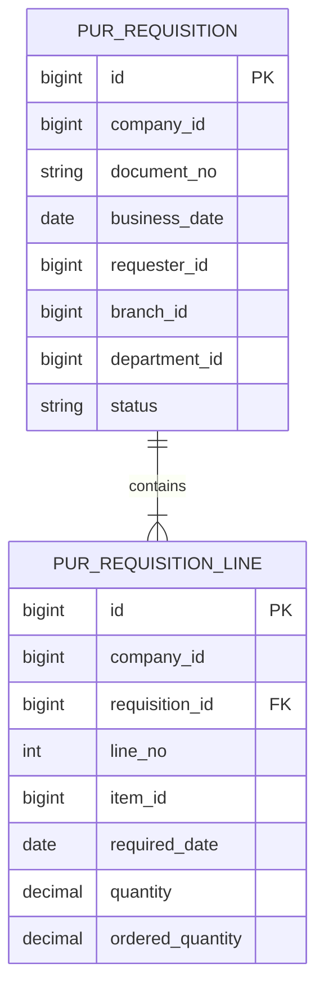

| Requirement ID | Version | Table Name | Description | Author | Related REQ_F |
|---|---|---|---|---|---|
| REQ_DS43.161 | 1.0 | pur_requisition | This table stores company-scoped purchase requisition headers, document numbers and approval state. | Developer | REQ_F4114.3.1, REQ_F4114.3.2, REQ_F4114.3.3, REQ_F4114.3.4, REQ_F4114.3.5, REQ_F4114.3.6 |
| REQ_DS43.162 | 1.0 | pur_requisition_line | This table stores ordered item demand, required dates, quantities and downstream order consumption. | Developer | REQ_F4114.3.1, REQ_F4114.3.2, REQ_F4114.3.3, REQ_F4114.3.4 |
## WU-PUR-008a46 — Invoice draft source storage baseline

The four PUR-owned tables store company-scoped order identity, order-line price and tax snapshots, posted receipt identity and receipt-line quantity counters. Same-module composite foreign keys prevent a receipt line from referencing an order line or receipt in another company. Each foreign key has a supporting index; quantity and status checks reject invalid stored states. `Purchasing_InvoiceSources` and the Draft/number-claim tables were applied to the isolated `myerp_test` database in WU-PUR-008a50. The source-link migration was reversed and reapplied with existing order, invoice and claim rows retained. The order and receipt product writers remain in WU-PUR-005e4/006a/007a; no production database application is claimed.

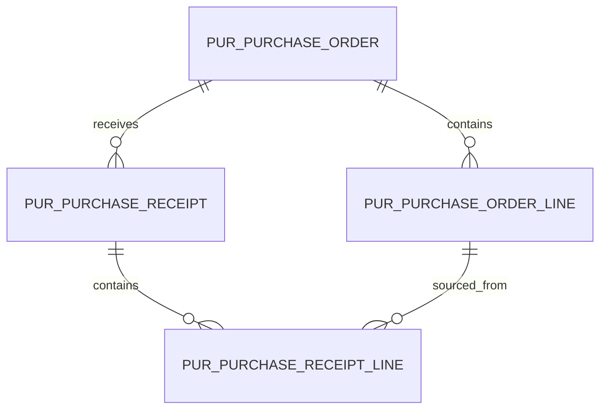

| Requirement ID | Version | Table Name | Description | Author | Related REQ_F |
|---|---|---|---|---|---|
| REQ_DS43.186 | 1.3 | pur_purchase_order | This table stores company-scoped purchase order supplier, currency, number, totals, remark, requisition consumption state and cancellation reason. | Developer | REQ_F4114.1.2, REQ_F4114.1.6, REQ_F4114.6.3, REQ_F4114.8.2 |
| REQ_DS43.187 | 1.3 | pur_purchase_order_line | This table stores order line price, tax, exchange, amounts, requisition source, and receipt capacity counters. | Developer | REQ_F4114.1.2, REQ_F4114.2.2, REQ_F4114.2.4, REQ_F4114.8.3 |
| REQ_DS43.188 | 1.1 | pur_purchase_receipt | This table stores purchase receipt order, supplier, currency, optional draft document number and business date, and posting identity. | Developer | REQ_F4114.2.2, REQ_F4114.8.2 |
| REQ_DS43.211 | 1.1 | pur_purchase_receipt_line | This table stores receipt line order references, optional draft quantity and warehouse, and committed quantity counters. | Developer | REQ_F4114.2.2, REQ_F4114.8.2 |
| REQ_DS43.222 | 1.0 | pur_purchase_receipt_line_tracking | This table stores the lot or serial numbers (with optional lot manufacture and expiry dates) captured on a purchase receipt line; INV creates lots and serials from them when the receipt posts. | Developer | REQ_F4114.2.2, REQ_F4114.2.5 |

Change record (2026-11-25T21:44:40+08:00, WU-P0-043): the receipt-line source row originally reused REQ_DS43.189, which ADR-106 assigns to FI `ar_sales_source`. The row now has the next unallocated ID, REQ_DS43.211; table identity, schema and related functional requirements are unchanged. The duplicate historical ID is not reused for another table.

Change record (2026-11-27T09:49:20+08:00, WU-PUR-005e4): REQ_DS43.186／187 move to 1.1 for nullable conversion fields and amount checks. Existing invoice-source rows retain their columns and values. The new award link has its own ID below.

Change record (2026-11-28T07:35:31+08:00, WU-PUR-006c2): REQ_DS43.186 moves to 1.3 for nullable `cancel_reason nvarchar(500)` and `ck_pur_order_cancel_reason` (a reason is only valid on a Cancelled order). Reversible migration `Purchasing_OrderCancelReason` preserves existing order rows; no new table ID.

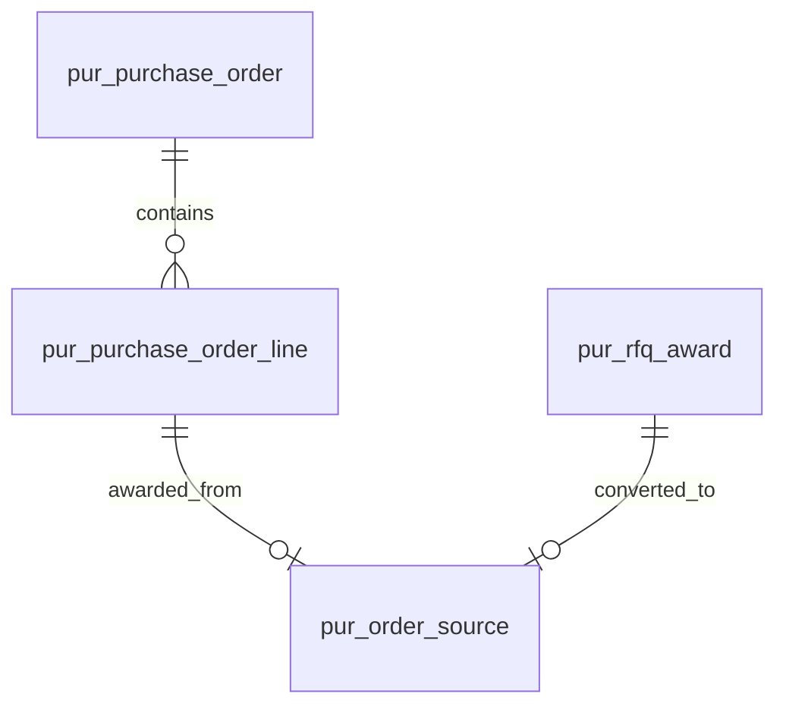

| Requirement ID | Version | Table Name | Description | Author | Related REQ_F |
|---|---|---|---|---|---|
| REQ_DS43.213 | 1.0 | pur_order_source | This table keeps a permanent company-scoped link between a purchase order line and its selected RFQ award. | Developer | REQ_F4114.6.3 |

`Purchasing_OrderConversionSource` extends the two existing order tables and creates only `pur_order_source`. The link has unique `(company_id, award_id)` and `(company_id, purchase_order_line_id)` indexes, same-company foreign keys to line and award, and an UPDATE／DELETE rejection trigger. New order fields are nullable for pre-existing invoice-source rows. The migration Down removes only the new link and fields; it does not drop either existing order table. Conversion writing and full Up／Down preservation verification remain pending.

## WU-PUR-008a54 — Invoice difference resolution history

`pur_purchase_invoice_resolution` keeps one immutable row per decided line of a Disputed invoice (ADR-201). Columns: `invoice_id`, `invoice_version` (version the decision applied to), `line_no`, `action` (`Accept`／`Reject`, CHECK), `reason` (nvarchar(500), trimmed, CHECK non-empty), `net_difference`／`tax_difference`／`gross_difference` (decimal(19,4), invoice minus order basis at decision time) plus standard company, audit and version columns. The same-company composite FK `fk_pur_purchase_invoice_resolution_invoice` restricts deletion; unique index `(company_id, invoice_id, invoice_version, line_no)` also supports the FK lookup. Re-MATCH followed by another RESOLVE appends rows under the new version. Migration `Purchasing_InvoiceResolution` was reversed and reapplied on `myerp_test` (table 1→0→1, invoice rows retained); not applied to production `myerp`.

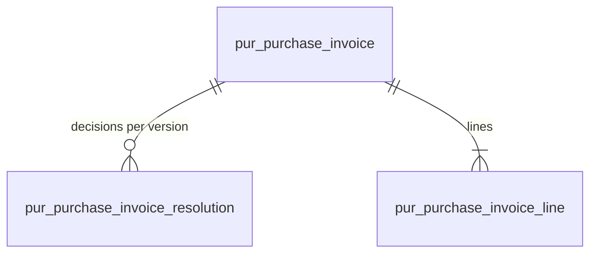

| Requirement ID | Version | Table Name | Description | Author | Related REQ_F |
|---|---|---|---|---|---|
| REQ_DS43.212 | 1.0 | pur_purchase_invoice_resolution | This table stores per-line accept or reject decisions, reasons and differences for disputed purchase invoices. | Developer | REQ_F4114.8.4 |

## WU-PUR-008b2 — Purchase-order exchange-rate snapshot (ADR-206)

`pur_purchase_order` (REQ_DS43.186) gains `base_currency_code char(3) NULL` and `exchange_rate decimal(19,8) NULL` (1 order currency = rate × base currency), mirroring `sal_order`. CHECK `ck_pur_order_rate_snapshot` requires both to be null (pre-WU-PUR-006a placeholder rows) or both present with a positive rate, and rate 1 when order currency equals base currency; each comparison is guarded by `IS NOT NULL` so an UNKNOWN result cannot pass. No new index: the posting read is a primary-key seek inside the order-header lock. Migration `Purchasing_OrderRateSnapshot` was reversed and reapplied on `myerp_test` (columns 2→0→2, constraint recreated); not applied to production `myerp`. WU-PUR-006a writes both columns when it creates orders.

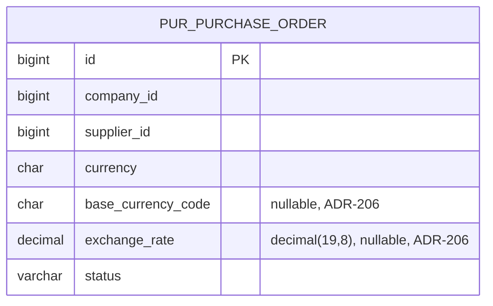
