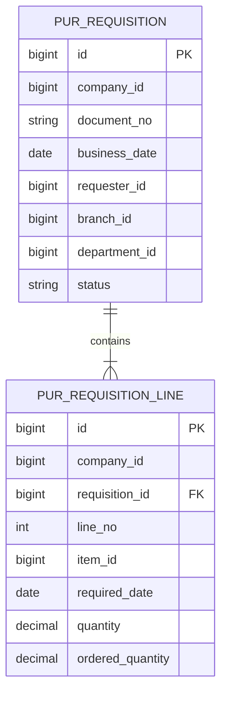

# PUR 資料結構

## WU-PUR-002a 請購資料表

`Purchasing_RequisitionDraft` migration 建立 `pur_requisition` 表頭及 `pur_requisition_line` 明細。表頭有公司、SYS 單號、業務日期、請購人 ID、狀態、備註、審計、版本及軟刪欄位；明細有公司、表頭 ID、行號、MD 物料 ID、需求日期、六位基本單位數量、已轉採購數量、備註及審計。兩表使用 `bigint identity` 主鍵，日期為 `date`，數量為 `decimal(19,6)`；表頭 `(company_id,document_no)` 永久唯一，行 `(company_id,requisition_id,line_no)` 唯一。公司／日期／ID、公司／狀態／ID、公司／請購人／ID 支援列表索引；行表頭外鍵由唯一索引涵蓋，物料另有公司複合索引。MD／SYS ID 只保存，不建立跨模組 FK 或 navigation。

`Purchasing_RequisitionDataScope` 增加表頭可空的 `branch_id`、`department_id`，並分別建立 `(company_id,branch_id,id)`、`(company_id,department_id,id)` 索引。既有記錄未填組織歸屬時，分店／部門資料範圍不可見，只有本人或全公司可見；建立端點須從 SYS 當前授權寫入歸屬，不能信任用戶提供的組織 ID。

已核准數量是請購行數量，後續採購單消耗的累計量只由 PUR 同交易維護，並受 `0 ≤ 已轉採購量 ≤ 請購量` 守衛；請購本身不產生庫存異動。後續轉單設計須以同公司與行鎖避免雙重引用。

WU-PUR-002b2c 不變更資料庫結構。修改草稿或駁回單時在交易內刪除原行並插入整組新行，沿用同公司複合 FK 與行號唯一約束；表頭單號與建立歸屬保持不變。軟刪只改表頭 `is_deleted`、`deleted_at`，單號唯一索引仍保留舊號。

| Requirement ID | Version | Table Name | Description | Author | Related REQ_F |
|---|---|---|---|---|---|
| REQ_DS43.161 | 1.0 | pur_requisition | This table stores company-scoped purchase requisition headers, document numbers and approval state. | Developer | REQ_F4114.3.1, REQ_F4114.3.2, REQ_F4114.3.3, REQ_F4114.3.4, REQ_F4114.3.5, REQ_F4114.3.6 |
| REQ_DS43.162 | 1.0 | pur_requisition_line | This table stores ordered item demand, required dates, quantities and downstream order consumption. | Developer | REQ_F4114.3.1, REQ_F4114.3.2, REQ_F4114.3.3, REQ_F4114.3.4 |
