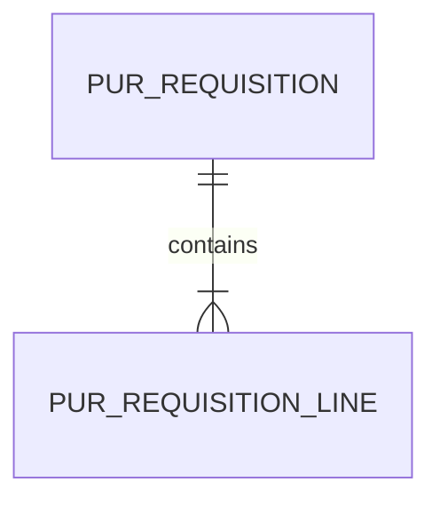

# PUR 資料結構

## WU-PUR-000 請購預計模型

WU-PUR-002 migration 落地時才分配 REQ_DS43 並登記正式表，避免 SRS 4.3 早於實際資料庫。預計 `pur_requisition` 表頭有公司、SYS 單號、業務日期、請購人 ID、狀態、備註、審計、版本及軟刪欄位；`pur_requisition_line` 有公司、表頭 ID、行號、MD 物料 ID、需求日期、六位基本單位數量、已轉採購數量、備註及審計。兩表使用 `bigint identity` 主鍵，日期為 `date`，數量為 `decimal(19,6)`；表頭 `(company_id,document_no)` 永久唯一，行 `(company_id,requisition_id,line_no)` 唯一。公司／日期／ID 與公司／狀態／ID 支援列表索引；行表頭外鍵建立索引。MD／SYS ID 只保存，不建立跨模組 FK 或 navigation。

已核准數量是請購行數量，後續採購單消耗的累計量只由 PUR 同交易維護，並受 `0 ≤ 已轉採購量 ≤ 請購量` 守衛；請購本身不產生庫存異動。後續轉單設計須以同公司與行鎖避免雙重引用。

