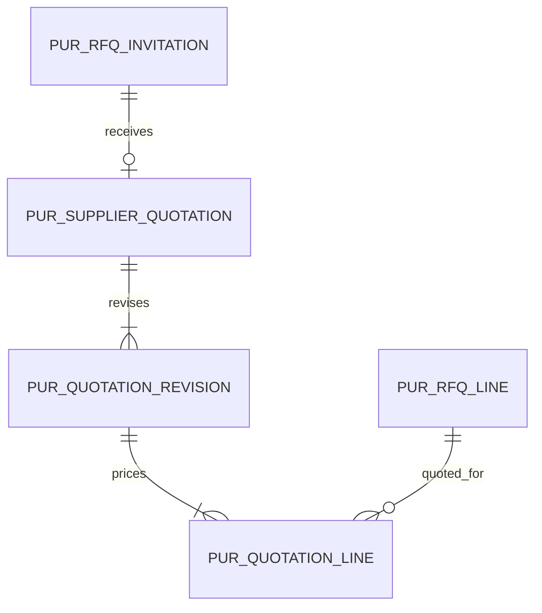
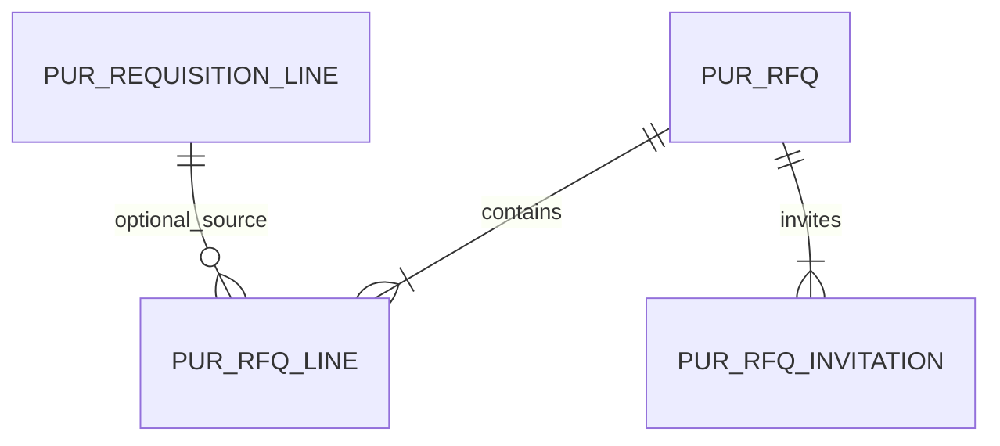
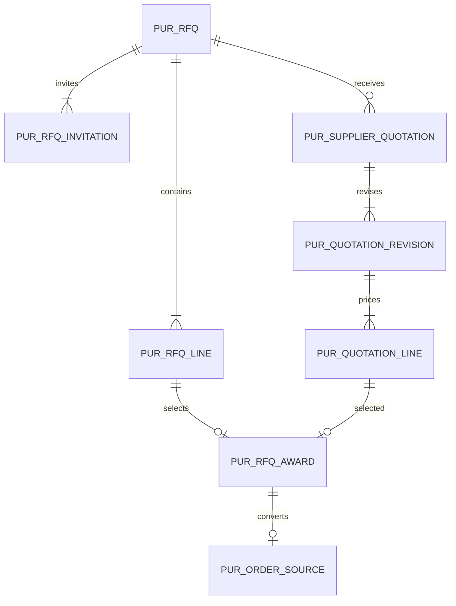
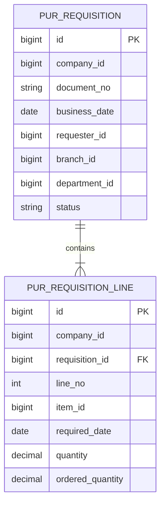

# PUR 資料結構

## WU-PUR-005d1 供應商報價版本資料表

`Purchasing_SupplierQuotation` migration 建立 `pur_supplier_quotation`、`pur_quotation_revision`、`pur_quotation_line`（REQ_DS43.166～168）。報價表頭以同公司 `(rfq_id,supplier_id)` 唯一，複合 FK 指向詢價邀請；狀態為 Active／Withdrawn／Awarded，`current_revision_no` 是應用服務在同交易維護的目前修訂號。修訂版存報價日、有效期與備註；行存詢價行 ID、六位小數原幣單價、三字元幣別和 MD 稅率 ID。MD 引用只存 ID，不建跨模組 FK；005d3 寫入時須驗證其有效性與幣別。版本及行以 SQL 觸發器拒絕 UPDATE／DELETE，修訂必須新增版本；撤回只改表頭狀態。報價與修訂／行均有審計和版本欄位。

同公司複合 FK 鎖定報價所屬邀請、修訂所屬表頭及行所屬修訂／詢價行；同一修訂的詢價行唯一。行的 `rfq_line_id` 是否屬於報價表頭的同一詢價，仍須由 005d3 Application 同交易驗證。`decimal(19,6)` 可能自行取整，API 另需先拒絕超六位。索引支援公司／詢價／供應商、狀態、修訂號、詢價行及稅率查詢。可逆 migration 的 Down 移除三表及新複合鍵。

| Requirement ID | Version | Table Name | Description | Author | Related REQ_F |
|---|---|---|---|---|---|
| REQ_DS43.166 | 1.0 | pur_supplier_quotation | This table stores one company-scoped supplier quotation header per RFQ invitation. | Developer | REQ_F4114.5.1, REQ_F4114.5.2, REQ_F4114.5.3, REQ_F4114.5.4 |
| REQ_DS43.167 | 1.0 | pur_quotation_revision | This table stores immutable dated quotation revisions. | Developer | REQ_F4114.5.1, REQ_F4114.5.2, REQ_F4114.5.3 |
| REQ_DS43.168 | 1.0 | pur_quotation_line | This table stores immutable per-line prices, currencies and tax references. | Developer | REQ_F4114.5.1, REQ_F4114.5.2, REQ_F4114.5.3 |

## WU-PUR-005b 詢價草稿資料表

`Purchasing_RfqDraft` migration 已建立 `pur_rfq`、`pur_rfq_line`、`pur_rfq_invitation`。表頭保存永久唯一的公司單號、業務日、回覆期限、負責人及組織歸屬、草稿／已發送／關閉狀態、送出時間和軟刪欄位。行保存物料、可空的同公司請購行來源、需求日及 `decimal(19,6)` 數量；邀請保存 MD 供應商 ID，發送時填入代碼／名稱和時間快照。三表均有 `bigint identity` 主鍵、公司、審計及版本欄位。MD／SYS 引用只有 ID，沒有跨模組 FK；請購來源使用 `(company_id,requisition_line_id)` 複合 FK。此切片只有持久化模型，草稿 API 與引用有效性檢查留 005c。

`(company_id,document_no)` 永久唯一，即使草稿軟刪仍不能重用；`(company_id,rfq_id,line_no)` 及 `(company_id,rfq_id,supplier_id)` 唯一。子表以 `(company_id,rfq_id)` 複合 FK 指向表頭，禁止跨公司拼接；已發送資料無級聯刪除。日期、狀態、正數 ID／數量及邀請快照完整性有 SQL CHECK。索引涵蓋公司／日期、狀態、負責人、分店、部門列表及子表的物料、來源請購行、供應商查詢。前端和 Application 仍需在送 SQL 前拒絕多於六位小數，因 SQL `decimal(19,6)` 可能自行取整。

| Requirement ID | Version | Table Name | Description | Author | Related REQ_F |
|---|---|---|---|---|---|
| REQ_DS43.163 | 1.0 | pur_rfq | This table stores company-scoped requests for quotation, document numbers, deadlines and send state. | Developer | REQ_F4114.4.1, REQ_F4114.4.2, REQ_F4114.4.3, REQ_F4114.4.4, REQ_F4114.4.5, REQ_F4114.4.6 |
| REQ_DS43.164 | 1.0 | pur_rfq_line | This table stores item demand, quantities and optional requisition line references for requests for quotation. | Developer | REQ_F4114.4.1, REQ_F4114.4.2, REQ_F4114.4.3, REQ_F4114.4.4 |
| REQ_DS43.165 | 1.0 | pur_rfq_invitation | This table stores invited supplier IDs and send-time name snapshots. | Developer | REQ_F4114.4.1, REQ_F4114.4.2, REQ_F4114.4.4 |

## WU-PUR-005a 詢價至轉單資料模型預案（尚未建表）

此段是 WU-PUR-005b／d／e 的建模契約；詢價三表已在 005b 落地，報價、決標及採購單表待後續 migration 與 REQ_DS43 ID。詢價表頭保存公司、單號、業務日期、回覆期限、負責人／分店／部門、狀態、版本及審計；詢價行保存 MD 物料 ID、請購行 ID（可空）、基本單位數量與需求日期；邀請表保存供應商 ID 及發送快照。報價表頭保存詢價及供應商、有效期、目前修訂號與狀態；報價版本與行保存不可變的價格、幣別、稅別及原始商務條件。決標行保存詢價行／報價版本行與換算快照、理由、轉單狀態。採購單草稿與來源連結於 005e 建立，完整欄位由 006 補足。

同模組子表使用 `(company_id,parent_id)` 複合 FK 與索引；公司單號永久唯一，邀請名單 `(company_id,rfq_id,supplier_id)` 唯一，報價同一詢價／供應商只有一筆目前有效表頭，修訂版本以 `(company_id,quotation_id,revision_no)` 唯一；決標來源行及轉單來源以唯一約束防重。所有 FK 欄位另有查詢索引。MD／SYS ID 僅存 ID，透過其公開契約驗證，不建立跨模組 FK。金額 `decimal(19,4)`、單價 `decimal(19,6)`、數量 `decimal(19,6)`、匯率 `decimal(19,8)`，業務日期 `date`，建立／修訂時間 `datetime2(6)`；具體 SQL CHECK、可逆 migration 與索引效能在建表切片驗證。

詢價不消耗請購餘量；決標也不消耗。後續採購單提交時才以行鎖及請購累計量約束核實剩餘數量。詢價或報價被引用後保留歷史，不級聯刪除；軟刪限未發送草稿。所有表具公司、建立者／建立時間、更新者／更新時間、版本與軟刪欄位（適用時），遵循第 6 節。

## WU-PUR-002a 請購資料表

`Purchasing_RequisitionDraft` migration 建立 `pur_requisition` 表頭及 `pur_requisition_line` 明細。表頭有公司、SYS 單號、業務日期、請購人 ID、狀態、備註、審計、版本及軟刪欄位；明細有公司、表頭 ID、行號、MD 物料 ID、需求日期、六位基本單位數量、已轉採購數量、備註及審計。兩表使用 `bigint identity` 主鍵，日期為 `date`，數量為 `decimal(19,6)`；表頭 `(company_id,document_no)` 永久唯一，行 `(company_id,requisition_id,line_no)` 唯一。公司／日期／ID、公司／狀態／ID、公司／請購人／ID 支援列表索引；行表頭外鍵由唯一索引涵蓋，物料另有公司複合索引。MD／SYS ID 只保存，不建立跨模組 FK 或 navigation。

`Purchasing_RequisitionDataScope` 增加表頭可空的 `branch_id`、`department_id`，並分別建立 `(company_id,branch_id,id)`、`(company_id,department_id,id)` 索引。既有記錄未填組織歸屬時，分店／部門資料範圍不可見，只有本人或全公司可見；建立端點須從 SYS 當前授權寫入歸屬，不能信任用戶提供的組織 ID。

已核准數量是請購行數量，後續採購單消耗的累計量只由 PUR 同交易維護，並受 `0 ≤ 已轉採購量 ≤ 請購量` 守衛；請購本身不產生庫存異動。後續轉單設計須以同公司與行鎖避免雙重引用。

WU-PUR-002b2c 不變更資料庫結構。修改草稿或駁回單時在交易內刪除原行並插入整組新行，沿用同公司複合 FK 與行號唯一約束；表頭單號與建立歸屬保持不變。軟刪只改表頭 `is_deleted`、`deleted_at`，單號唯一索引仍保留舊號。

| Requirement ID | Version | Table Name | Description | Author | Related REQ_F |
|---|---|---|---|---|---|
| REQ_DS43.161 | 1.0 | pur_requisition | This table stores company-scoped purchase requisition headers, document numbers and approval state. | Developer | REQ_F4114.3.1, REQ_F4114.3.2, REQ_F4114.3.3, REQ_F4114.3.4, REQ_F4114.3.5, REQ_F4114.3.6 |
| REQ_DS43.162 | 1.0 | pur_requisition_line | This table stores ordered item demand, required dates, quantities and downstream order consumption. | Developer | REQ_F4114.3.1, REQ_F4114.3.2, REQ_F4114.3.3, REQ_F4114.3.4 |
