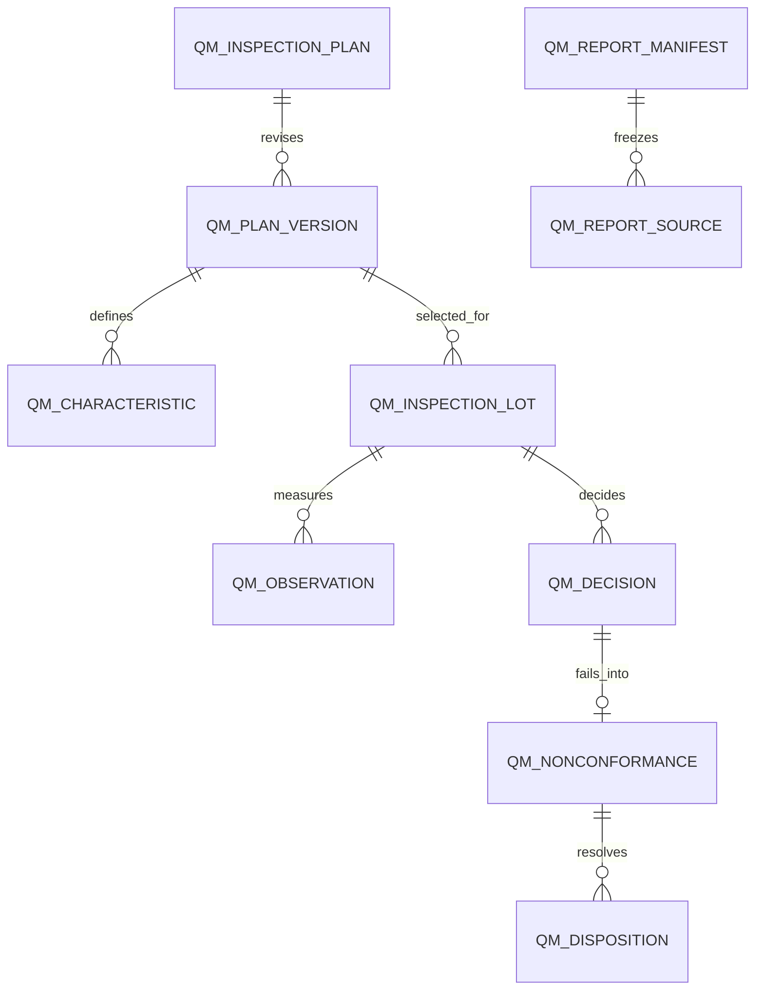

# QM — Planned data structure

WU-QM-000d assigns no `REQ_DS43` and adds no migration. Candidate QM-owned aggregates are inspection plan/version/characteristic, incoming and in-process lot/observation/decision, nonconformance case/disposition, and frozen report manifest. Implementation slices will specify actual columns, decimal scale, unique keys, indexes, constraints and reversible migrations. Every aggregate is company-scoped, audited and versioned. Cross-module source IDs have no SQL foreign key or EF navigation.

PUR receipt, PP work order/operation, INV movement/quarantine and MD item remain owner data. Source keys and owner confirmation tokens are stored as evidence, not replicated editable balances.
