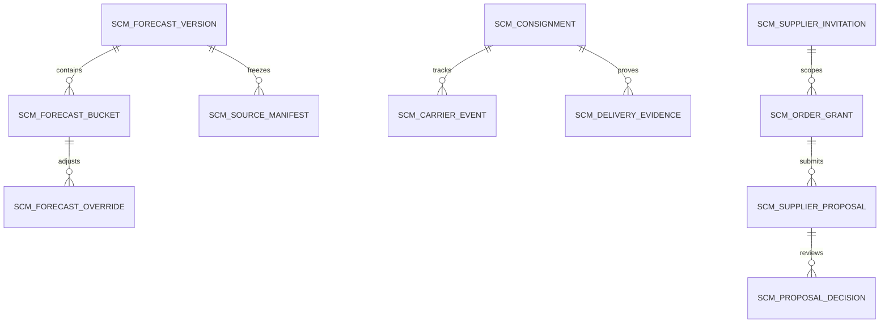

# SCM — Planned data structure

WU-SCM-000d allocates no `REQ_DS43` and creates no migration. Candidate company-scoped aggregates: forecast run/version, source manifest, bucket and override; consignment, carrier event and delivery evidence; supplier invitation, order grant, proposal and decision. Implementation units must define money/quantity scales, all local FK indexes, unique keys including soft-deleted history, optimistic versions, audit fields and reversible migrations. Foreign module IDs remain scalar references without EF navigation or database FK.

SCM stores confirmed owner IDs, versions and cutoff tokens. SD demand, PP plans, INV postings, PUR order/receipt and MD supplier records remain authoritative in their own modules.

WU-SCM-001d refinement: the planned source manifest also stores per-owner availability/reason, opaque committed cursor/schema version, row count and canonical digest; source rows retain raw/base UOM IDs and quantity, conversion path/version evidence, source state/direction and permanent owner lineage. Forecast version stores `SCM-SD-MA3-v1`, window/rounding parameters, three complete input bucket totals and approval snapshot. No `REQ_DS43` or migration is allocated until 001a defines physical tables and real SQL constraints.
