# SD data structure

WU-SD-003c3 receipt checkpoint (2026-11-19T01:00:13+08:00): the creator-only receipt query uses existing `sal_order.created_by`, company, soft-delete and action-scope fields. No table, index or migration change is required.

WU-SD-003a1 (2026-11-05T01:27:55+08:00): conversion preparation uses the existing `sal_order.source_quotation_id` and `sal_order_line.source_quotation_line_id` fields and their previously defined source uniqueness constraints. It adds no table or migration. The pure builder requires the saved quotation line count to be measured separately from loaded lines so a partial navigation load cannot silently create a partial order; the future SQL caller must perform both reads while holding the source lock.

WU-SD-003a2 (2026-11-05T01:36:37+08:00): the create-store source guard reuses those two columns and constraints. No schema or migration changes; actual converted inserts and source uniqueness remain for SQL verification in 003a.

## WU-SD-002a quotation schema checkpoint (2026-10-29T00:51:18+08:00)

Migration `20261028164921_Sales_QuotationDraft` creates the two SD quotation tables and has been applied to `myerp`. A real SQL integration test verifies both tables, permanent-number and ordered-line unique indexes, the same-company parent FK, and date, deletion and positive-quantity checks. This checkpoint contains schema only; quotation commands, SYS approval and authorised HTTP remain open.

| Requirement ID | Version | Table Name | Description | Author | Related REQ_F |
|---|---|---|---|---|---|
| REQ_DS43.174 | 1.0 | sal_quotation | This table stores sales quotation headers, approval state and saved commercial totals. | Developer | REQ_F4112.1.1, REQ_F4112.1.2, REQ_F4112.1.3 |
| REQ_DS43.175 | 1.0 | sal_quotation_line | This table stores ordered quotation item, tax and rounded amount snapshots. | Developer | REQ_F4112.1.2, REQ_F4112.1.3 |

The header has permanent unique `(company_id, document_no)`, business and expiry dates, positive exchange rate, status, approval timestamps, audit/version and Draft-only soft deletion. Lines have same-company parent FK, unique `(company_id, quotation_id, line_no)`, positive `decimal(19,6)` quantity, bounded price/discount/tax rate and six rounded `decimal(19,4)` amounts. Company/customer, company/status/date, company/expiry/status, company/branch/department/owner and line item/tax indexes support authorised lookup. MD and SYS identities remain scalar.

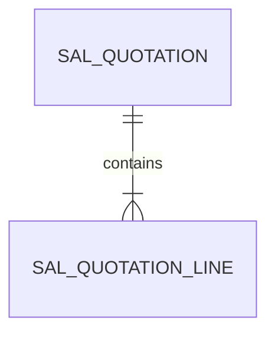

## WU-SD-003a order schema checkpoint (2026-10-27T10:48:32+08:00)

Migration `20261027024542_Sales_OrderDraft` was applied to `myerp`. Real SQL tests verified the two tables, same-company parent FK, source uniqueness, positive quantity and atomic rollback of an invalid line. This checkpoint does not provide order CRUD, quotation conversion, authorization or approval.

| Requirement ID | Version | Table Name | Description | Author | Related REQ_F |
|---|---|---|---|---|---|
| REQ_DS43.172 | 1.0 | sal_order | This table stores sales order headers and their saved commercial totals. | Developer | REQ_F4112.2.1, REQ_F4112.2.2, REQ_F4112.2.3 |
| REQ_DS43.173 | 1.0 | sal_order_line | This table stores order quantities, source quotation lines and rounded commercial amounts. | Developer | REQ_F4112.2.2, REQ_F4112.2.3 |

WU-SD-003a data-scope migration adds `branch_id`, `department_id` and `owner_user_id` to `sal_order`, plus a company/branch/department/owner index. The owner of an existing order is backfilled from `created_by`; new manual orders save the SYS CREATE action's owner and organization IDs. These are scalar authorization attributes, not cross-module foreign keys.

`sal_order` keeps a permanent company/document number and unique non-null quotation source, including deleted rows. `sal_order_line` has positive `decimal(19,6)` quantity, bounded prices/rates, unique line and non-null quotation line source, and a same-company order FK. SQL update triggers prevent clearing or reassigning either saved quotation-source ID, including after soft deletion. An insert/update trigger also rejects a quoted order line without a quotation line source, or a manual order line with one. Reversible status triggers reject invalid saved header transitions, deleted Draft revival, and line writes outside active Draft. A reversible `AFTER DELETE` guard rejects physical header deletion, preserving number, quotation source and child lines even after soft deletion. Both tables carry audit/version fields. MD and SYS identifiers remain scalar. Header status/date/customer and line item/tax lookup indexes are present.

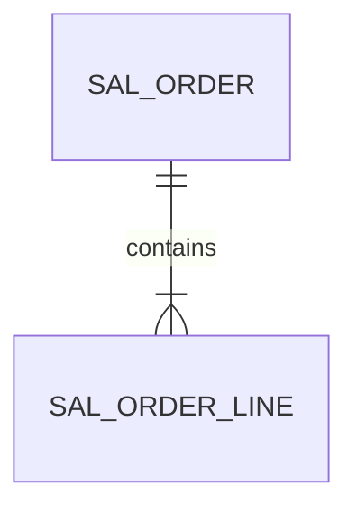

## WU-SD-004a2b delivery schema checkpoint (2026-10-27T10:16:42+08:00)

Migration `20261026220435_Sales_DeliveryDraft` creates the header and line tables. Migration `20261115222416_Sales_DeliveryLineTracking` adds saved selections. The Draft schema still needs INV movement references and final posting in WU-SD-004b.

| Requirement ID | Version | Table Name | Description | Author | Related REQ_F |
|---|---|---|---|---|---|
| REQ_DS43.170 | 1.0 | sal_delivery | This table stores sales delivery headers and their lifecycle state. | Developer | REQ_F4112.3.1, REQ_F4112.3.2, REQ_F4112.3.3, REQ_F4112.3.4, REQ_F4112.3.5, REQ_F4112.3.6 |
| REQ_DS43.171 | 1.1 | sal_delivery_line | This table stores saved delivery quantities, source order line identities and, once Posted, the INV outbound movement ID of each line. | Developer | REQ_F4112.3.2, REQ_F4112.3.3, REQ_F4112.3.4 |
| REQ_DS43.203 | 1.0 | sal_delivery_line_tracking | This table stores ordered lot or serial selections and base-unit quantities for delivery lines. | Developer | REQ_F4112.3.1, REQ_F4112.3.2, REQ_F4112.3.3, REQ_F4112.3.4 |

`sal_delivery` has a permanent unique `(company_id, document_no)`, positive source order ID, Draft/Pending/Rejected/Posted status, business date, soft deletion and audit/version fields. `sal_delivery_line` has a same-company `(company_id, delivery_id)` parent FK, unique `(company_id, delivery_id, line_no)`, positive source/item/warehouse IDs, positive quantity `decimal(19,6)` and audit/version fields. The migration creates lookup indexes for status/date, source order, source order line, item and warehouse/location. Source order, item, warehouse, SYS and INV identities remain scalar cross-module references.

`sal_delivery_line_tracking` has `id bigint identity`, same-company `(company_id,line_id)` FK with cascade on line replacement, positive `seq_no`, nullable `lot_no nvarchar(50)` and `serial_no nvarchar(100)`, positive `quantity decimal(19,6)` and audit/version fields. A CHECK requires exactly one identifier and quantity one for a serial. Unique `(company_id,line_id,seq_no)` is the ordered retrieval and FK lookup index. The line's alternate key `(company_id,id)` enforces same-company ownership. Application validation checks trimmed nonblank identifiers, mode, duplicate numbers and exact totals on submit.

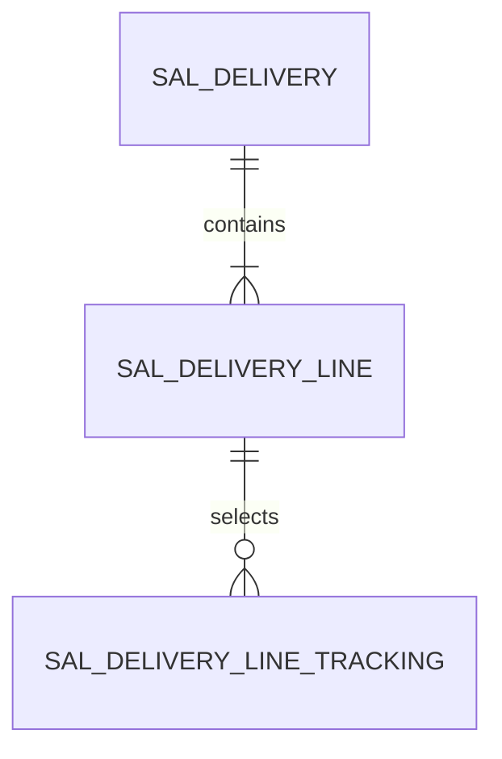

## WU-SD-005a8 price rule schema checkpoint (2026-11-21T14:21:56+08:00)

Migration `20261121061620_Sales_PriceRule` creates `sal_price_rule` (ADR-157). Revision history and the document pricing provenance columns are still open in WU-SD-005a.

| Requirement ID | Version | Table Name | Description | Author | Related REQ_F |
|---|---|---|---|---|---|
| REQ_DS43.204 | 1.0 | sal_price_rule | This table stores dated selling prices and ordinary discount ceilings per item, currency and optional customer. | Developer | REQ_F4112.4.1 |

`sal_price_rule` has `id bigint identity`, `company_id`, scalar MD `item_id` (positive) and nullable `customer_id` (positive when present; null is the company default key), `currency_code char(3)` (CHECK binary `[A-Z]{3}`), inclusive `valid_from`/`valid_to date` (CHECK `valid_to >= valid_from`), `unit_price decimal(19,6)` (CHECK `>= 0`), `discount_ceiling decimal(7,4)` (CHECK 0–100), `is_active`, `is_deleted`, `version` and audit stamps. Indexes: `(company_id,item_id,currency_code,customer_id,valid_from,id)` for dated selection and the overlap check (it also serves company/item lookups), `(company_id,customer_id)` and `(company_id,valid_from,id)` for the default list sort. No FK points to MD. Same-key writers take a transaction-owned `sp_getapplock` on `sal_price_rule:{company}:{item}:{currency}:{customer|default}` and re-check active inclusive overlaps inside the transaction, so a null customer has one explicit logical key.

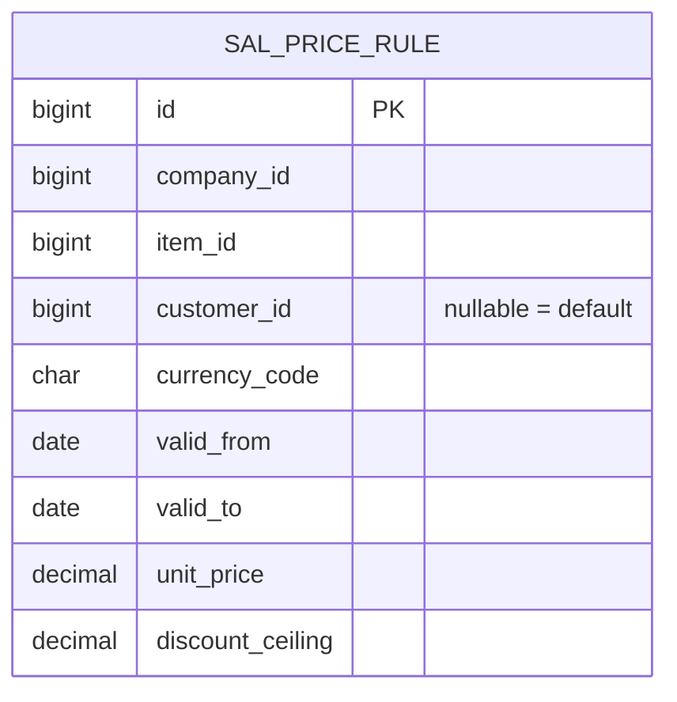

WU-SD-004a1 introduces no table or migration. Its balance input is a transient projection of saved order and delivery lines; WU-SD-004a2 must create and verify the durable schema before using it in a transaction.

WU-SD-004a2a also introduces no table or migration. Its Draft input is transient; WU-SD-004a2b owns the durable delivery schema and SQL verification.

Other proposed tables remain without `REQ_DS43` IDs until their migrations create and verify them. WU-SD-001's module foundation adds no entity, table or migration. Proposed SD-owned tables are `sal_invoice`, `sal_invoice_line`, `sal_return`, and `sal_return_line` (`sal_credit_override` was created in WU-SD-006b1 as REQ_DS43.205). The implementation work unit may split or revise these after tests prove the needed constraints.

Each table needs `id bigint identity`, `company_id`, UTC+8 audit stamps through `IClock`, actor IDs and optimistic `version`; commercial document headers need permanent unique `(company_id,document_no)`. Lines need `(company_id,header_id,line_no)` uniqueness, decimal(19,6) quantity/unit price, decimal(19,4) amounts and dates as SQL `date`. SD internal relations use same-company foreign keys and manually indexed FK columns. MD/SYS/FI/INV references store IDs only, without cross-module FK or EF navigation. Proposed lookup indexes begin with company and common status/date, order, customer, source and delivery references. Exact columns, constraints, indexes and REQ_DS43 IDs are fixed in each migration unit.

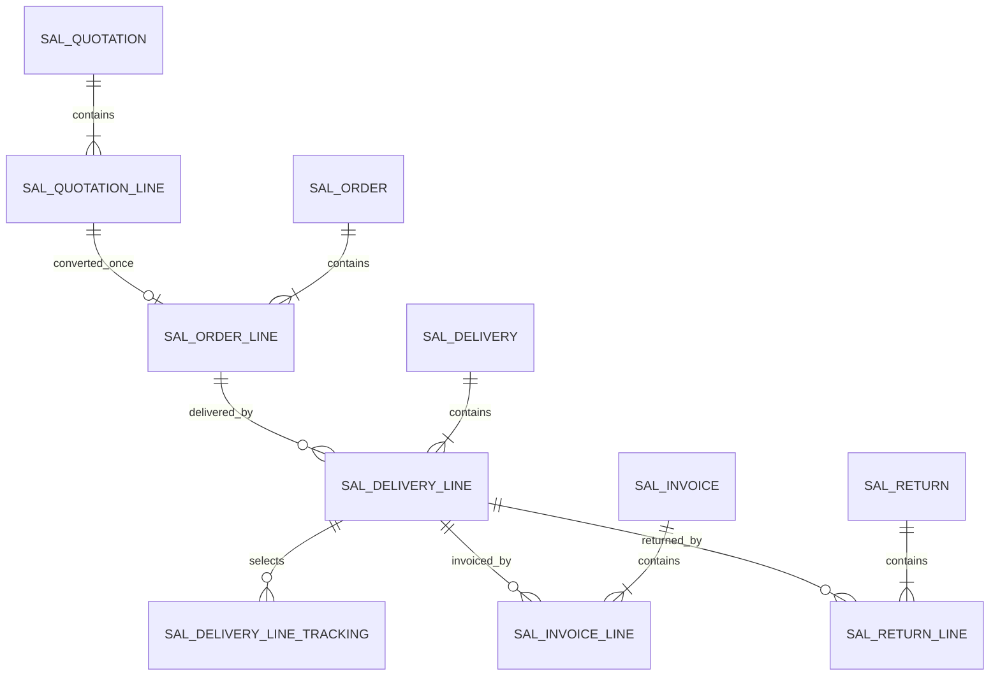

The arrows show SD-owned logical relations. No database relation is proposed between SD and another module's table. INV posting references are stored as source identity and verified through INV Contracts. No SQL structure or migration changes in WU-SD-000.

## WU-SD-002d quotation schema contract (implemented schema checkpoint above)

WU-SD-002a allocated `REQ_DS43.174–175` after verifying `sal_quotation` and `sal_quotation_line` in SQL Server. This section preserves the original design contract; the actual schema is described above.

`sal_quotation` needs company, permanent document number, customer ID and code/name snapshot, business and inclusive expiry dates, currency and base currency, saved exchange rate, Draft/Pending/Rejected/Approved/Voided status, submit/approve/void stamps, version, soft deletion and standard audit columns. `sal_quotation_line` needs company, parent ID, ordered line number, MD item ID and code/name snapshot, base-unit quantity, unit price, discount percentage, output-tax ID/rate, rounded original/base currency net/tax/gross amounts and standard audit columns. Exact SQL types follow section 6: ID bigint, dates date, money decimal(19,4), quantity and unit price decimal(19,6), exchange rate decimal(19,8); discount/tax rates need explicit precision and CHECK bounds in the migration. Conversion IDs belong to the later order tables; the quotation itself is not rewritten as the source of truth for conversion.

Required constraints: unique `(company_id,document_no)` and `(company_id,quotation_id,line_no)` including deleted rows; same-company parent FK, plus indexes for company/customer, status/business date/ID, and expiry lookup. The later order migration adds filtered uniqueness for non-null `(company_id,source_quotation_id)` and `(company_id,source_quotation_line_id)` without excluding soft-deleted rows. For source lines it also verifies their parent quote equals the order header source. MD and SYS IDs have no cross-module FK/navigation. Test quotation SQL constraints and reverse migration in WU-SD-002a; test order-source constraints in WU-SD-003a.

## WU-SD-003d order schema contract (migration checkpoint above)

WU-SD-003a allocated `REQ_DS43.172–173` after verifying `sal_order` and `sal_order_line` in SQL Server. Header: company, permanent document number, customer ID/code/name snapshot, business date, currency/base currency, saved rate, Draft/Pending/Rejected/Approved/Cancelled status, nullable quotation source, original/base net/tax/gross totals, audit/approval stamps, version and soft deletion. Line: company, order parent, line number, item ID/code/name snapshot, nullable quotation line source, base-unit quantity decimal(19,6), unit price decimal(19,6), discount/tax rates with bounded CHECKs, original/base net/tax/gross decimal(19,4), and audit columns. Delivered quantity is derived from delivery documents, not a freely updated order column.

Require unique `(company_id,document_no)` and `(company_id,order_id,line_no)` across soft deletion; unique non-null `(company_id,source_quotation_id)` on headers and `(company_id,source_quotation_line_id)` on lines including soft-deleted rows. Check source line's quote matches header source in the conversion transaction and test constraint behavior under concurrency. Add same-company order header/line FK, explicit FK indexes, plus company/status/business-date/ID, customer/date and source lookup indexes. Cross-module MD/SYS/FI IDs have no FK/navigation. Migration rollback, constraints, indexes and actual SQL types are WU-SD-003a acceptance gates.

## WU-SD-004d outbound schema contract (no migration yet)

WU-SD-004a2b has allocated REQ_DS43.170–171 to `sal_delivery` and `sal_delivery_line`. The current migration has company, permanent number, order ID, business date, Draft/Pending/Rejected/Posted status, version, soft deletion and SYS instance ID on the header. The line has company, delivery/order line IDs, line number, item ID, warehouse/location IDs and positive base-unit quantity `decimal(19,6)`. Saved INV movement references and lot/serial tracking remain to be designed and migrated before posting; allocate another ID if a normalized SD-owned tracking table is needed. No cross-module FK points to SYS, MD or INV.

Require permanent unique `(company_id,document_no)` and `(company_id,delivery_id,line_no)` including soft-deleted rows, same-company SD parent relation, explicit FK indexes and company/order/status/date/ID lookup indexes. Order-line identity is a scalar until the order table is implemented. A reservation is derived from active Pending SD lines, not stored as an editable order quantity. Posted quantity is derived from Posted SD lines whose INV posting completed in the same transaction. A document-level posting reference must retain the returned INV movement IDs for audit; it is not a license to rewrite INV rows. Test six-place precision, duplicate line numbers, cross-company sources, deleted rows, concurrency, rollback and down migration in 004a/b. The current migration creates only the two Draft tables; later migrations must finish tracking and posting audit storage.

## WU-SD-005d pricing schema contract (`sal_price_rule` created in WU-SD-005a8; provenance columns pending)

WU-SD-005a allocates the next `REQ_DS43` ID only after `sal_price_rule` exists and is verified in SQL. Proposed columns: company, item ID, nullable customer ID, currency code, inclusive valid dates, nonnegative `decimal(19,6)` unit price, `decimal(7,4)` ordinary discount ceiling, active/soft-delete state, optimistic version and standard UTC+8 audit columns. Rule history must preserve old row identity/version and prior commercial values when a revision changes a price; implementation may use append-only revisions or an SD-owned history child table, with an ID assigned only if actually created. No MD FK/navigation is allowed.

Proposed indexes: company/item/currency/customer/valid-from/ID for dated selection; company/customer and company/item lookup indexes; a database-backed serialization strategy for same-key interval mutation plus an application overlap check inside that transaction. A unique key on the interval start alone is insufficient because intervals can overlap without equal starts. SQL acceptance must prove two writers cannot commit overlapping active intervals and that soft deletion does not erase saved document provenance. A nullable default customer has one logical key, so SQL null semantics must be handled explicitly.

Quotation and manual-order lines need immutable pricing provenance: nullable rule ID/version, chosen unit price and discount, override flag/reason/actor/time and existing rounded money snapshots. These columns are created in their document migration or a later pricing migration after exact types/checks and backfill policy are tested. A converted order copies its source quotation provenance; it does not reference the current rule price. No cross-module FK points to MD or SYS. No SQL object or `REQ_DS43` allocation occurs in WU-SD-005d.

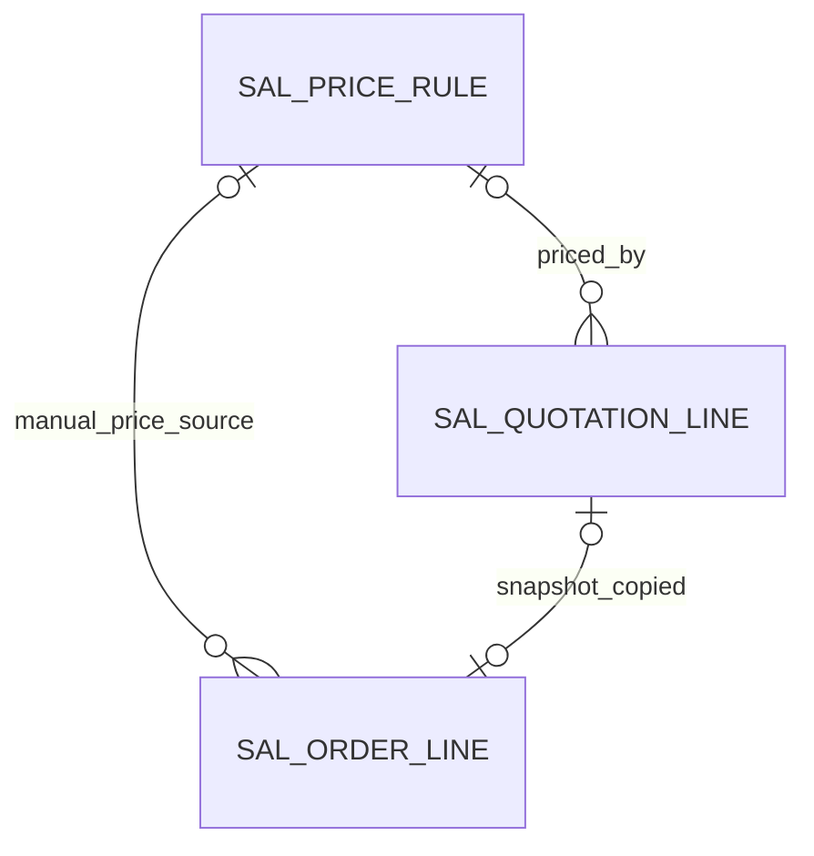

## WU-SD-006d credit schema contract (no migration yet)

FI/AR owns credit-limit and posted-open-receivable storage. Its 006a migration chooses FI-owned names, constraints and `REQ_DS43` IDs; this SD design allocates none and does not require an SD query of FI tables. Both public values are in the company's base currency, `decimal(19,4)`, with a dated/versioned snapshot. The FI-owned credit-key serialization primitive must be usable by FI mutations and SD approval in one SQL transaction, without a direct SD table query.

SD derives committed exposure from Approved `sal_order` saved base-currency gross less amounts already represented by posted FI receivables. The order/invoice transition needs an auditable, same-transaction link from each posted invoice amount to the released commitment, preventing either a gap or double count. If 006b/SD invoice implementation needs a materialized commitment for locked queries, it must be SD-owned, reconcile to saved order/invoice rows, and allocate its `REQ_DS43` ID only after migration verification. No editable client balance or cross-module FK is permitted.

`sal_credit_override` is proposed as an append-only SD table with company/order IDs, order version, SYS round ID, FI snapshot version/date, base currency, limit/open AR/other commitment/candidate/excess `decimal(19,4)`, reason, actor and `IClock` timestamp. Unique `(company_id,order_id,order_version,approval_round_id)` prevents replay, including after soft deletion. Index `(company_id,order_id,created_at,id)` supports audit; order FK is same-company and indexed. FI/SYS/customer IDs have no cross-module FK or EF navigation. Exact migration, reversal and ID allocation belong to 006b.

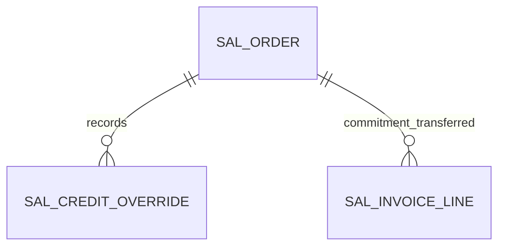

These arrows describe SD-owned audit/transfer relations only; FI credit and receivable objects are reached through a public contract. No SQL object is created by 006d.

## WU-SD-007d invoice schema contract (no migration yet)

WU-SD-007a assigns `REQ_DS43` IDs only when its migration creates and verifies `sal_invoice` and `sal_invoice_line`; 007d reserves no IDs. The header needs company, permanent number, customer/order IDs, business date, original/base currency, saved rate, Posted status, unique client request key, FI posting ID, original/base net/tax/gross totals, version and audit columns. A line needs company, parent ID, line number, immutable Posted delivery/delivery-line/order-line IDs, positive base-unit quantity `decimal(19,6)`, saved item and tax identity/rate, and original/base net/tax/gross `decimal(19,4)`. Source references to SD rows are same-company relations; FI posting ID is a value, without a cross-module FK/navigation. Store cumulative allocation evidence or derive it under source locks from immutable invoice lines; it must reconcile against each source order-line snapshot.

Require permanent unique `(company_id,document_no)` and `(company_id,request_key)` on headers and `(company_id,invoice_id,line_no)` on lines, including soft-deleted rows; same-company parent/source FKs and explicit indexes for each FK. Add `(company_id,delivery_line_id,invoice_id)` for balance locking/aggregation, `(company_id,order_line_id,invoice_id)` for commercial allocation, and company/customer/date/ID for bounded lists. CHECK positive quantity, permitted status and nonnegative money; SQL and service jointly enforce aggregate quantity, currency and tax provenance. No client-editable balance column. A retry payload fingerprint must be saved with the request key so a different payload cannot reuse it. FI-owned AR source uniqueness and posting ID are verified via FI public contract, not by reading FI tables. Migration down path, indexes, deleted-row uniqueness and concurrent aggregate checks are 007a gates.

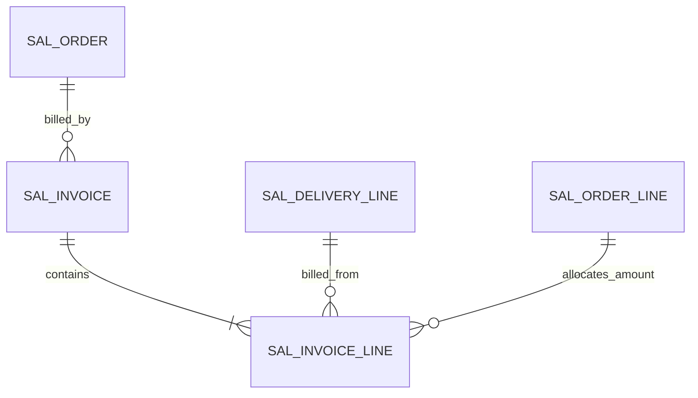

FI receivable and credit rows are deliberately outside this SD-owned relation diagram. No SQL object is created by 007d.

## WU-SD-008d return schema contract (no migration yet)

WU-SD-008a allocates `REQ_DS43` IDs when its migration creates and verifies `sal_return`, `sal_return_line` and, if needed for multiple invoice portions, `sal_return_invoice_allocation`. A header needs company, permanent number, request key/fingerprint, customer/order IDs, business date, state, SYS round, FI credit ID, version and audit fields. Each line needs company, parent/line number, Posted delivery and delivery-line IDs, original outbound movement IDs, destination warehouse/location, tracking snapshot, positive base-unit quantity `decimal(19,6)`, unbilled quantity, immutable inbound movement IDs and original/base money snapshots. Invoice allocations need the precise source invoice-line ID, returned quantity and allocated original/base net/tax/gross. FI/INV IDs remain scalar references without cross-module FK/navigation. Same-company SD source/parent FKs and explicit indexes are required.

Permanent unique `(company_id,document_no)`, `(company_id,request_key)`, `(company_id,return_id,line_no)` and `(company_id,return_line_id,invoice_line_id)` include deleted history. Index `(company_id,delivery_line_id,status,id)` supports return balance locks; `(company_id,invoice_line_id,return_line_id)` supports billed allocation; company/customer/date/ID supports paging. CHECK positive six-place quantity and nonnegative money; service and SQL transaction enforce cross-row sums and disjoint billed/unbilled allocation. No editable balance column. INV owns new `SALES_RETURN` movement schema/uniqueness and cost calculation; FI owns credit note/AR/GL schema/uniqueness. The 008a migration and real SQL tests prove down path, unique keys after soft delete, lock ordering, replay, aggregate bounds and rollback. This section creates no SQL object.

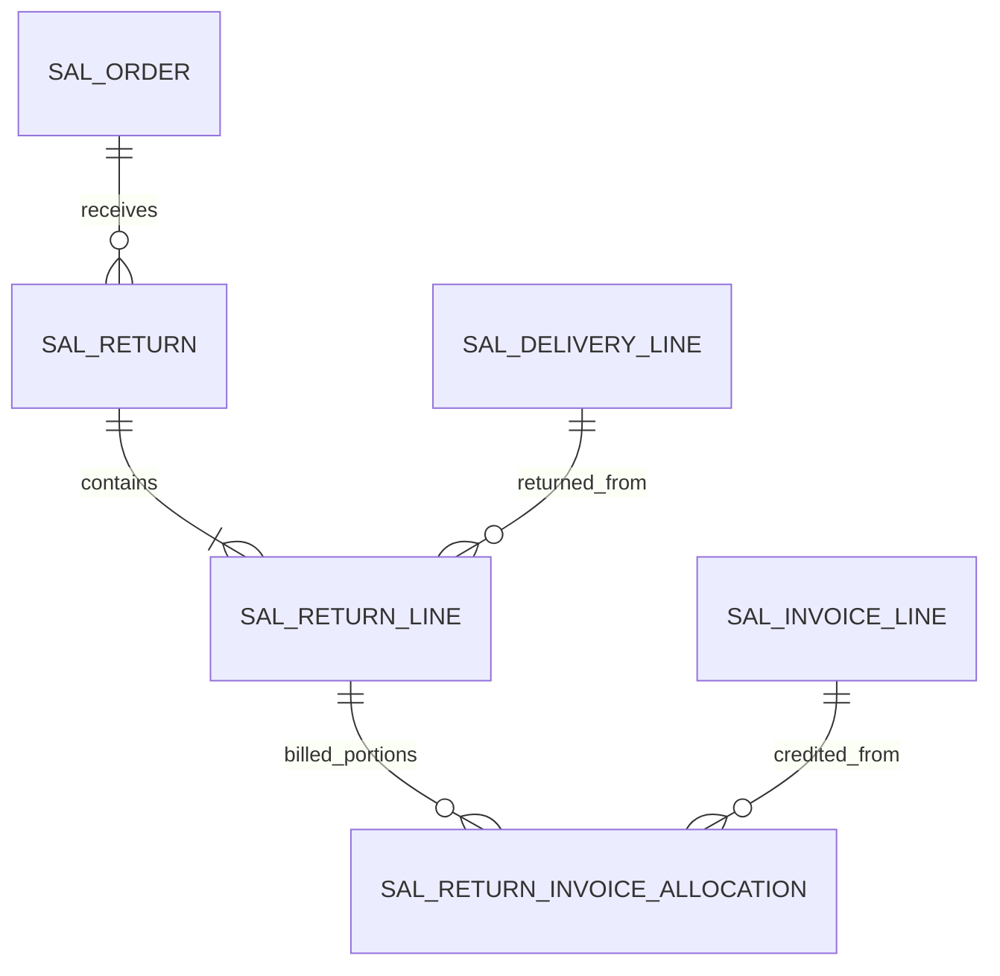

WU-SD-004b2 (ADR-146, 2026-11-21): migration `20261120161001_Sales_DeliveryInventoryMovement` adds nullable `sal_delivery_line.inv_movement_id bigint` (REQ_DS43.171 v1.1; no new table, REQ_DS43.204 not allocated). `CHECK (inv_movement_id IS NULL OR inv_movement_id > 0)` and filtered unique index `ix_sal_delivery_line_company_id_inv_movement_id (company_id, inv_movement_id) WHERE inv_movement_id IS NOT NULL` keep one INV movement on at most one delivery line. It is a scalar reference with no FK to INV. The posting step fills it in the Posted transaction; Draft/Pending/Rejected lines keep null. Deliveries posted before this migration are not backfilled and stay linked through the INV ledger key (`SALES_OUTBOUND`, delivery ID, line number). Down migration drops the index, check and column.

## WU-SD-005a11a quotation line pricing provenance (2026-11-21T15:15:49+08:00, ADR-160)

Migration `20261121071354_Sales_QuotationLinePricing` (applied to `myerp`) revises REQ_DS43.175 `sal_quotation_line` to Version 1.1; no new table, so REQ_DS43.205 stays unallocated.

| Column | Type | Rule |
|---|---|---|
| pricing_mode | varchar(30) NOT NULL DEFAULT 'Legacy' | `Legacy` (rows before 005a11a), `Rule`, `Override` |
| pricing_rule_id | bigint NULL | Same-company FK `fk_sal_quotation_line_sal_price_rule` (company_id, pricing_rule_id) → `sal_price_rule` (company_id, id), Restrict; index `ix_sal_quotation_line_company_id_pricing_rule_id` |
| pricing_rule_version | int NULL | Rule version used by the decision |
| rule_unit_price | decimal(19,6) NULL | Rule price at save time |
| rule_discount_ceiling | decimal(7,4) NULL | Rule ordinary discount ceiling at save time |
| override_reason | nvarchar(200) NULL | Trimmed reason, Override only |
| override_by | bigint NULL | SYS user ID (cross-module, no FK), Override only |
| override_at | datetime2(6) NULL | Server time (UTC+8), Override only |

`ck_sal_quotation_line_pricing`: Legacy has no provenance; Rule needs the full rule snapshot, `unit_price = rule_unit_price`, `discount_rate <= rule_discount_ceiling` and no override data; Override needs reason, actor and time with either a full rule snapshot or none. All nullable comparisons are guarded by `IS NOT NULL`. `sal_price_rule` gains alternate key `ak_sal_price_rule_company_id_id` as FK principal. Down migration drops FK, index, check, key and columns.

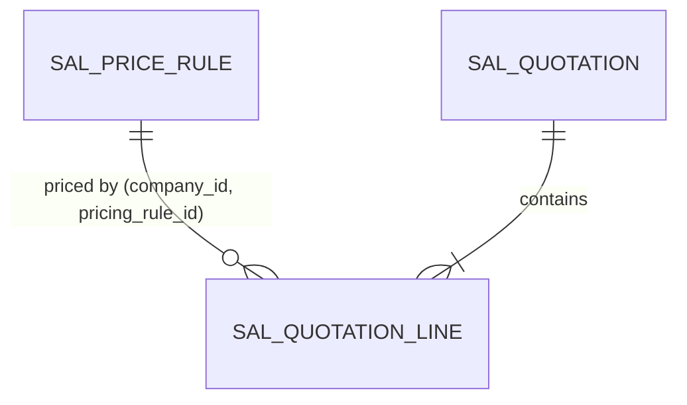

Migration `20261121072227_Sales_OrderLinePricing` (applied to `myerp`) adds the same eight columns, default `'Legacy'`, the same CHECK text (`ck_sal_order_line_pricing`), index `ix_sal_order_line_company_id_pricing_rule_id` and same-company FK `fk_sal_order_line_sal_price_rule` to `sal_order_line` (REQ_DS43.173 revised to Version 1.1). Converted lines copy the quotation line values; manual order lines stay `Legacy` until WU-SD-005a11b decides them.

## WU-SD-006b1 credit override evidence (2026-11-22, ADR-169)

Migration `20261121174302_Sales_CreditOverride` creates `sal_credit_override`.

| Requirement ID | Version | Table Name | Description | Author | Related REQ_F |
|---|---|---|---|---|---|
| REQ_DS43.205 | 1.0 | sal_credit_override | This table stores the append-only evidence of each reasoned credit-limit override of a sales order, bound to the order version and SYS approval round. | Developer | REQ_F4112.6.1 |

| Column | Type | Rule |
|---|---|---|
| id | bigint identity | PK |
| company_id | bigint | Same-company FK `fk_sal_credit_override_sal_order` (company_id, order_id) → `sal_order` (company_id, id), Restrict |
| order_id | bigint | Overridden order |
| order_version | int | Order version the decision was made on (> 0) |
| approval_instance_id | bigint | SYS approval round (scalar, no FK, > 0) |
| stage | varchar(30) | `Submit` or `FinalApproval` (CHECK) |
| evaluation_date | date | Server `IClock.Today` used for the FI snapshot |
| credit_limit_version | int | FI limit version (> 0) |
| base_currency_code | char(3) | Company base currency |
| credit_limit, posted_open_ar, other_commitments, candidate, excess | decimal(19,4) | All ≥ 0; `excess > 0` and `excess = posted_open_ar + other_commitments + candidate − credit_limit` |
| reason | nvarchar(200) | Trimmed, non-blank |
| created_at / created_by | datetime2(6) / bigint | Override time (`IClock`) and actor |
| updated_at / updated_by / version | | Standard columns; never changed (append-only) |

Indexes: unique `(company_id, order_id, approval_instance_id, stage)` (one decision per order, round and stage; it also serves the FK) and `(company_id, order_id, created_at, id)` for the audit timeline. Trigger `tr_sal_credit_override_immutable` refuses UPDATE and DELETE (THROW 51031). Down migration drops the trigger and the table.

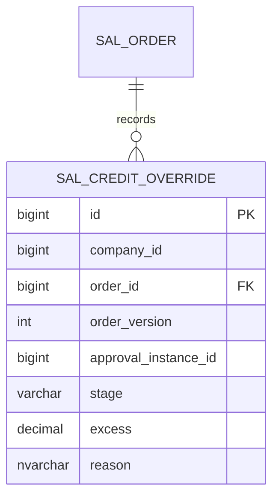

## WU-SD-007a1 sales invoice tables (2026-11-23T09:12:38+08:00, ADR-176)

Migration `20261122221834_Sales_Invoice` creates `sal_invoice` and `sal_invoice_line` and adds alternate key `ak_sal_order_line_company_id_id` (FK principal). Both tables carry `company_id`, `created_at/by`, `updated_at/by`, `version` (BusinessEntity).

| Requirement ID | Version | Table Name | Description | Author | Related REQ_F |
|---|---|---|---|---|---|
| REQ_DS43.206 | 1.0 | sal_invoice | This table stores each permanent sales invoice issued from Posted deliveries of one order, with saved currency, rate, original/base totals and the FI/AR posting references. | Developer | REQ_F4112.5.1 |
| REQ_DS43.207 | 1.0 | sal_invoice_line | This table stores the write-once invoiced portion of each Posted delivery line with its item, tax rate and allocated original/base amounts. | Developer | REQ_F4112.5.1 |

`sal_invoice`

| Column | Type | Rule |
|---|---|---|
| id | bigint identity | PK |
| document_no | varchar(30) | Unique per company |
| request_key / request_fingerprint | varchar(64) / varchar(128) | Client idempotency key (unique per company) and payload fingerprint; both non-blank |
| customer_id, order_id | bigint | > 0; same-company FK `fk_sal_invoice_sal_order` → `sal_order` (Restrict) |
| business_date | date | Invoice date |
| currency_code, base_currency_code | char(3) | Same currency requires rate 1 and base = original amounts |
| exchange_rate | decimal(19,8) | > 0, saved snapshot |
| status | varchar(30) | `Issuing` (inside the ISSUE transaction only) or `Posted` |
| posted_at, fi_sales_source_id, fi_receivable_id, fi_journal_id | datetime2(6) / bigint NULL | All set (> 0) when Posted, all NULL when Issuing (`ck_sal_invoice_posted`); FI IDs are scalar, no FK; filtered unique (company_id, fi_sales_source_id) |
| original_net/tax/gross, base_net/tax/gross | decimal(19,4) | ≥ 0 and gross = net + tax |

`sal_invoice_line`

| Column | Type | Rule |
|---|---|---|
| invoice_id | bigint | Same-company FK → `sal_invoice` (Restrict); unique (company_id, invoice_id, line_no), line_no > 0 |
| delivery_id, delivery_line_id, order_line_id | bigint | Same-company FKs → `sal_delivery`, `sal_delivery_line`, `sal_order_line` (Restrict) |
| item_id, tax_rate_id | bigint | > 0, saved snapshot (MD IDs, no FK) |
| tax_rate_percent | decimal(9,4) | 0～100 |
| quantity | decimal(19,6) | > 0, base unit |
| original_net/tax/gross, base_net/tax/gross | decimal(19,4) | ≥ 0 and gross = net + tax |

Triggers: `tr_sal_invoice_immutable` (THROW 51032) refuses UPDATE/DELETE of a Posted header and any change to saved content while Issuing; `tr_sal_invoice_line_immutable` (THROW 51033) refuses line UPDATE and INSERT/DELETE under a Posted header. Down migration drops triggers, tables and the alternate key.

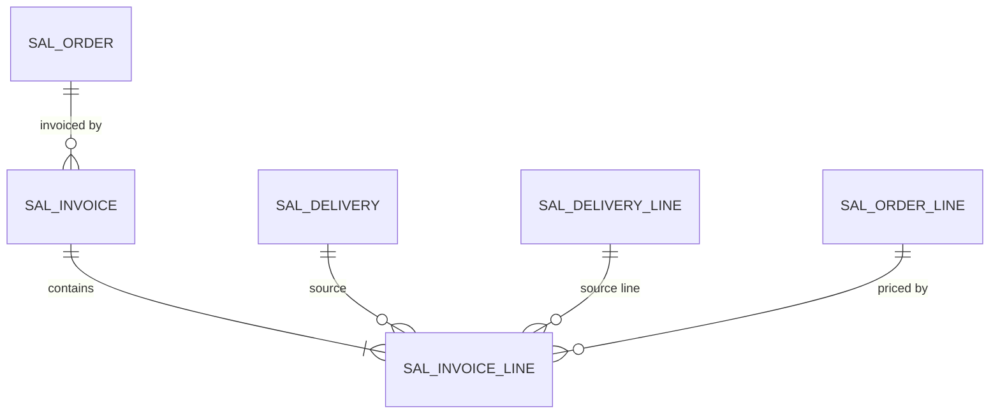
