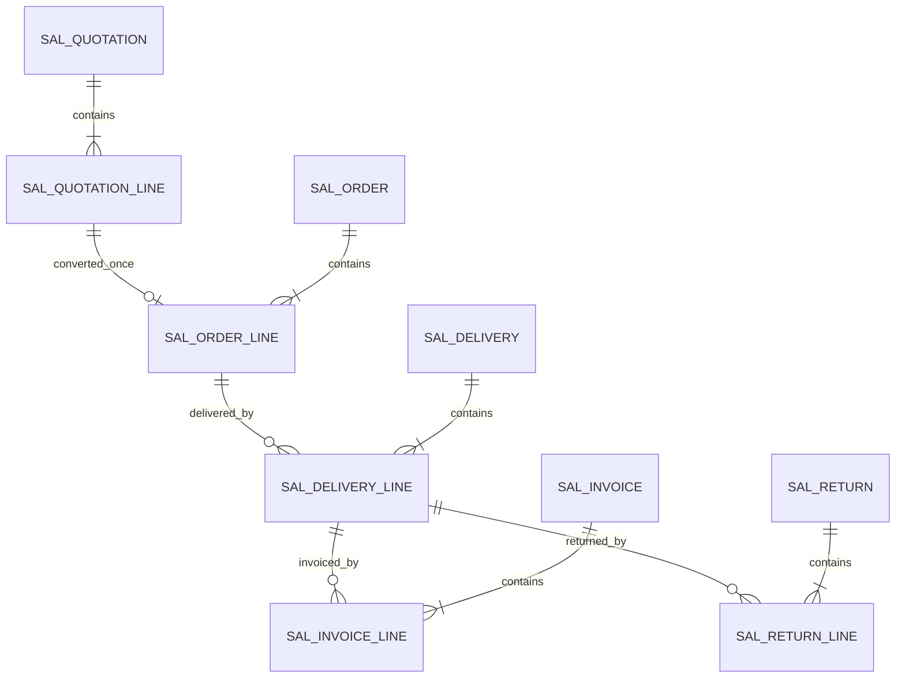

# SD data structure (WU-SD-000 proposed; no migration)

No `REQ_DS43` IDs are allocated until a migration creates and verifies each table. Proposed SD-owned tables are `sal_quotation`, `sal_quotation_line`, `sal_order`, `sal_order_line`, `sal_delivery`, `sal_delivery_line`, `sal_price_rule`, `sal_invoice`, `sal_invoice_line`, `sal_credit_override`, `sal_return`, and `sal_return_line`. The implementation work unit may split or revise these after tests prove the needed constraints.

Each table needs `id bigint identity`, `company_id`, UTC+8 audit stamps through `IClock`, actor IDs and optimistic `version`; commercial document headers need permanent unique `(company_id,document_no)`. Lines need `(company_id,header_id,line_no)` uniqueness, decimal(19,6) quantity/unit price, decimal(19,4) amounts and dates as SQL `date`. SD internal relations use same-company foreign keys and manually indexed FK columns. MD/SYS/FI/INV references store IDs only, without cross-module FK or EF navigation. Proposed lookup indexes begin with company and common status/date, order, customer, source and delivery references. Exact columns, constraints, indexes and REQ_DS43 IDs are fixed in each migration unit.

The arrows show SD-owned logical relations. No database relation is proposed between SD and another module's table. INV posting references are stored as source identity and verified through INV Contracts. No SQL structure or migration changes in WU-SD-000.
