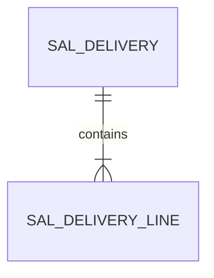
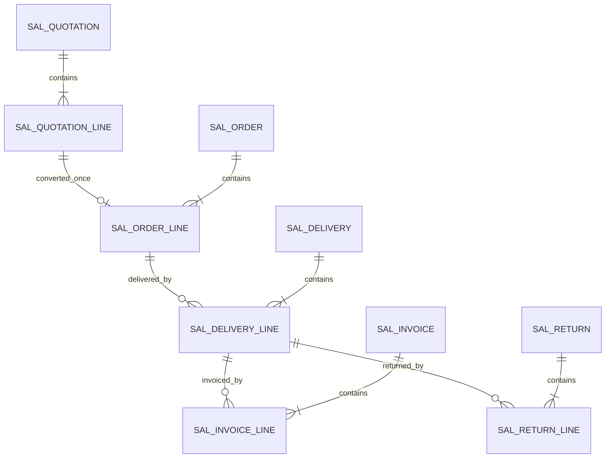
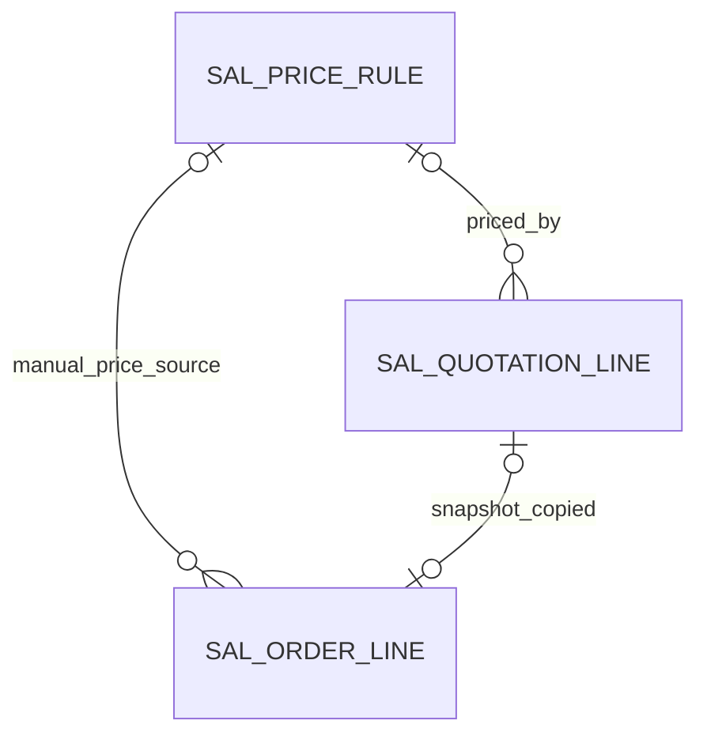
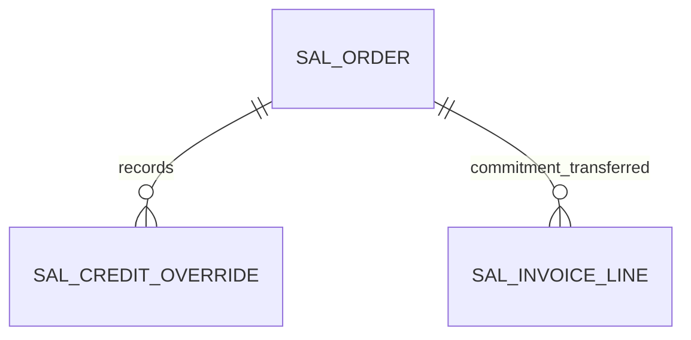
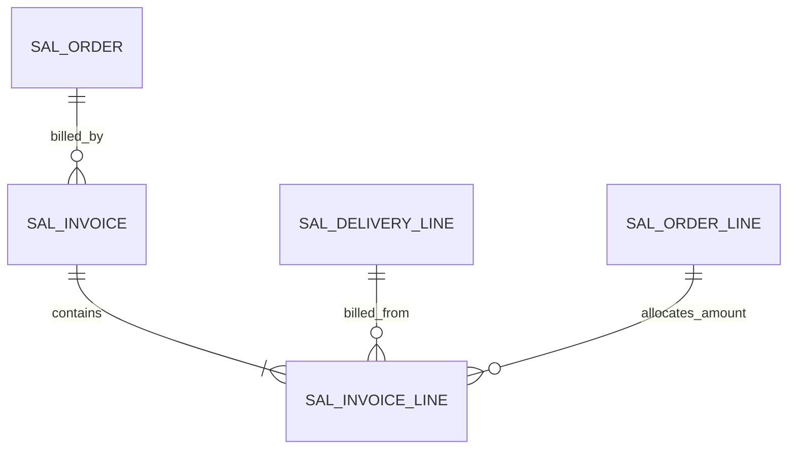
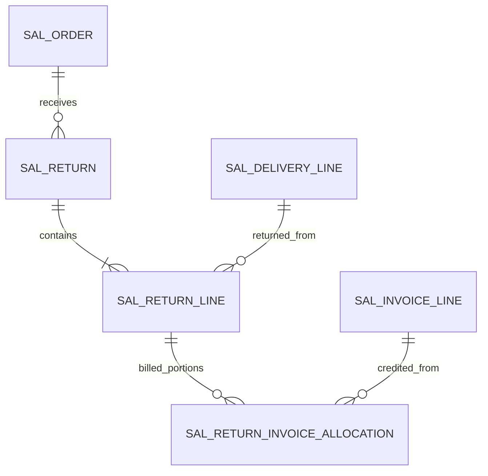

# SD data structure

## WU-SD-004a2b delivery schema checkpoint (2026-10-27T10:16:42+08:00)

Migration `20261026220435_Sales_DeliveryDraft` creates two SD-owned tables. It was applied to `myerp` and both tables plus the one same-company parent FK were verified in SQL Server. This checkpoint contains the durable Draft schema only; delivery commands, saved tracking, INV movement references and SQL balance locking remain in WU-SD-004a2b. This checkpoint does not satisfy the full outbound acceptance plan.

| Requirement ID | Version | Table Name | Description | Author | Related REQ_F |
|---|---|---|---|---|---|
| REQ_DS43.170 | 1.0 | sal_delivery | This table stores sales delivery headers and their lifecycle state. | Developer | REQ_F4112.3.1–6 |
| REQ_DS43.171 | 1.0 | sal_delivery_line | This table stores saved delivery quantities and source order line identities. | Developer | REQ_F4112.3.2–4 |

`sal_delivery` has a permanent unique `(company_id, document_no)`, positive source order ID, Draft/Pending/Rejected/Posted status, business date, soft deletion and audit/version fields. `sal_delivery_line` has a same-company `(company_id, delivery_id)` parent FK, unique `(company_id, delivery_id, line_no)`, positive source/item/warehouse IDs, positive quantity `decimal(19,6)` and audit/version fields. The migration creates lookup indexes for status/date, source order, source order line, item and warehouse/location. Source order, item, warehouse, SYS and INV identities remain scalar cross-module references.

WU-SD-004a1 introduces no table or migration. Its balance input is a transient projection of saved order and delivery lines; WU-SD-004a2 must create and verify the durable schema before using it in a transaction.

WU-SD-004a2a also introduces no table or migration. Its Draft input is transient; WU-SD-004a2b owns the durable delivery schema and SQL verification.

Other proposed tables remain without `REQ_DS43` IDs until their migrations create and verify them. WU-SD-001's module foundation adds no entity, table or migration. Proposed SD-owned tables are `sal_quotation`, `sal_quotation_line`, `sal_order`, `sal_order_line`, `sal_price_rule`, `sal_invoice`, `sal_invoice_line`, `sal_credit_override`, `sal_return`, and `sal_return_line`. The implementation work unit may split or revise these after tests prove the needed constraints.

Each table needs `id bigint identity`, `company_id`, UTC+8 audit stamps through `IClock`, actor IDs and optimistic `version`; commercial document headers need permanent unique `(company_id,document_no)`. Lines need `(company_id,header_id,line_no)` uniqueness, decimal(19,6) quantity/unit price, decimal(19,4) amounts and dates as SQL `date`. SD internal relations use same-company foreign keys and manually indexed FK columns. MD/SYS/FI/INV references store IDs only, without cross-module FK or EF navigation. Proposed lookup indexes begin with company and common status/date, order, customer, source and delivery references. Exact columns, constraints, indexes and REQ_DS43 IDs are fixed in each migration unit.

The arrows show SD-owned logical relations. No database relation is proposed between SD and another module's table. INV posting references are stored as source identity and verified through INV Contracts. No SQL structure or migration changes in WU-SD-000.

## WU-SD-002d quotation schema contract (no migration yet)

WU-SD-002a owns the first allocation of two consecutive `REQ_DS43` IDs from `state.json.idCounters.REQ_DS43` when its migration creates `sal_quotation` and `sal_quotation_line`; do not reserve an ID in this design slice. Update the counter only with verified table definitions. The order implementation later allocates its own IDs. No SQL object exists from this section.

`sal_quotation` needs company, permanent document number, customer ID and code/name snapshot, business and inclusive expiry dates, currency and base currency, saved exchange rate, Draft/Pending/Rejected/Approved/Voided status, submit/approve/void stamps, version, soft deletion and standard audit columns. `sal_quotation_line` needs company, parent ID, ordered line number, MD item ID and code/name snapshot, base-unit quantity, unit price, discount percentage, output-tax ID/rate, rounded original/base currency net/tax/gross amounts and standard audit columns. Exact SQL types follow section 6: ID bigint, dates date, money decimal(19,4), quantity and unit price decimal(19,6), exchange rate decimal(19,8); discount/tax rates need explicit precision and CHECK bounds in the migration. Conversion IDs belong to the later order tables; the quotation itself is not rewritten as the source of truth for conversion.

Required constraints: unique `(company_id,document_no)` and `(company_id,quotation_id,line_no)` including deleted rows; same-company parent FK, plus indexes for company/customer, status/business date/ID, and expiry lookup. The later order migration adds filtered uniqueness for non-null `(company_id,source_quotation_id)` and `(company_id,source_quotation_line_id)` without excluding soft-deleted rows. For source lines it also verifies their parent quote equals the order header source. MD and SYS IDs have no cross-module FK/navigation. Test quotation SQL constraints and reverse migration in WU-SD-002a; test order-source constraints in WU-SD-003a.

## WU-SD-003d order schema contract (no migration yet)

WU-SD-003a allocates `REQ_DS43` IDs only when verified `sal_order` and `sal_order_line` tables exist. Header: company, permanent document number, customer ID/code/name snapshot, business date, currency/base currency, saved rate, Draft/Pending/Rejected/Approved/Cancelled status, nullable quotation source, original/base net/tax/gross totals, audit/approval stamps, version and soft deletion. Line: company, order parent, line number, item ID/code/name snapshot, nullable quotation line source, base-unit quantity decimal(19,6), unit price decimal(19,6), discount/tax rates with bounded CHECKs, original/base net/tax/gross decimal(19,4), and audit columns. Delivered quantity is derived from delivery documents, not a freely updated order column.

Require unique `(company_id,document_no)` and `(company_id,order_id,line_no)` across soft deletion; unique non-null `(company_id,source_quotation_id)` on headers and `(company_id,source_quotation_line_id)` on lines including soft-deleted rows. Check source line's quote matches header source in the conversion transaction and test constraint behavior under concurrency. Add same-company order header/line FK, explicit FK indexes, plus company/status/business-date/ID, customer/date and source lookup indexes. Cross-module MD/SYS/FI IDs have no FK/navigation. Migration rollback, constraints, indexes and actual SQL types are WU-SD-003a acceptance gates.

## WU-SD-004d outbound schema contract (no migration yet)

WU-SD-004a2b has allocated REQ_DS43.170–171 to `sal_delivery` and `sal_delivery_line`. The current migration has company, permanent number, order ID, business date, Draft/Pending/Rejected/Posted status, version, soft deletion and SYS instance ID on the header. The line has company, delivery/order line IDs, line number, item ID, warehouse/location IDs and positive base-unit quantity `decimal(19,6)`. Saved INV movement references and lot/serial tracking remain to be designed and migrated before posting; allocate another ID if a normalized SD-owned tracking table is needed. No cross-module FK points to SYS, MD or INV.

Require permanent unique `(company_id,document_no)` and `(company_id,delivery_id,line_no)` including soft-deleted rows, same-company SD parent relation, explicit FK indexes and company/order/status/date/ID lookup indexes. Order-line identity is a scalar until the order table is implemented. A reservation is derived from active Pending SD lines, not stored as an editable order quantity. Posted quantity is derived from Posted SD lines whose INV posting completed in the same transaction. A document-level posting reference must retain the returned INV movement IDs for audit; it is not a license to rewrite INV rows. Test six-place precision, duplicate line numbers, cross-company sources, deleted rows, concurrency, rollback and down migration in 004a/b. The current migration creates only the two Draft tables; later migrations must finish tracking and posting audit storage.

## WU-SD-005d pricing schema contract (no migration yet)

WU-SD-005a allocates the next `REQ_DS43` ID only after `sal_price_rule` exists and is verified in SQL. Proposed columns: company, item ID, nullable customer ID, currency code, inclusive valid dates, nonnegative `decimal(19,6)` unit price, `decimal(7,4)` ordinary discount ceiling, active/soft-delete state, optimistic version and standard UTC+8 audit columns. Rule history must preserve old row identity/version and prior commercial values when a revision changes a price; implementation may use append-only revisions or an SD-owned history child table, with an ID assigned only if actually created. No MD FK/navigation is allowed.

Proposed indexes: company/item/currency/customer/valid-from/ID for dated selection; company/customer and company/item lookup indexes; a database-backed serialization strategy for same-key interval mutation plus an application overlap check inside that transaction. A unique key on the interval start alone is insufficient because intervals can overlap without equal starts. SQL acceptance must prove two writers cannot commit overlapping active intervals and that soft deletion does not erase saved document provenance. A nullable default customer has one logical key, so SQL null semantics must be handled explicitly.

Quotation and manual-order lines need immutable pricing provenance: nullable rule ID/version, chosen unit price and discount, override flag/reason/actor/time and existing rounded money snapshots. These columns are created in their document migration or a later pricing migration after exact types/checks and backfill policy are tested. A converted order copies its source quotation provenance; it does not reference the current rule price. No cross-module FK points to MD or SYS. No SQL object or `REQ_DS43` allocation occurs in WU-SD-005d.

## WU-SD-006d credit schema contract (no migration yet)

FI/AR owns credit-limit and posted-open-receivable storage. Its 006a migration chooses FI-owned names, constraints and `REQ_DS43` IDs; this SD design allocates none and does not require an SD query of FI tables. Both public values are in the company's base currency, `decimal(19,4)`, with a dated/versioned snapshot. The FI-owned credit-key serialization primitive must be usable by FI mutations and SD approval in one SQL transaction, without a direct SD table query.

SD derives committed exposure from Approved `sal_order` saved base-currency gross less amounts already represented by posted FI receivables. The order/invoice transition needs an auditable, same-transaction link from each posted invoice amount to the released commitment, preventing either a gap or double count. If 006b/SD invoice implementation needs a materialized commitment for locked queries, it must be SD-owned, reconcile to saved order/invoice rows, and allocate its `REQ_DS43` ID only after migration verification. No editable client balance or cross-module FK is permitted.

`sal_credit_override` is proposed as an append-only SD table with company/order IDs, order version, SYS round ID, FI snapshot version/date, base currency, limit/open AR/other commitment/candidate/excess `decimal(19,4)`, reason, actor and `IClock` timestamp. Unique `(company_id,order_id,order_version,approval_round_id)` prevents replay, including after soft deletion. Index `(company_id,order_id,created_at,id)` supports audit; order FK is same-company and indexed. FI/SYS/customer IDs have no cross-module FK or EF navigation. Exact migration, reversal and ID allocation belong to 006b.

These arrows describe SD-owned audit/transfer relations only; FI credit and receivable objects are reached through a public contract. No SQL object is created by 006d.

## WU-SD-007d invoice schema contract (no migration yet)

WU-SD-007a assigns `REQ_DS43` IDs only when its migration creates and verifies `sal_invoice` and `sal_invoice_line`; 007d reserves no IDs. The header needs company, permanent number, customer/order IDs, business date, original/base currency, saved rate, Posted status, unique client request key, FI posting ID, original/base net/tax/gross totals, version and audit columns. A line needs company, parent ID, line number, immutable Posted delivery/delivery-line/order-line IDs, positive base-unit quantity `decimal(19,6)`, saved item and tax identity/rate, and original/base net/tax/gross `decimal(19,4)`. Source references to SD rows are same-company relations; FI posting ID is a value, without a cross-module FK/navigation. Store cumulative allocation evidence or derive it under source locks from immutable invoice lines; it must reconcile against each source order-line snapshot.

Require permanent unique `(company_id,document_no)` and `(company_id,request_key)` on headers and `(company_id,invoice_id,line_no)` on lines, including soft-deleted rows; same-company parent/source FKs and explicit indexes for each FK. Add `(company_id,delivery_line_id,invoice_id)` for balance locking/aggregation, `(company_id,order_line_id,invoice_id)` for commercial allocation, and company/customer/date/ID for bounded lists. CHECK positive quantity, permitted status and nonnegative money; SQL and service jointly enforce aggregate quantity, currency and tax provenance. No client-editable balance column. A retry payload fingerprint must be saved with the request key so a different payload cannot reuse it. FI-owned AR source uniqueness and posting ID are verified via FI public contract, not by reading FI tables. Migration down path, indexes, deleted-row uniqueness and concurrent aggregate checks are 007a gates.

FI receivable and credit rows are deliberately outside this SD-owned relation diagram. No SQL object is created by 007d.

## WU-SD-008d return schema contract (no migration yet)

WU-SD-008a allocates `REQ_DS43` IDs when its migration creates and verifies `sal_return`, `sal_return_line` and, if needed for multiple invoice portions, `sal_return_invoice_allocation`. A header needs company, permanent number, request key/fingerprint, customer/order IDs, business date, state, SYS round, FI credit ID, version and audit fields. Each line needs company, parent/line number, Posted delivery and delivery-line IDs, original outbound movement IDs, destination warehouse/location, tracking snapshot, positive base-unit quantity `decimal(19,6)`, unbilled quantity, immutable inbound movement IDs and original/base money snapshots. Invoice allocations need the precise source invoice-line ID, returned quantity and allocated original/base net/tax/gross. FI/INV IDs remain scalar references without cross-module FK/navigation. Same-company SD source/parent FKs and explicit indexes are required.

Permanent unique `(company_id,document_no)`, `(company_id,request_key)`, `(company_id,return_id,line_no)` and `(company_id,return_line_id,invoice_line_id)` include deleted history. Index `(company_id,delivery_line_id,status,id)` supports return balance locks; `(company_id,invoice_line_id,return_line_id)` supports billed allocation; company/customer/date/ID supports paging. CHECK positive six-place quantity and nonnegative money; service and SQL transaction enforce cross-row sums and disjoint billed/unbilled allocation. No editable balance column. INV owns new `SALES_RETURN` movement schema/uniqueness and cost calculation; FI owns credit note/AR/GL schema/uniqueness. The 008a migration and real SQL tests prove down path, unique keys after soft delete, lock ordering, replay, aggregate bounds and rollback. This section creates no SQL object.

