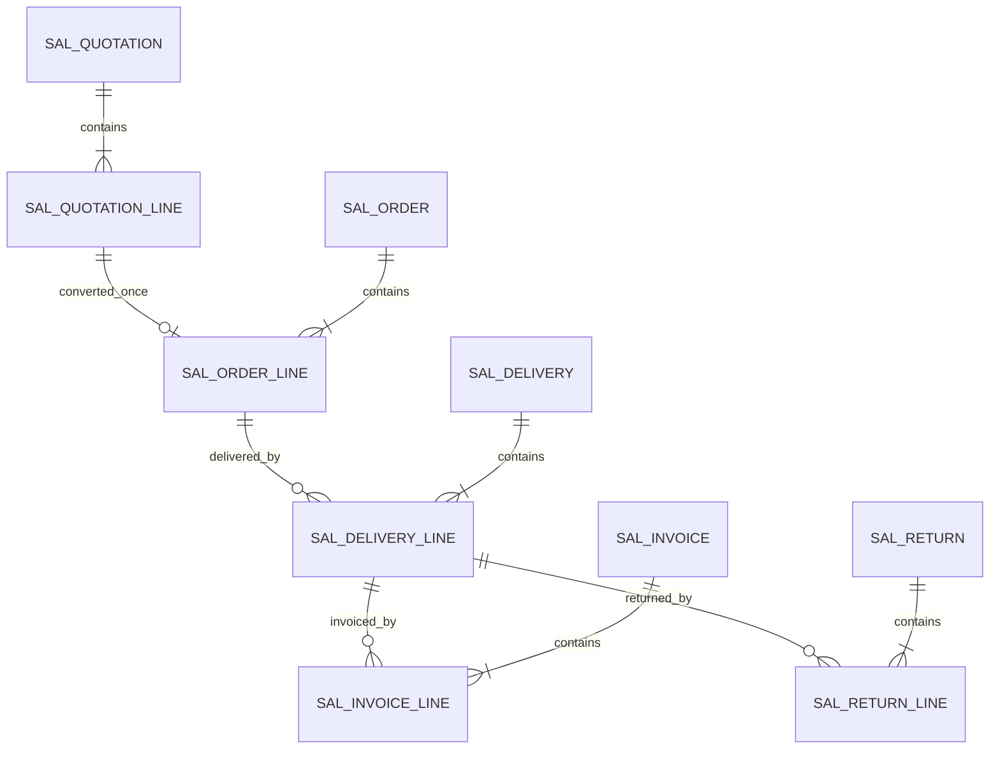

# SD data structure (WU-SD-000 proposed; no migration)

No `REQ_DS43` IDs are allocated until a migration creates and verifies each table. WU-SD-001's module foundation adds no entity, table or migration. Proposed SD-owned tables are `sal_quotation`, `sal_quotation_line`, `sal_order`, `sal_order_line`, `sal_delivery`, `sal_delivery_line`, `sal_price_rule`, `sal_invoice`, `sal_invoice_line`, `sal_credit_override`, `sal_return`, and `sal_return_line`. The implementation work unit may split or revise these after tests prove the needed constraints.

Each table needs `id bigint identity`, `company_id`, UTC+8 audit stamps through `IClock`, actor IDs and optimistic `version`; commercial document headers need permanent unique `(company_id,document_no)`. Lines need `(company_id,header_id,line_no)` uniqueness, decimal(19,6) quantity/unit price, decimal(19,4) amounts and dates as SQL `date`. SD internal relations use same-company foreign keys and manually indexed FK columns. MD/SYS/FI/INV references store IDs only, without cross-module FK or EF navigation. Proposed lookup indexes begin with company and common status/date, order, customer, source and delivery references. Exact columns, constraints, indexes and REQ_DS43 IDs are fixed in each migration unit.

The arrows show SD-owned logical relations. No database relation is proposed between SD and another module's table. INV posting references are stored as source identity and verified through INV Contracts. No SQL structure or migration changes in WU-SD-000.

## WU-SD-002d quotation schema contract (no migration yet)

WU-SD-002a owns the first allocation of two consecutive `REQ_DS43` IDs from `state.json.idCounters.REQ_DS43` when its migration creates `sal_quotation` and `sal_quotation_line`; do not reserve an ID in this design slice. Update the counter only with verified table definitions. The order implementation later allocates its own IDs. No SQL object exists from this section.

`sal_quotation` needs company, permanent document number, customer ID and code/name snapshot, business and inclusive expiry dates, currency and base currency, saved exchange rate, Draft/Pending/Rejected/Approved/Voided status, submit/approve/void stamps, version, soft deletion and standard audit columns. `sal_quotation_line` needs company, parent ID, ordered line number, MD item ID and code/name snapshot, base-unit quantity, unit price, discount percentage, output-tax ID/rate, rounded original/base currency net/tax/gross amounts and standard audit columns. Exact SQL types follow section 6: ID bigint, dates date, money decimal(19,4), quantity and unit price decimal(19,6), exchange rate decimal(19,8); discount/tax rates need explicit precision and CHECK bounds in the migration. Conversion IDs belong to the later order tables; the quotation itself is not rewritten as the source of truth for conversion.

Required constraints: unique `(company_id,document_no)` and `(company_id,quotation_id,line_no)` including deleted rows; same-company parent FK, plus indexes for company/customer, status/business date/ID, and expiry lookup. The later order migration adds filtered uniqueness for non-null `(company_id,source_quotation_id)` and `(company_id,source_quotation_line_id)` without excluding soft-deleted rows. For source lines it also verifies their parent quote equals the order header source. MD and SYS IDs have no cross-module FK/navigation. Test quotation SQL constraints and reverse migration in WU-SD-002a; test order-source constraints in WU-SD-003a.
