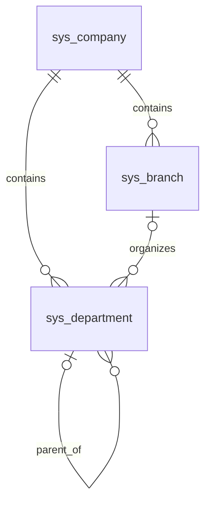
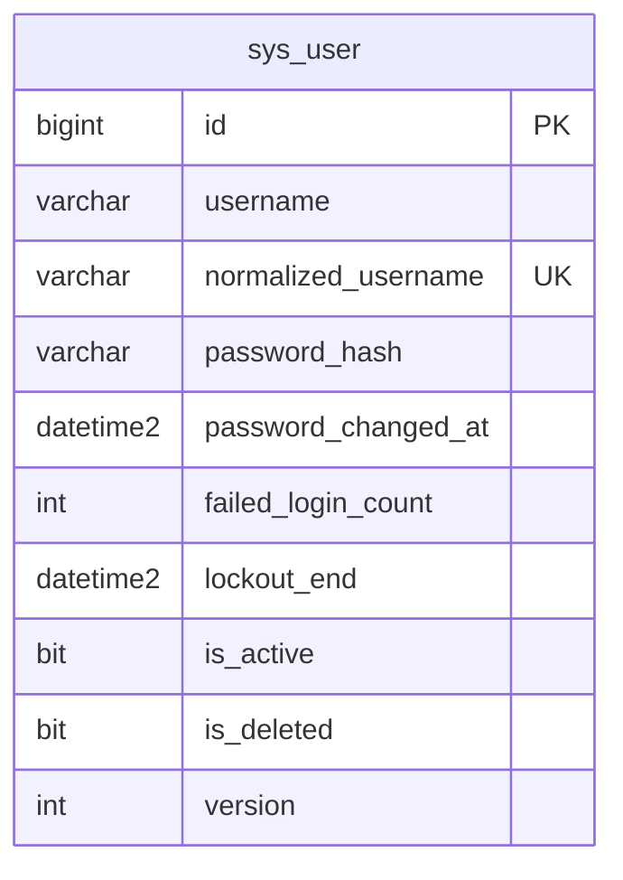
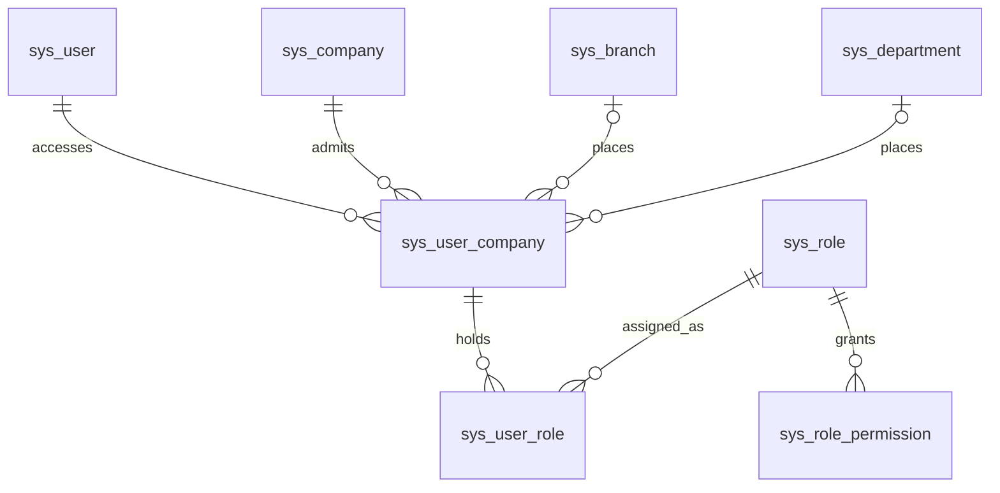

# SYS 組織資料結構

| Requirement ID | Version | Table Name | Description | Author | Related REQ_F |
|---|---|---|---|---|---|
| REQ_DS43.20 | 1.0 | sys_company | Company isolation root; globally unique code, audit, version and soft deletion. | Developer | REQ_F4118.20.1, REQ_F4118.20.2, REQ_F4118.20.3, REQ_F4118.20.4 |
| REQ_DS43.89 | 1.0 | sys_branch | Branch master scoped to a company. | Developer | REQ_F4118.21.1, REQ_F4118.21.2, REQ_F4118.21.3 |
| REQ_DS43.22 | 1.0 | sys_department | Department master scoped to a company, optionally linked to a branch and parent department. | Developer | REQ_F4118.22.1, REQ_F4118.22.2, REQ_F4118.22.3 |

`sys_company` 為隔離根，沒有 `company_id` 與公司篩選；應用層必須先驗證權限。分店與部門繼承主檔欄位：`id`、`company_id`、`code`、`name`、審計、`version`、`is_active`、`is_deleted`、`custom_fields`。代碼分別以 `(company_id, code)` 唯一索引保護，刪除後代碼仍保留。分店與部門透過外鍵歸屬公司；部門指向分店／上級部門使用 `(company_id, id)` 複合外鍵，在資料庫層阻止跨公司參照。上級循環仍由應用層檢查。三表 `custom_fields` 皆用 ISJSON 約束。公司自身的代碼全域唯一。

## 用戶身分

| Requirement ID | Version | Table Name | Description | Author | Related REQ_F |
|---|---|---|---|---|---|
| REQ_DS43.82 | 1.0 | sys_user | Global login identities with password hash, failure count, lockout and audit fields. | Developer | REQ_F4118.23.1, REQ_F4118.23.2, REQ_F4118.23.3, REQ_F4118.23.4 |

`sys_user` 是全系統身分，不綁定單一公司；WU-SYS-004 再建立用戶與獲授權公司的關聯。`normalized_username` 以唯一索引防止不同大小寫及刪除後重用。密碼只存 ASP.NET Core Identity 雜湊。其餘審計欄位沿用 `IAuditable`。

## 角色與授權（WU-SYS-004）

| Requirement ID | Version | Table Name | Description | Author | Related REQ_F |
|---|---|---|---|---|---|
| REQ_DS43.90 | 1.0 | sys_role | System-wide role definitions with data scope, full-access flag, audit, version and soft deletion. | Developer | REQ_F4118.25.1, REQ_F4118.25.2, REQ_F4118.25.3, REQ_F4118.25.4 |
| REQ_DS43.91 | 1.0 | sys_role_permission | Permission codes granted by each role. | Developer | REQ_F4118.25.2, REQ_F4118.25.3, REQ_F4118.25.7 |
| REQ_DS43.92 | 1.0 | sys_user_company | Companies a user may access, with branch and department placement and the default company. | Developer | REQ_F4118.25.5, REQ_F4118.25.6, REQ_F4118.25.7 |
| REQ_DS43.93 | 1.0 | sys_user_role | Roles assigned to a user within a company. | Developer | REQ_F4118.25.6, REQ_F4118.25.7 |

- `sys_role`：`code VARCHAR(50)` 唯一（`ux_sys_role_code`，含已刪除）；`data_scope VARCHAR(30)`（Self／Department／Branch／Company）；`is_full_access`；審計、`version`、`is_active`、`is_deleted`。角色為全系統定義，不屬於單一公司。
- `sys_role_permission`：`permission_code VARCHAR(100)`；唯一 `(role_id, permission_code)`，同時作為外鍵索引；刪除角色列時連帶刪除（角色實務上只做軟刪除）。權限目錄在程式碼，不另建權限表（ADR-014）。
- `sys_user_company`：唯一 `(user_id, company_id)`（alternate key，亦為 `sys_user_role` 複合外鍵的主鍵端）；`ux_sys_user_company_default` 篩選唯一索引（`is_default = 1`）保證每位用戶最多一間預設公司；`(company_id, branch_id)`、`(company_id, department_id)` 複合外鍵指向分店／部門，資料庫層阻止跨公司歸屬；`is_active`、審計、`version`。
- `sys_user_role`：唯一 `(user_id, company_id, role_id)`；`(user_id, company_id)` 複合外鍵指向 `sys_user_company`（刪除關聯時連帶刪除），沒有公司存取權就不能指派角色；`role_id` 有索引，外鍵為 Restrict。
- 以上授權表不實作公司篩選（`ICompanyOwned`），因為授權查詢需要跨公司列出用戶可存取的公司；存取一律經 SYS 應用服務。
