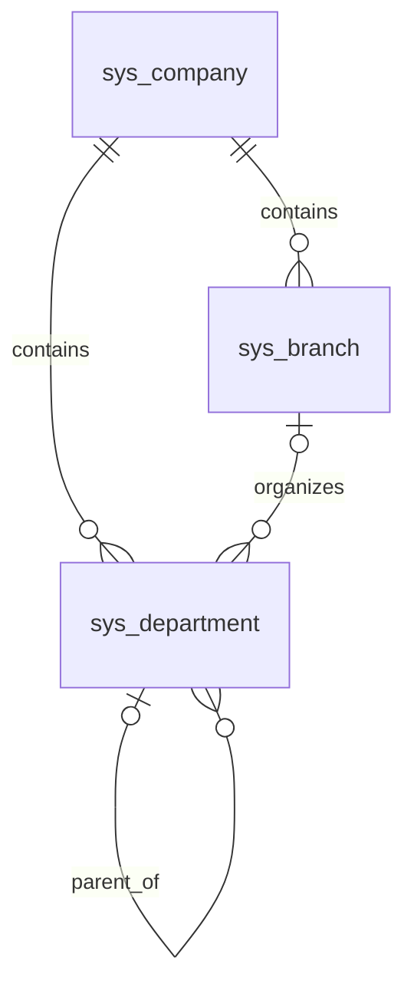
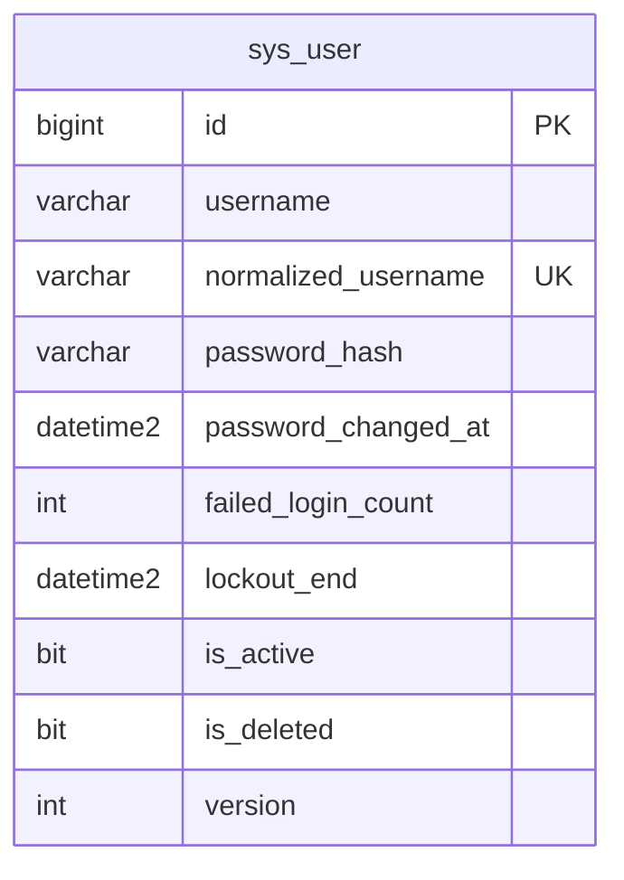

# SYS 組織資料結構

| Requirement ID | Version | Table Name | Description | Author | Related REQ_F |
|---|---|---|---|---|---|
| REQ_DS43.20 | 1.0 | sys_company | Company isolation root; globally unique code, audit, version and soft deletion. | Developer | REQ_F4118.20.1, REQ_F4118.20.2, REQ_F4118.20.3, REQ_F4118.20.4 |
| REQ_DS43.89 | 1.0 | sys_branch | Branch master scoped to a company. | Developer | REQ_F4118.21.1, REQ_F4118.21.2, REQ_F4118.21.3 |
| REQ_DS43.22 | 1.0 | sys_department | Department master scoped to a company, optionally linked to a branch and parent department. | Developer | REQ_F4118.22.1, REQ_F4118.22.2, REQ_F4118.22.3 |

`sys_company` 為隔離根，沒有 `company_id` 與公司篩選；應用層必須先驗證權限。分店與部門繼承主檔欄位：`id`、`company_id`、`code`、`name`、審計、`version`、`is_active`、`is_deleted`、`custom_fields`。代碼分別以 `(company_id, code)` 唯一索引保護，刪除後代碼仍保留。分店與部門透過外鍵歸屬公司；部門指向分店／上級部門使用 `(company_id, id)` 複合外鍵，在資料庫層阻止跨公司參照。上級循環仍由應用層檢查。三表 `custom_fields` 皆用 ISJSON 約束。公司自身的代碼全域唯一。

## 用戶身分

| Requirement ID | Version | Table Name | Description | Author | Related REQ_F |
|---|---|---|---|---|---|
| REQ_DS43.82 | 1.0 | sys_user | Global login identities with password hash, failure count, lockout and audit fields. | Developer | REQ_F4118.23.1, REQ_F4118.23.2, REQ_F4118.23.3, REQ_F4118.23.4 |

`sys_user` 是全系統身分，不綁定單一公司；WU-SYS-004 再建立用戶與獲授權公司的關聯。`normalized_username` 以唯一索引防止不同大小寫及刪除後重用。密碼只存 ASP.NET Core Identity 雜湊。其餘審計欄位沿用 `IAuditable`。
