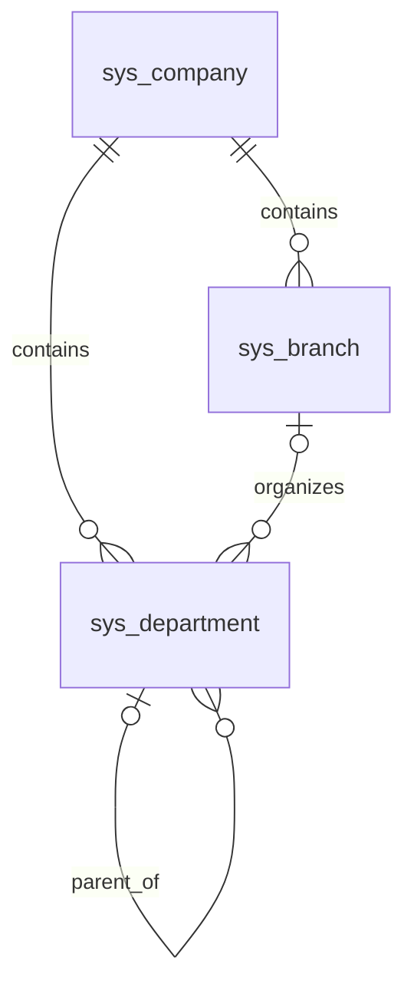
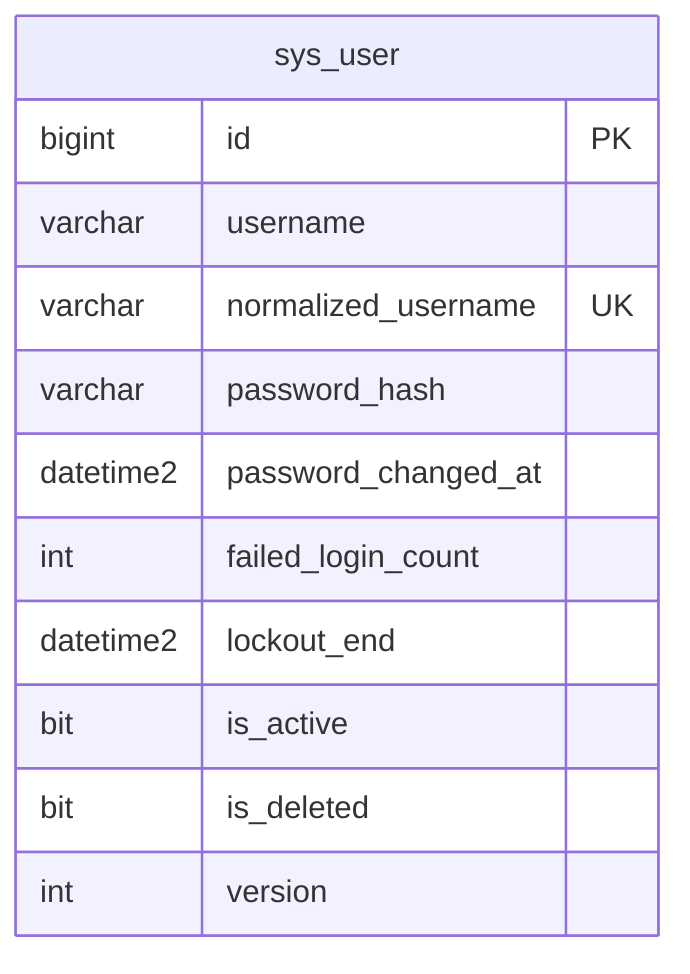
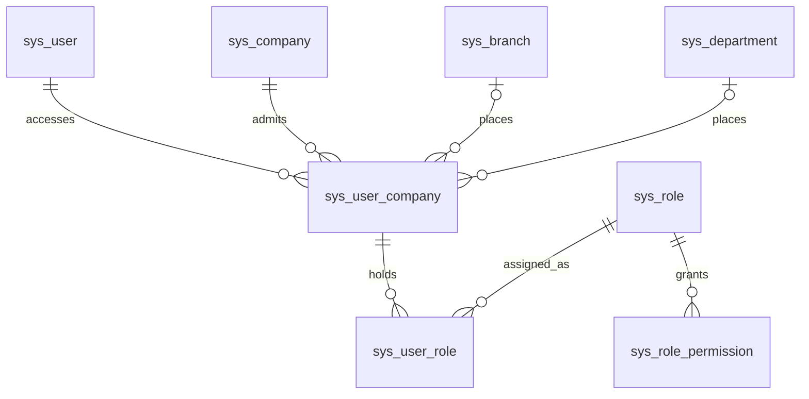
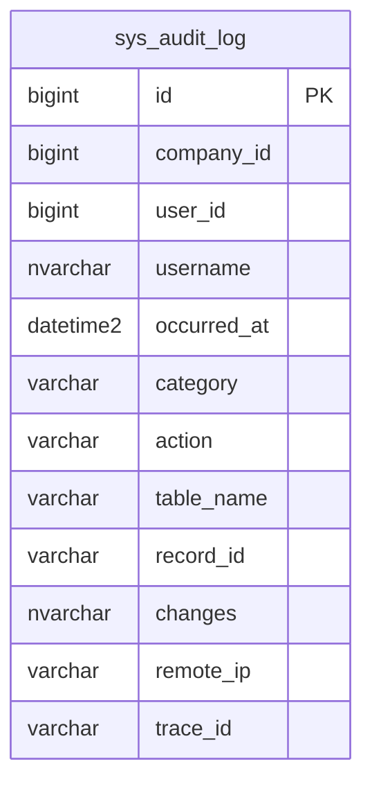
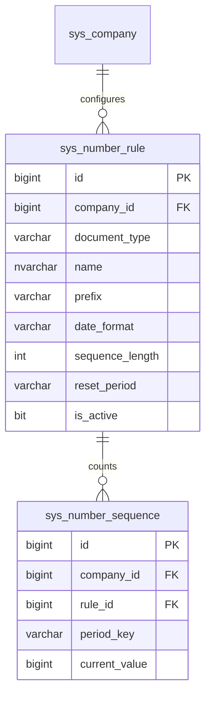

# SYS 組織資料結構

| Requirement ID | Version | Table Name | Description | Author | Related REQ_F |
|---|---|---|---|---|---|
| REQ_DS43.20 | 1.0 | sys_company | Company isolation root; globally unique code, audit, version and soft deletion. | Developer | REQ_F4118.20.1, REQ_F4118.20.2, REQ_F4118.20.3, REQ_F4118.20.4 |
| REQ_DS43.89 | 1.0 | sys_branch | Branch master scoped to a company. | Developer | REQ_F4118.21.1, REQ_F4118.21.2, REQ_F4118.21.3 |
| REQ_DS43.22 | 1.0 | sys_department | Department master scoped to a company, optionally linked to a branch and parent department. | Developer | REQ_F4118.22.1, REQ_F4118.22.2, REQ_F4118.22.3 |

`sys_company` 為隔離根，沒有 `company_id` 與公司篩選；應用層必須先驗證權限。分店與部門繼承主檔欄位：`id`、`company_id`、`code`、`name`、審計、`version`、`is_active`、`is_deleted`、`custom_fields`。代碼分別以 `(company_id, code)` 唯一索引保護，刪除後代碼仍保留。分店與部門透過外鍵歸屬公司；部門指向分店／上級部門使用 `(company_id, id)` 複合外鍵，在資料庫層阻止跨公司參照。上級循環仍由應用層檢查。三表 `custom_fields` 皆用 ISJSON 約束。公司自身的代碼全域唯一。

## 用戶身分

| Requirement ID | Version | Table Name | Description | Author | Related REQ_F |
|---|---|---|---|---|---|
| REQ_DS43.82 | 1.0 | sys_user | Global login identities with password hash, failure count, lockout and audit fields. | Developer | REQ_F4118.23.1, REQ_F4118.23.2, REQ_F4118.23.3, REQ_F4118.23.4, REQ_F4118.23.5, REQ_F4118.23.6, REQ_F4118.23.7, REQ_F4118.23.8 |

`sys_user` 是全系統身分，不綁定單一公司；WU-SYS-004 再建立用戶與獲授權公司的關聯。`normalized_username` 以唯一索引防止不同大小寫及刪除後重用。密碼只存 ASP.NET Core Identity 雜湊。其餘審計欄位沿用 `IAuditable`。

## 角色與授權（WU-SYS-004）

| Requirement ID | Version | Table Name | Description | Author | Related REQ_F |
|---|---|---|---|---|---|
| REQ_DS43.90 | 1.0 | sys_role | System-wide role definitions with data scope, full-access flag, audit, version and soft deletion. | Developer | REQ_F4118.25.1, REQ_F4118.25.2, REQ_F4118.25.3, REQ_F4118.25.4 |
| REQ_DS43.91 | 1.0 | sys_role_permission | Permission codes granted by each role. | Developer | REQ_F4118.25.2, REQ_F4118.25.3, REQ_F4118.25.7 |
| REQ_DS43.92 | 1.0 | sys_user_company | Companies a user may access, with branch and department placement and the default company. | Developer | REQ_F4118.23.5, REQ_F4118.23.6, REQ_F4118.25.5, REQ_F4118.25.6, REQ_F4118.25.7, REQ_F4118.25.8 |
| REQ_DS43.93 | 1.0 | sys_user_role | Roles assigned to a user within a company. | Developer | REQ_F4118.25.6, REQ_F4118.25.7, REQ_F4118.25.8 |

- `sys_role`：`code VARCHAR(50)` 唯一（`ux_sys_role_code`，含已刪除）；`data_scope VARCHAR(30)`（Self／Department／Branch／Company）；`is_full_access`；審計、`version`、`is_active`、`is_deleted`。角色為全系統定義，不屬於單一公司。
- `sys_role_permission`：`permission_code VARCHAR(100)`；唯一 `(role_id, permission_code)`，同時作為外鍵索引；刪除角色列時連帶刪除（角色實務上只做軟刪除）。權限目錄在程式碼，不另建權限表（ADR-014）。
- `sys_user_company`：唯一 `(user_id, company_id)`（alternate key，亦為 `sys_user_role` 複合外鍵的主鍵端）；`ux_sys_user_company_default` 篩選唯一索引（`is_default = 1`）保證每位用戶最多一間預設公司；`(company_id, branch_id)`、`(company_id, department_id)` 複合外鍵指向分店／部門，資料庫層阻止跨公司歸屬；`is_active`、審計、`version`。
- `sys_user_role`：唯一 `(user_id, company_id, role_id)`；`(user_id, company_id)` 複合外鍵指向 `sys_user_company`（刪除關聯時連帶刪除），沒有公司存取權就不能指派角色；`role_id` 有索引，外鍵為 Restrict。
- 以上授權表不實作公司篩選（`ICompanyOwned`），因為授權查詢需要跨公司列出用戶可存取的公司；存取一律經 SYS 應用服務。

## 稽核日誌（WU-SYS-007）

| Requirement ID | Version | Table Name | Description | Author | Related REQ_F |
|---|---|---|---|---|---|
| REQ_DS43.94 | 1.0 | sys_audit_log | Append-only audit trail of data changes (field old/new values) and security events, with company, user, IP and trace id. | Developer | REQ_F4118.27.1, REQ_F4118.27.2, REQ_F4118.27.3, REQ_F4118.27.4, REQ_F4118.27.5, REQ_F4118.27.6 |

`sys_audit_log` 由 Shared.Infrastructure 的 `AuditTrailInterceptor` 寫入，與業務資料同一交易（ADR-019）。

- 刻意不設外鍵：用戶或公司日後刪除，稽核記錄仍保留；安全事件可能沒有用戶（不存在的帳號）或沒有公司（登入）。
- `category`：`DATA` 或 `SECURITY`。`action`：CREATE／UPDATE／DELETE／VOID／APPROVE／POST／LOGIN／LOGIN_FAILED／MASTER_CODE_LOGIN／LOGOUT／PERMISSION_CHANGE／EXPORT。
- `changes`：欄位差異 `{"欄位":{"old":…,"new":…}}` 或安全事件明細，有 ISJSON 約束；敏感欄位值為 `***`。
- `trg_sys_audit_log_append_only`（INSTEAD OF UPDATE, DELETE）拒絕任何修改與刪除。
- 索引：`(company_id, occurred_at)`、`(user_id, occurred_at)`、`(table_name, record_id, occurred_at)`。
- 本表沒有審計欄位、version 與軟刪除，因為記錄本身不可變。

## 單號規則

| Requirement ID | Version | Table Name | Description | Author | Related REQ_F |
|---|---|---|---|---|---|
| REQ_DS43.95 | 1.0 | sys_number_rule | Document number rule per company and document type: prefix, date format, sequence length, reset period and active flag. | Developer | REQ_F4118.28.1, REQ_F4118.28.2, REQ_F4118.28.3, REQ_F4118.28.4, REQ_F4118.28.5 |
| REQ_DS43.96 | 1.0 | sys_number_sequence | Running sequence counter per number rule and reset period, updated atomically when a number is issued. | Developer | REQ_F4118.28.3, REQ_F4118.28.4, REQ_F4118.28.5 |

- 兩表都有 6.4 節的必備欄位（`company_id`、審計欄位、`version`）。規則是設定資料，沒有軟刪除與 `custom_fields`，以 `is_active` 停用。
- `sys_number_rule`：`(company_id, document_type)` 唯一索引（亦為 company_id 外鍵索引）；`sequence_length` CHECK 3–10；`date_format`、`reset_period` 以字串儲存列舉。
- `sys_number_sequence`：`period_key` 為 `-`（不重設）、`yyyy`、`yyyyMM` 或 `yyyyMMdd`；`(company_id, rule_id, period_key)` 唯一索引是取號 MERGE 的定位索引，亦為 `(company_id, rule_id)` → `sys_number_rule (company_id, id)` 複合外鍵的索引，令計數列不可指向他公司的規則；`current_value` CHECK ≥ 1。
- 計數列只由 `NumberGenerator` 以單一 `MERGE … WITH (HOLDLOCK)` 原子更新（`version` 同步遞增），不經 EF 追蹤，不寫稽核（ADR-021）。
