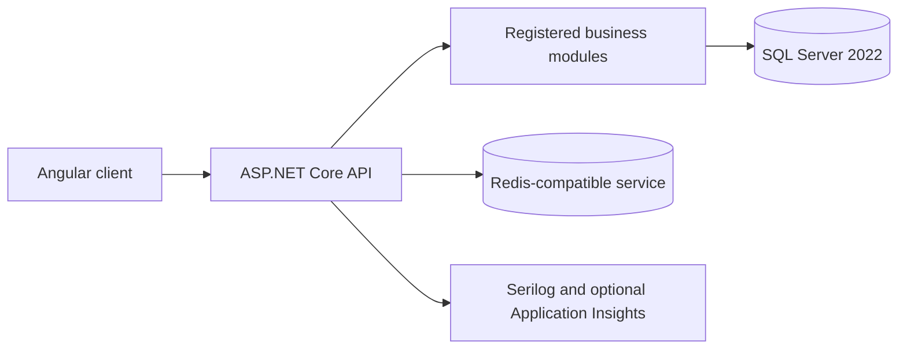

MyERP uses a browser-based Angular client and a versioned ASP.NET Core Web API hosted as one modular monolith on Windows. The client presents localized workflows, light and dark themes, and charts; it sends authenticated JSON requests to the API. The API uses EF Core and Microsoft.Data.SqlClient to access SQL Server 2022 with Windows authentication. A Redis-compatible service supports refresh-token state and shared caching. Serilog writes structured local logs, and an Application Insights sink is enabled only when configured. The architecture does not require containers.

The API is the composition root for module implementations. The current solution registers System, Master Data, Inventory, Purchasing and Sales modules; other modules in the architecture map remain planned or in document design and must not be presented as deployed services. Each module owns its operational data and exposes selected application contracts to other modules. The shared database context permits synchronous operations that must commit in one SQL transaction. Essential inventory and finance posting effects belong inside that transaction; events after commit serve notifications or rebuildable projections. Reporting may consume documented read-only contracts or projections, while writes remain with the owning module.

The development deployment has separate client, API, SQL Server and Redis-compatible processes. Health endpoints distinguish a running API from dependency readiness. Production hosting, scale-out and recovery arrangements require environment-specific validation. Chapter 4 data tables are generated from module sources; a live SQL connection is required before this SDS can confirm that its database design matches the deployed schema. A generated document without that connection makes no live-schema claim.

Figure 3.1.1 MyERP development architecture
