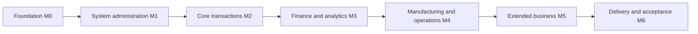

The following sequence follows the project charter milestones. It is a planning dependency map, not an approved calendar. <Project Start Date>, <Milestone Date M0> through <Milestone Date M6> and <Project End Date> require agreement and capacity estimates. Actual completion is reported in the progress register rather than inferred from the rows below.

| Phase | Milestone | Start | End |
|---|---|---|---|
| P0 Foundation | M0 Planning and platform foundation | <Project Start Date> | <Milestone Date M0> |
| P0 System administration | M1 Identity, authorization and shared workflow | <Milestone Date M0> | <Milestone Date M1> |
| P1 Core transactions | M2 Master data, inventory, purchase and sales | <Milestone Date M1> | <Milestone Date M2> |
| P2 Finance and analytics | M3 Finance, controlling and first reporting release | <Milestone Date M2> | <Milestone Date M3> |
| P3 Manufacturing and operations | M4 Production, quality and maintenance | <Milestone Date M3> | <Milestone Date M4> |
| P4 Extended business | M5 CRM, human resources, projects and supply chain | <Milestone Date M4> | <Milestone Date M5> |
| P5 Delivery | M6 Reporting extension, final documents and acceptance | <Milestone Date M5> | <Milestone Date M6> |

The following figure shows dependency gates only; it assigns no calendar dates or task durations. Parallel work within a phase is possible after its owner interfaces and integration evidence are available.

Figure 4.6.2.1 Planning milestone dependencies

The dated Gantt chart requires an approved schedule. It remains pending until project dates and task durations are agreed; the dependency diagram above must not be read as a calendar commitment.
